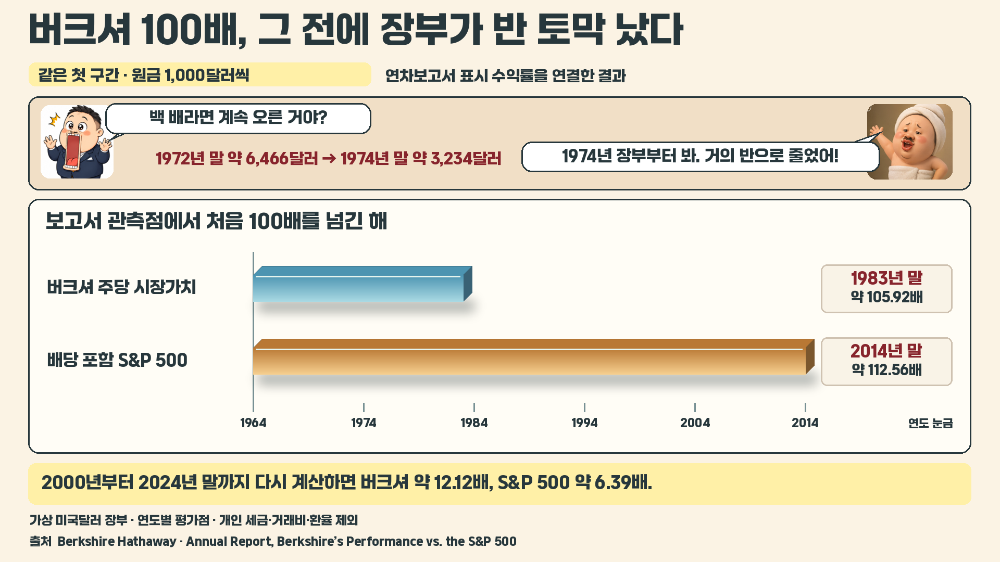

# 버크셔 주가 100배까지 얼마나 걸렸을까? S&P 500과 같은 출발점으로 검산

## 백 배라는 제목에 빠진 영수증

가상의 천억이가 오래된 신문 사진 위에 ‘100배’라고 씁니다. 수건 친구가 옆에 빈칸 세 개를 붙입니다. 언제 시작했는지, 언제 처음 그 금액을 봤는지, 중간에 얼마나 줄었는지입니다. 천억이는 버크셔 해서웨이 연차보고서에서 이 세 칸을 직접 채우기로 합니다. 백 배가 된 시점만 보면 사라지는 연도가 하나 있었습니다. 그 연도에는 그때까지 남아 있던 돈이 거의 반으로 줄었습니다.

## 천 달러로 같은 장부 두 권을 만든다

버크셔 해서웨이 연차보고서에 공개된 연도별 비교표를 사용합니다. 왼쪽은 버크셔의 주당 시장가치 변화율이고 오른쪽은 배당을 포함한 S&P 500 성과입니다. 두 장부에 1965년으로 표시된 첫 구간 직전 각각 가상의 미국달러 1,000달러를 넣습니다. 추가 입출금, 환율, 개인 세금과 거래비용은 없습니다. 버크셔에는 보고서에 나온 시장가치 변화율을 그대로 쓰고 별도의 현금배당을 재투자하는 모형은 추가하지 않습니다. 지수 쪽은 보고서의 배당 포함 성과를 연결합니다. 당시 지수를 실제 상품으로 매수했다는 뜻은 아닙니다. 1965년과 1966년은 9월 말까지의 연도, 1967년은 12월 말까지 15개월입니다. 이후는 달력연도입니다. 원문에 있는 구간을 그대로 썼으므로 첫 세 행을 모두 12월 결산으로 읽으면 안 됩니다.

## 달력에 100배가 처음 보이는 해를 적는다

각 관측 구간의 수익률을 100으로 나눈 뒤 1을 더해 직전 배수에 곱합니다. 원금 1,000달러의 100배는 100,000달러이고, 원금을 뺀 이익률로는 9,900%입니다. 보고서의 표시 수익률을 곱하면 버크셔는 1982년 말에 약 62.67배, 1983년 말에 약 105.92배입니다. 첫 100배가 보인 것은 1983년 말, 표에서 열아홉 번째 관측 구간의 끝입니다. 이 표로는 1983년 어느 거래일에 먼저 선을 넘었는지 알 수 없습니다.

같은 출발점의 배당 포함 S&P 500은 1983년 말 약 4.23배였습니다. 지수 쪽은 2013년 말 약 99.00배, 2014년 말 약 112.56배가 나옵니다. 같은 계산에서 보고서상 첫 100배 관측은 2014년 말입니다. 두 자료 모두 소수점 한 자리까지 표시된 수익률을 사용했으므로 계산 결과는 근삿값입니다. 이 글의 도달 시점은 그 근사 장부의 관측점입니다.

| 그해 말 관측 · 같은 첫 구간 | 버크셔 | 배당 포함 S&P 500 |
|---|---:|---:|
| 1972년 말 | 약 6.47배 | 약 1.83배 |
| 1974년 말 | 약 3.23배 | 약 1.15배 |
| 1982년 말 | 약 62.67배 | 약 3.46배 |
| 1983년 말 | 약 105.92배 | 약 4.23배 |

## 1974년에 돈이 필요했다면 백 배를 볼 수 있었을까

천억이가 1983년 표에 밑줄을 긋자 수건 친구가 앞 장을 펼칩니다. 1972년 말 버크셔 장부는 약 6,466달러였습니다. 1973년에는 −2.5%, 1974년에는 −48.7%였습니다. 1974년 말에는 약 3,234달러가 남습니다. 이전 고점으로부터 약 49.98% 떨어진 값입니다. 최초 원금 1,000달러보다는 여전히 높지만, 1972년 말의 금액을 생활비 계획에 쓴 사람은 약 절반이 줄어든 장부를 보게 됩니다. 최고점과 비교한 낙폭, 처음 넣은 돈과 비교한 손익은 분모가 다릅니다.

이 계산의 낙폭은 공개된 연도별 평가점 사이에서 관찰한 수치입니다. 장중이나 월별 저점은 포함하지 않았습니다. 실제 보유자가 대출을 쓰거나 그해에 돈을 인출했다면 같은 장부를 계속 들고 갈 수 있었는지도 별도의 문제입니다.

*보고서 표시 수익률을 연결한 가상 미국달러 장부. 막대 길이는 첫 100배 관측점까지의 연도 차이를 나타낸다.*

## 같은 주식이라도 늦게 시작하면 숫자가 달라진다

같은 보고서에서 다시 2000년으로 표시된 첫 구간 직전부터 시작합니다. 2024년 말까지 25개 달력연도의 수익률을 연결하면 버크셔는 약 12.12배, 배당 포함 S&P 500은 약 6.39배입니다. 첫 장부의 백 배 조건을 떠올려도, 이 두 번째 장부에서는 둘 다 100배에 닿지 않았습니다. 가령 같은 1,000달러로 환산하면 약 12,120달러와 약 6,390달러 규모입니다. 두 기간은 끝을 공유해도 돈이 시장에 들어간 날과 길이가 다릅니다.

## 보고서의 누적 칸은 따로 읽는다

연차보고서는 첫 구간부터 2024년까지의 전체 상승률도 따로 공시합니다. 개별 연도에 표시된 숫자를 곱해 만든 근사 장부와 보고서가 직접 제시한 전체 상승률을 같은 수치처럼 섞지 않습니다. 이 글의 목표는 연도별 관측값으로 문턱을 처음 넘는 장면을 재현하는 것이므로 연도별 표시 수익률을 사용했습니다. 비교 대상도 구분합니다. 한쪽은 회사의 주당 시장가치이고 다른 쪽은 시장 지수의 배당 포함 성과입니다. 버크셔의 실제 주주 계좌나 개인별 세후 성과, 당시 지수 추종 상품의 실현 수익으로 바꿔 읽을 수 없습니다.

## 이 사례를 먼저 골랐다는 사실도 장부에 쓴다

이제 천억이는 백 배를 기록한 회사 이름부터 알고 있었습니다. 그 이름을 고르고 과거로 돌아가 수익률을 계산하면 높은 성과의 한 사례를 설명할 수 있습니다. 당시 같은 후보군에 있던 기업 모두가 어떤 결과를 냈는지는 설명할 수 없습니다. 비슷한 회사 가운데 사라지거나 합병된 회사까지 포함해야 처음부터 그 회사를 고를 가능성을 평가할 수 있습니다. 여기서는 다른 후보군을 만들지 않았으므로 투자자가 같은 기간에 100배 종목을 고를 확률을 계산하지 않습니다.

## 숫자 하나를 볼 때마다 날짜를 두 개 붙인다

신문 사진을 다시 접기 전에 수건 친구는 첫 100배 관측점 옆에 과거 손실 구간을 함께 씁니다. **직접 확인하기.** 100배 투자 사례를 볼 때는 같은 종료일로 출발 날짜를 바꾸고, 돈이 필요했던 해의 잔액까지 표시해 보세요. 그다음 비교 대상의 배당과 세금·비용 조건을 맞춥니다. 100배 문구에서 얻을 수 있는 정보는 실제로 얼마나 오래 버텨야 했는지, 다른 출발 조건에서도 같은 결론이 나오는지까지 확인할 때 늘어납니다.

**편집부 Q&A · 1983년에 모든 투자자가 100배를 실현했나요?** 첫 구간 직전부터 보유했다고 놓은 가상 경로가 보고서의 1983년 관측점에서 100배를 넘었다는 뜻입니다. 실제 매매 가격과 수량, 세금, 중간 거래는 반영하지 않았습니다.

**편집부 Q&A · 100배가 되려면 연 100%씩 벌어야 하나요?** 기간과 경로에 따라 다릅니다. 가상으로 매년 같은 비율이 20년 이어진다면 100배에 필요한 연 복리 수익률은 약 25.89%입니다. 이 회사의 실제 관측 수익률은 매년 달랐습니다.

## 원문

- [Berkshire Hathaway · Annual Report, Berkshire’s Performance vs. the S&P 500](https://www.berkshirehathaway.com/2024ar/2024ar.pdf)
- [S&P Dow Jones Indices · Index Mathematics Methodology](https://www.spglobal.com/spdji/en/documents/methodologies/methodology-index-math.pdf)
