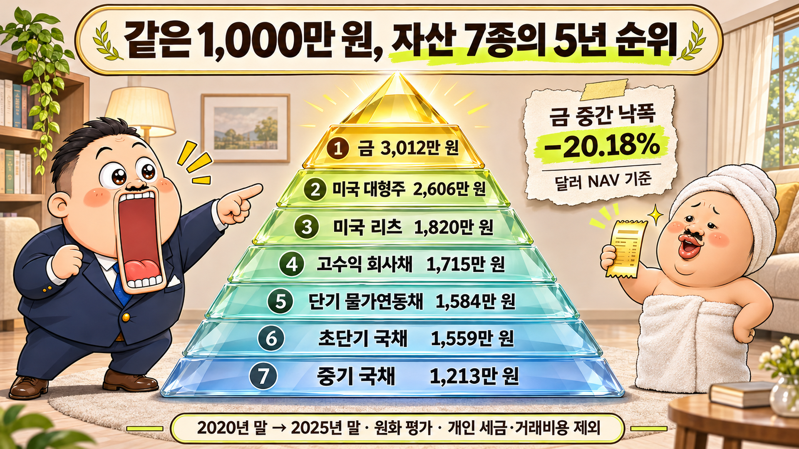

# 같은 1,000만 원, 자산 7종의 5년 순위

**편집부가 만든 질문.** 아버지가 수익 순위 화면을 봅니다. 금, 미국 주식, 리츠, 채권에 각각 1,000만 원을 넣고 같은 날까지 보유했다면 어디에 돈이 가장 많이 남았을까요?

**답.** 2020년 말부터 2025년 말까지 이 글에서 고른 일곱 상품 중 금 현물 신탁 GLDM의 원화 평가액이 약 **3,012만 원**으로 가장 높았습니다. 2024년 말에 끝내면 **미국 대형주 IVV**가 앞섰습니다. GLDM의 같은 5년 구간 달러 순자산가치 최대 낙폭은 **20.18%**였습니다.

*공시 총수익과 연준 환율을 가상 원금에 적용한 순위입니다. 개인 세금·거래비용 제외, 만 원 단위 반올림. 피라미드의 층 폭은 금액을 나타내지 않습니다.*

**편집부가 만든 질문.** 꼭대기에 있는 금 신탁은 비교 기간 중에도 줄어든 적이 있었나요?  
**답.** 달러 순자산가치로 2022년 3월 고점부터 같은 해 11월 저점까지 **약 20.18%** 내려갔습니다.

## 원금과 날짜를 맞춘 순위

**가정과 관측.** 2020년 말 각각 1,000만 원을 한 번 투자하고 2025년 말까지 추가 입출금 없이 보유합니다. 보유 중 분배가 있으면 공시의 총수익 가정에 따라 재투자하고, 공시에 반영된 펀드 비용은 그대로 둡니다. 개인 세금·수수료·호가 차이·환전비용을 제외했습니다. 미국에 상장된 상품 중 공통 다섯 달력 연도에 달러 NAV 수익률을 확인할 수 있는 일곱 자산 유형에서 사례를 하나씩 골랐습니다. 순위 범위는 아래 일곱 상품입니다.

| 순위 | 상품 | 2025년 말 원화 평가액 | 원금 대비 평가 차익 |
|---:|---|---:|---:|
| 1 | GLDM 금 현물 상장 신탁 | 30,118,213원 | +20,118,213원 |
| 2 | IVV 미국 대형주 | 26,055,379원 | +16,055,379원 |
| 3 | USRT 미국 리츠 | 18,201,257원 | +8,201,257원 |
| 4 | SHYG 고수익 회사채 | 17,146,318원 | +7,146,318원 |
| 5 | STIP 단기 물가연동국채 | 15,843,378원 | +5,843,378원 |
| 6 | SGOV 초단기 국채 | 15,590,526원 | +5,590,526원 |
| 7 | IEF 미국 7~10년 국채 | 12,132,371원 | +2,132,371원 |

**복리 입력값.** 아래 달러 NAV 총수익률을 순서대로 복리 적용했습니다.

| 상품 | 2021 | 2022 | 2023 | 2024 | 2025 |
|---|---:|---:|---:|---:|---:|
| GLDM | −3.93% | −0.54% | +13.68% | +26.47% | +64.84% |
| IVV | +28.66% | −18.13% | +26.27% | +24.98% | +17.85% |
| USRT | +43.11% | −24.40% | +13.62% | +8.60% | +2.51% |
| SHYG | +4.97% | −4.94% | +10.96% | +8.02% | +7.79% |
| STIP | +5.48% | −2.81% | +4.59% | +4.78% | +6.03% |
| SGOV | +0.02% | +1.58% | +5.13% | +5.28% | +4.24% |
| IEF | −3.27% | −15.23% | +3.58% | −0.61% | +8.06% |

원화 평가액은 **1,000만 원 × 달러 누적 수익 배율 × 1,444.55 ÷ 1,086.11**입니다. 연준 H.10의 환율 관측일은 각각 2025-12-31과 2020-12-31입니다. **반례.** 2024년 말에 합계를 내면 IVV 22,618,746원, GLDM 18,692,497원입니다. 이 시점의 환율은 2024-12-31 1,477.86원입니다. 2021년 말에는 USRT가 약 1,566만 원으로 표의 1위였습니다. 확인일은 2026년 11월 27일입니다. [GLDM 공식 수익률 도표 14b](https://www.ssga.com/library-content/products/fund-docs/etfs/us/insights-investment-ideas/spdr-invest-in-gold.pdf) · [IVV 공식 자료](https://www.ishares.com/us/products/239726/ishares-core-s-p-500-etf-ivv) · [USRT 공식 팩트시트](https://www.ishares.com/us/literature/fact-sheet/usrt-ishares-core-u-s-reit-etf-fund-fact-sheet-en-us.pdf) · [SHYG 공식 팩트시트](https://www.ishares.com/us/literature/fact-sheet/shyg-ishares-0-5-year-high-yield-corporate-bond-etf-fund-fact-sheet-en-us.pdf) · [STIP 공식 팩트시트](https://www.ishares.com/us/literature/fact-sheet/stip-ishares-0-5-year-tips-bond-etf-fund-fact-sheet-en-us.pdf) · [SGOV 공식 팩트시트](https://www.ishares.com/us/literature/fact-sheet/sgov-ishares-0-3-month-treasury-bond-etf-fund-fact-sheet-en-us.pdf) · [IEF 공식 자료](https://www.ishares.com/us/products/239456/ishares-7-10-year-treasury-bond-etf-ief) · [연준 H.10](https://www.federalreserve.gov/releases/h10/Hist/dat00_ko.htm)

## 3배가 되기까지의 하락

운용사의 일별 달러 NAV 기록에서 2020-12-31~2025-12-31의 1,286행을 날짜순으로 놓았습니다. 2022년 2월 23일 두 주를 한 주로 합친 병합에 맞춰 전날까지의 NAV에 2를 곱했습니다. 이 구간의 그날까지 최고치 대비 가장 큰 하락은 2022-03-08 **40.513311달러**에서 2022-11-03 **32.339622달러**까지였습니다. 계산은 32.339622 ÷ 40.513311 − 1 ≈ **−20.18%**입니다. 이 값은 달러 NAV 기준이며, 원화 낙폭·장중 낙폭이나 나머지 여섯 상품의 일별 낙폭은 별도 자료가 필요합니다. [State Street GLDM 일별 NAV](https://www.ssga.com/library-content/products/fund-data/etfs/us/navhist-us-en-gldm.xlsx) · [GLDM 주식 병합 SEC 공시](https://www.sec.gov/Archives/edgar/data/1618181/000119312522028312/d279440d8k.htm)

1. **분모.** 원금까지 포함한 3.01배와 원금을 뺀 이익을 구별합니다.
2. **통화.** 금 신탁의 달러 누적 배율은 약 2.26배이며 원화 환산 배율에는 환율이 들어 있습니다.
3. **기간.** 연말 순위는 종료 시점에 따라 달라졌습니다.
4. **하락.** 비교한 2022년 한 해에는 SGOV만 달러 수익이 플러스였습니다.
5. **분배.** 재투자한 공시 수익에 현금 분배를 다시 더하지 않습니다.
6. **기초자산.** 리츠 ETF는 상장 부동산 주식을 담고, 금 신탁은 금에 노출됩니다.
7. **신용.** 회사채의 원리금 지급 여력과 국채의 금리 민감도를 각각 봅니다.
8. **구매력.** 명목 원화 평가와 내가 지출할 곳의 물가를 별도로 확인합니다.
9. **분산.** 전체 1,000만 원을 처음 일곱 등분해 중간 조정 없이 보유한 모형은 약 1,930만 원입니다.
10. **실수령액.** 실제 매매·환전·세금 자료가 있으면 평가액과 함께 적습니다.

**오늘 해볼 일.** 최근 본 수익 순위에서 원금, 출발일, 종료일을 적고 종료일을 앞당겼을 때도 같은 순서인지 확인하세요.

관련 장 [금과 미국 주식, 반반으로 뒀다면?](EP112.md) · [미국 리츠 vs 미국 대형주](EP120.md) · [달러는 늘었는데, 구매력은?](EP124.md)
