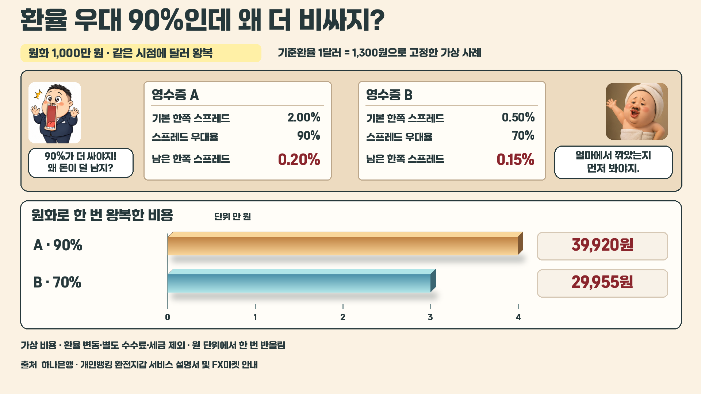

# 환율 우대 90%가 70%보다 비쌀 수 있을까? 1,000만 원 환전 왕복 계산

## ‘최대 90%’가 쓰인 쪽을 먼저 눌렀다

가상의 천억이는 미국 주식 ETF 계좌에 넣을 원화를 환전하려 합니다. 두 화면에는 각각 90%와 70% 우대가 써 있습니다. 수건 친구가 같은 시간에 실제로 적용될 달러 매수 환율과 나중에 원화로 바꿀 때의 달러 매도 환율을 장부에 적습니다. 큰 숫자가 붙은 쪽이 오히려 더 비싼 장부가 나왔습니다. 어느 비용을 얼마나 깎는지부터 적어야 이유를 알 수 있습니다.

## 우대율을 붙이기 전에 기준을 적는다

원화 1,000만 원을 한 번 넣고 같은 시점에 달러로 바꿨다가 다시 원화로 돌린다고 가정합니다. 가상의 기준환율은 1달러에 1,300원으로 고정합니다. A의 기본 한쪽 스프레드는 기준환율의 2%, B는 0.5%입니다. 모형 속 각 채널은 달러를 사고팔 때 같은 한쪽 스프레드를 사용하며 A는 양방향에서 90%, B는 양방향에서 70%를 우대합니다. 이 값들은 실제 금융사의 견적이나 이벤트가 아닙니다. 별도 수수료, 세금, 환전 금액 반올림, ETF 거래와 투자 손익, 분배금 재투자, 이자는 모두 제외합니다. 실제 장부에서는 기준 시각과 환전자 관점에서 사는 쪽과 파는 쪽을 먼저 맞춥니다.

## 90%가 어느 숫자에 붙는지 계산한다

A의 2%에서 스프레드의 90%를 덜어내면 남는 한쪽 스프레드는 0.20%입니다. B의 0.5%에서 70%를 덜면 0.15%가 남습니다. 같은 가상 기준환율 1,300원에 적용하면 A에서 달러를 사는 환율은 1,302.60원, 다시 파는 환율은 1,297.40원입니다. B에서는 각각 1,301.95원, 1,298.05원입니다. A에 붙은 할인 비율은 더 크지만 출발 비용도 컸습니다. 90%를 환전 금액 전체에서 깎는 숫자로 해석하면 실제 원화 입출금액을 계산할 수 없습니다.

## 달러를 샀다가 되팔면 얼마가 남나

사는 환율로 원화를 나눈 금액이 받은 달러입니다. 그 달러에 파는 환율을 곱하면 돌아오는 원화입니다. A는 약 7,676.95달러를 받았다가 다시 바꾸면 9,960,080원이 남습니다. B는 약 7,680.79달러를 받았다가 다시 바꾸면 9,970,045원이 남습니다. 끝까지 계산하고 원화는 마지막에 원 단위로 반올림했습니다. 비교에는 중간에 표시한 두 자리 달러 금액을 다시 넣지 않았습니다.

| 가상 환전 장부 | A · 90% 우대 | B · 70% 우대 |
|---|---:|---:|
| 남은 한쪽 스프레드 | 0.20% | 0.15% |
| 달러 살 때 / 팔 때 | 1,302.60원 / 1,297.40원 | 1,301.95원 / 1,298.05원 |
| 같은 시점에 한 번 왕복한 뒤 | 9,960,080원 | 9,970,045원 |
| 원금에서 줄어든 금액 | 39,920원 | 29,955원 |

*같은 기준환율과 시점으로 달러를 사고 다시 파는 가상 계산. 두 채널은 실제 금융사 견적이 아니다.*

## 이벤트 문구를 적용 환율과 나란히 본다

하나은행의 개인뱅킹 환전지갑 설명서는 외화 환전 신청과 원화 재환전에 각기 다른 적용 환율을 안내합니다. 같은 은행의 FX마켓 상품 안내에는 송금 환율에 스프레드 우대를 반영하는 방식이 나와 있고 현찰 환율과 다를 수 있음을 알립니다. 여기서 두 문서는 실제로 환율의 적용 기준을 확인할 수 있는 예입니다. 위 A와 B가 이 두 서비스를 뜻하지는 않습니다. 앱의 광고 문구를 비교할 때는 현찰이 필요한지 계좌 안에서 외화 잔액을 바꿀 건지부터 맞춥니다. 우대가 한 방향에서만 적용되거나 한도와 시간이 정해져 있을 수 있으므로, 그 조건을 넣은 뒤 최종 환율을 비교합니다.

## ETF 거래가 끝날 때마다 왕복하면 숫자가 달라진다

천억이는 같은 날 환전해 본 결과를 다음에 달러 자산을 거래할 때의 장부에 붙입니다. 가상으로 매번 같은 스프레드와 기준환율이라고 해도, 남은 원금을 다시 왕복에 넣으면 한 번의 손실을 세 번 더하는 계산과 미세하게 어긋납니다. 매번 남은 돈에 ‘파는 환율 ÷ 사는 환율’을 곱하기 때문입니다. A에서 1,000만 원을 세 번 왕복하면 약 9,880,717원, B는 약 9,910,404원입니다. 위 가상 결과는 ETF의 실제 투자수익이나 환율 등락을 예측하지 않습니다. 매도 대금을 같은 통화로 보유해 다음 거래에 쓰는 조건과 매번 원화로 바꾸는 조건의 비용을 분리해 보는 데 쓰는 비교입니다.

## 조건을 바꾸면 높은 우대율이 실제로 유리할 수 있다

두 채널의 기본 스프레드를 똑같이 0.5%로 맞춰 봅니다. 그 경우 90% 우대를 받으면 한쪽에 0.05%, 70%면 0.15%가 남습니다. 다른 조건이 같고 두 방향 모두 실제 적용된다면 높은 우대율 쪽이 더 적은 비용을 냅니다. 반대로 높은 우대율은 달러 매수에만 적용되고 매도에서 기본 스프레드를 부담하는 상황을 가정하면, 같은 광고 숫자로도 왕복 장부의 결론이 달라질 수 있습니다. 보유 중 시장의 기준환율이 바뀐다면 환율 변동 손익까지 별도로 더해야 합니다. 이를 섞어서 우대 혜택이 컸다고 해석하지 않습니다.

## 최종 확인 화면에서 한 줄을 복사한다

수건 친구는 어떤 앱이 ‘최대’를 더 크게 표시했는지 적었던 메모를 지웁니다. **직접 확인하기.** 같은 시각과 같은 금액으로 원화 출금액, 받을 달러, 원화로 다시 바꿀 때의 예상 수령액을 거래 확인 화면에서 읽어 한 줄에 적습니다. 적용 환율과 별도 비용, 금액이나 시간 제한이 함께 보이면 붙입니다. 그래야 금융사가 다르거나 이벤트가 끝나도 같은 방법으로 실제 비용을 다시 비교할 수 있습니다.

**편집부 Q&A · 해외 ETF를 원화로 주문하면 환전 비용이 없나요?** 상품의 거래 통화와 금융사의 자동 환전 처리, 적용 환율을 각각 확인합니다. 원화 금액이 화면에 보인다는 사실만으로 실제 환전 여부나 비용을 판정할 수 없습니다.

**편집부 Q&A · 한 번의 환전에서도 왕복 전체를 비용으로 잡나요?** 비교 목적에 따라 다릅니다. 바로 달러를 쓸 계획이라면 사는 쪽 견적을 먼저 봅니다. 다시 원화로 바꿔 써야 한다면 예상 매도 환율과 비용까지 넣습니다.

## 원문

- [하나은행 · 개인뱅킹 환전지갑 서비스 설명서](https://image.kebhana.com/cont/download/documents/manual/0000020260313_20260313_m.pdf)
- [하나은행 · FX마켓 상품 안내](https://m.kebhana.com/cont/product/s_product05/1492434_154113.jsp)
