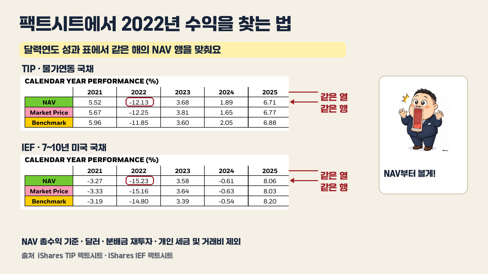
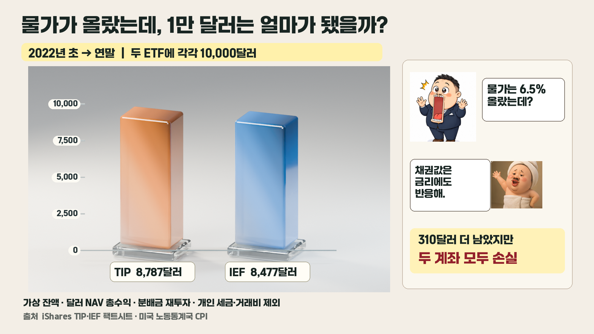

# 미국 물가가 6.5% 오른 해, 물가연동채 ETF는 왜 12.13% 내렸을까?

## 장바구니가 비싸졌는데 채권도 내렸다

가상의 천억이가 미국 물가 상승률을 보고 수건 친구에게 묻는다. “물가를 따라간다는 채권 ETF였는데, 왜 1만 달러가 줄어?” 수건 친구는 영수증 세 장을 펼친다. 미국의 물가, 개별 채권의 원금, ETF의 평가액이다. 같은 기간을 보더라도 세 장은 각각 다른 숫자를 기록한다.

## 먼저 같은 날짜의 두 ETF 성과를 찾았다

iShares 팩트시트의 2022년 달력연도 NAV 총수익률을 나란히 놓자. TIP은 미국 물가연동 국채에 투자하는 ETF이고, IEF는 미국 7~10년 국채에 투자하는 ETF다. 미 노동통계국의 CPI-U는 2021년 12월부터 2022년 12월까지 계절조정 전 6.5% 올랐다. 물가 통계의 12월 관측치와 ETF의 연말 NAV는 서로 다른 종류의 자료다. [미 노동통계국 CPI 발표](https://www.bls.gov/news.release/archives/cpi_01122023.htm) · [iShares TIP 팩트시트](https://www.ishares.com/us/literature/fact-sheet/tip-ishares-tips-bond-etf-fund-fact-sheet-en-us.pdf) · [iShares IEF 팩트시트](https://www.ishares.com/us/literature/fact-sheet/ief-ishares-7-10-year-treasury-bond-etf-fund-fact-sheet-en-us.pdf)

*두 상품의 달력연도 표에서 같은 해의 NAV 총수익 행을 비교한다.*

## 실제 성과를 같은 1만 달러에 적용했다

두 상품에 각각 2022년 초 10,000달러를 일시 투자해 연말까지 보유했다고 가정한다. 공시 NAV 총수익률을 적용했으며 펀드 비용과 분배금 재투자는 공시 성과에 반영된다. 개인 세금, 환전·거래비용, 실제 체결 가격은 제외했다. 결과는 달러 기준의 가상 잔액이다.

| 상품 | 2022년 NAV 총수익률 | 연말 가상 잔액 |
|---|---:|---:|
| TIP | −12.13% | 8,787달러 |
| IEF | −15.23% | 8,477달러 |

물가연동채 ETF 쪽에 310달러가 더 남았다. 두 상품 모두 처음의 1만 달러보다 줄었다. 같은 표라도 ETF를 실제 시장 가격에 사고판 수익률은 NAV 기준의 수익률과 달라질 수 있다.

*2022년 공시 NAV 총수익률을 적용한 달러 잔액이다. TIP에 310달러 더 남았지만 두 계좌 모두 시작 원금보다 줄었다.*

### NAV 행에서 시장 가격 행으로 옮기면

천억이가 두 펀드에서 각각 1만 달러를 넣는 가정은 그대로 두고, 이번에는 팩트시트의 시장 가격 수익률을 적용한다. 같은 2022년의 시장 가격 총수익률은 TIP −12.25%, IEF −15.16%였다. 같은 투자액을 기준으로 각각 8,775달러와 8,484달러다. NAV에서 계산한 두 상품 간 차이는 310달러였는데 시장 가격 행에서는 291달러가 된다. 공시가 정한 시장 가격과 분배금 재투자 기준을 적용한 값이며, 특정 개인의 장중 체결 가격, 세금, 환전비 및 주문 수수료는 반영하지 않았다.

수건 친구가 조회 화면의 빨간 원을 한 줄 아래로 옮긴다. TIP 시장 가격 수익률에 IEF NAV 수익률을 붙이면 두 숫자를 같은 기준에서 비교할 수 없다. 화면을 캡처할 때에는 연도뿐 아니라 NAV인지 시장 가격인지 보여 주는 행 이름도 같이 남긴다. 실제 체결 내역을 가지고 있다면 본인이 부담한 비용과 매수·매도 가격을 별도 계산한다. [iShares TIP 팩트시트](https://www.ishares.com/us/literature/fact-sheet/tip-ishares-tips-bond-etf-fund-fact-sheet-en-us.pdf) · [iShares IEF 팩트시트](https://www.ishares.com/us/literature/fact-sheet/ief-ishares-7-10-year-treasury-bond-etf-fund-fact-sheet-en-us.pdf)

### 같은 퍼센트가 올라도 시작 금액으로는 돌아오지 않는다

첫 번째 가상의 NAV 장부로 돌아가자. TIP의 연말 잔액 8,787달러로 달러 원금 10,000달러를 다시 맞추려면 1,213달러를 더 벌어야 한다. 이때 출발금은 1만 달러에서 8,787달러로 줄었다. 1,213달러를 현재 잔액으로 나누면 약 13.80%가 필요하다. IEF의 시작점은 8,477달러고, 필요한 1,523달러를 그 잔액으로 나누면 약 17.97%다. 이 회복률은 미래 목표의 단순 기간 수익률로, 연율이나 예상 수익률은 아니다.

만약 내 실제 지출 목표가 달러 1만 달러로 고정돼 있다면 위 계산으로 필요한 격차를 가늠할 수 있다. 같은 미국 장바구니를 사야 한다면 다음 장에서 보듯 지출 목표액도 바뀐다. 처음 원금을 회복했다는 말과 처음 물건을 같은 양만큼 살 수 있다는 말을 같은 칸에 쓰면, 회복이 언제 이루어졌는지 다르게 읽게 된다. 이 계산도 앞의 NAV 가정과 같이 개인 세금·환전비·거래비를 제외했다.

### 달러 잔액과 미국에서 살 수 있는 양은 다르다

천억이가 남은 8,787달러를 보며 처음의 장바구니를 얼마나 채울 수 있는지 묻는다. 같은 품목으로 구성한 가상 장바구니가 2021년 12월에 10,000달러였고, 정확히 미국 CPI-U와 같은 비율로 값이 움직였다고 가정하자. 다음 해 12월에는 10,650달러가 필요하다. TIP 사례의 잔액 8,787달러는 그 장바구니의 약 82.51%를 살 수 있는 돈이다. IEF 사례의 8,477달러는 약 79.60%다. 이때 10,650달러는 투자 목표액이 아니라 물가로 가정한 장바구니 가격이다.

시작 시점의 구매력으로 돌려 보면, TIP의 8,787달러는 약 8,250.70달러, IEF의 8,477달러는 약 7,959.62달러에 해당한다. 원래 1만 달러의 구매력과 비교하면 각각 약 17.49%, 20.40% 줄었다. 계산에는 원래의 NAV 총수익 성과와 같은 재투자·펀드 비용 조건을 쓰고 개인 세금과 거래비, 환전비는 제외했다. CPI 상승률을 채권 수익률에서 바로 빼지 않고, 종료 잔액을 물가 배수 1.065로 나눴다. 발표된 6.5%는 반올림 값이고 가정한 장바구니도 미국 평균 물가와 똑같이 움직인다고 놓았다. 한국의 생활비나 개별 가계의 실제 지출이 같은 비율로 변했다는 뜻은 아니다. [미 노동통계국 CPI 발표](https://www.bls.gov/news.release/archives/cpi_01122023.htm)

## 개별 채권의 만기 규칙은 무엇을 지키나

미 재무부에 따르면 개별 TIPS의 원금은 물가에 따라 조정되고, 이자는 조정된 원금을 바탕으로 지급된다. 만기에는 조정 원금과 최초 액면 원금 중 큰 금액을 받는다. 가령 액면 1,000달러의 가상 채권에서 만기의 조정 원금이 1,060달러라면 원금으로 1,060달러를 받는다. 조정 원금이 980달러라면 액면인 1,000달러가 원금 지급의 기준이다. 이 두 계산은 쿠폰, 세금, 거래비용과 재투자를 제외한 원금 지급 예다. 중간에 1,030달러를 주고 매입했다면 액면 1,000달러만 돌려받는 경우 매입 가격보다 30달러 낮다. [TreasuryDirect TIPS 안내](https://www.treasurydirect.gov/marketable-securities/tips/) · [TreasuryDirect 채권 가격 안내](https://www.treasurydirect.gov/marketable-securities/understanding-pricing/)

### 같은 액면이라도 발행일이 다르면 조정 원금이 다르다

천억이는 미국 재무부 자료의 ‘지수 비율’ 칸을 본다. 가상으로 같은 날의 참조 CPI가 300이고, 첫 채권 발행일의 참조 CPI는 240, 둘째는 290이라고 하자. 다른 조건을 고정하고 액면을 각각 1,000달러로 놓으면 첫 채권의 조정 원금은 1,250달러, 둘째는 약 1,034.48달러다. 두 채권에서 시장에서 산 가격과 이자, 비용·세금·재투자는 제외한다. 이 표에서 다른 결과가 나오는 것은 두 상품에 적용된 오늘 물가가 달라서가 아니라 비교의 출발일에 사용한 참조 지수가 달라서다. [TreasuryDirect TIPS CPI 자료](https://www.treasurydirect.gov/auctions/announcements-data-results/tips-cpi-data/)

친구가 300이라는 숫자를 뉴스에 발표된 월간 물가상승률과 섞어 쓰려다가 손을 멈춘다. 재무부의 지수 비율은 해당 채권과 날짜에 연결된 값이다. 당월 CPI 기사에 적힌 상승률을 조정 원금에 바로 곱하면 출발점과 단위가 바뀐다. 확인하려면 먼저 미국 재무부의 지수 비율 표에서 채권을 식별하는 번호, 해당 날짜, 비율을 같은 행에서 읽는다. ETF를 가진 사람은 펀드 전체에 발행일 하나를 붙이지 말고 운용사의 보유 종목과 순자산 평가 기준을 본다.

### 쿠폰이 늘어나는 날짜와 필요한 지출일

천억이는 개별 채권을 이해하려고 날짜를 적는다. 실제 미국 재무부 안내에서 TIPS의 표면금리는 고정되며 매 6개월 이자는 해당 시점 조정 원금을 바탕으로 정해진다. 가상 액면 1,000달러, 연 표면금리 2%를 가정하자. 두 번의 가상 이자 지급일의 조정 원금이 각각 1,020달러와 1,050달러라면, 각 반년의 쿠폰은 10.20달러와 10.50달러다. 이 예는 재투자, 세금, 거래비용을 제외한 지급액 계산이다. 두 번째 지급일이 채권 만기라고 가정하지 않는다. [TreasuryDirect TIPS 안내](https://www.treasurydirect.gov/marketable-securities/tips/)

두 지급일 사이에 15달러를 써야 한다면, 처음 이자 10.20달러는 보유 현금으로 장부에 적을 수 있다. 두 번째 이자까지 합치면 20.70달러지만 아직 지급되기 전이라면 4.80달러가 모자란다. 두 번째 지급일까지 지출이 밀린다고 바꾸면 두 이자 합계로 15달러를 지불하고 5.70달러 남는다. 물가에 따라 원금이 1,000달러에서 1,050달러로 커졌다고 가정했지만, 그 50달러를 과거 쿠폰이 이미 채워 준 것으로 처리하지 않는다. 쿠폰 지급액과 조정 원금은 이 가상 장부에서도 움직이는 날짜가 다르다.

수건 친구가 현금 표의 마지막 칸을 비워 둔다. 조정 원금이 1,050달러라는 표시를 보고 그 금액에 바로 팔 수 있다고 가정할 근거는 없다. 만기 전 매도가는 그때의 시장 금리와 거래 가격을 확인해야 한다. 이 예에서 계산된 것은 두 차례의 쿠폰이다. 채권을 중간에 샀다면 이율을 얼마에 산 가격으로 나눌지, 매매 가격과 경과이자를 어떻게 보아야 할지도 별도 질문이다. [TreasuryDirect 채권 가격 안내](https://www.treasurydirect.gov/marketable-securities/understanding-pricing/)

## 원금이 조정돼도 중간 매매 가격은 움직인다

ETF는 보유 채권의 시장 평가를 반영한다. 물가가 채권 원금에 반영되는 동안, 새 투자자가 요구하는 실질수익률이 오르면 기존 채권 가격은 하락할 수 있다. 어느 힘이 더 컸는지는 그 시점의 만기 구성, 금리 변화, 이자와 매매 가격을 함께 봐야 한다. TIP과 IEF는 채권 편입 방식과 듀레이션이 같지 않다. 두 ETF의 310달러 차이를 물가연동 효과 하나의 크기로 볼 근거는 이 비교에 없다. [TreasuryDirect 채권 가격 안내](https://www.treasurydirect.gov/marketable-securities/understanding-pricing/)

### 당시 실질금리는 어느 방향으로 움직였을까

미 연준의 10년 만기 물가연동 국채 일정 만기 수익률 자료에서 2021년 12월 31일은 −1.04%, 2022년 12월 30일은 1.58%였다. 두 관측값의 차이는 2.62%포인트다. 물가 지표가 올라간 해에 실질금리도 올라갈 수 있었음을 보여 준다. 이 금리는 10년 지점의 시장 지표다. TIP이 보유한 전체 채권의 수익률이나 TIP의 연간 손실과 그대로 대응하지 않는다. [미 연준 H.15 · FRED 10년 물가연동 국채 수익률](https://fred.stlouisfed.org/series/DFII10)

수건 친구가 금리에 민감한 채권과 덜 민감한 채권을 가상으로 비교한다. 두 채권의 수정 듀레이션을 각각 3과 7로 놓고 실질금리가 1%포인트 오르는 작은 변화에 대한 가격 민감도를 단순히 계산하면, 가격 변동은 각각 약 −3%와 −7%다. 수익률 곡선이 같은 폭으로 움직이고 물가 조정·이자·볼록성·비용을 따로 둔 근사치다. 이 숫자를 TIP의 실제 손실 예측에 쓸 수는 없다. 처음 사는 사람이 앞으로 받을 실질수익률과, 먼저 샀던 사람이 그날 팔 때의 가격은 서로 다른 질문이라는 점을 보여 준다.

### 같은 할인율 변화인데 긴 만기의 가격이 더 크게 움직이는 이유

천억이는 가상으로 서로 다른 날짜에 1,000달러를 받는 종이 두 장을 만든다. 한 장은 지금부터 2년 뒤, 다른 한 장은 10년 뒤에 지급한다. 중간에 쿠폰은 없다. 실제 미국 물가연동 국채의 계약이 아니라, 만기까지 남은 기간에 따른 가격 변화를 보여 주는 단순화 모형이다. 달러 가격으로 비교하고 물가 조정, 세금, 매매 비용과 재투자는 제외한다.

가상의 연 유효 할인율을 2%로 두면 2년 뒤 1,000달러의 현재 가치는 약 961.17달러, 10년 뒤는 약 820.35달러다. 지금 받을 돈과 몇 년 뒤 받을 돈을 같은 기준에서 비교하려고 매년의 할인 배수만큼 나눈 것이다. 지급 시점이 멀수록 같은 이율을 적용받는 횟수가 많아진다.

시계를 앞으로 돌리지 않고 가상의 할인율만 3%로 올린다. 2년짜리의 가격은 약 942.60달러, 10년짜리는 약 744.09달러가 된다. 기존 가격에 비해 각각 약 1.93%와 9.30% 낮다. 이제 가격이 변한 이유를 날짜부터 따라갈 수 있다. 끝에 받을 금액은 두 계약 모두 그대로인데, 오늘의 가격을 산정할 때 3%로 나누는 횟수가 서로 다르다. 반대로 같은 기준에서 할인율이 낮아지면 그 횟수 차이 때문에 긴 쪽의 가격이 더 많이 오르는 방향으로 계산된다.

수건 친구는 이제 실제 상품 성과 옆에 만기 범위를 쓴다. 여러 채권에서 쿠폰이 들어오는 ETF의 가격을 이 두 장짜리 식 그대로 계산할 수는 없다. 시장의 만기별 금리가 같은 폭으로 움직인다고 정해져 있지도 않다. 비교하려는 상품도 이름만 보지 않고 얼마나 멀리 있는 현금흐름을 담았는지부터 확인한다. [TreasuryDirect 채권 가격 안내](https://www.treasurydirect.gov/marketable-securities/understanding-pricing/)

### 같은 물가연동 ETF 안에서도 만기 범위가 다르다

수건 친구는 이번엔 이름이 비슷한 STIP을 보여 준다. STIP은 잔존 만기가 짧은 미국 물가연동 국채 지수를 추종하는 상품이다. TIP과 모두 미국 물가연동 국채에 투자하지만, 어떤 만기의 채권이 들어오는지를 정하는 지수는 다르다. 같은 해 달러 NAV 총수익률로 보면, 2022년 STIP은 −2.81%, TIP은 −12.13%였다. 연초에 각각 1만 달러를 한 번 넣고 연말에 평가하는 가정이라면 STIP에 9,719달러, TIP에 8,787달러가 남는다. 차이는 932달러다. 운용사 공시 성과의 펀드 비용과 분배금 재투자를 포함했고, 개인 세금·환전·거래비는 제외했다. [iShares STIP 팩트시트](https://www.ishares.com/us/literature/fact-sheet/stip-ishares-0-5-year-tips-bond-etf-fund-fact-sheet-en-us.pdf)

2025년만 따로 보면 STIP은 6.03%, TIP은 6.71%다. 같은 가상 원금의 연말 잔액은 10,603달러와 10,671달러로 TIP 쪽에 68달러 더 남았다. 짧은 만기를 담아 상대적으로 손실이 작았던 2022년 결과를 2025년에 그대로 옮기면 결과의 순서부터 틀린다. 두 펀드는 편입 종목과 만기 구성, 보수 등도 다르므로 수익률 차이 전체를 듀레이션만의 영향으로 계산할 수 없다. [iShares STIP 팩트시트](https://www.ishares.com/us/literature/fact-sheet/stip-ishares-0-5-year-tips-bond-etf-fund-fact-sheet-en-us.pdf)

천억이는 ‘미국 물가연동 국채’라는 공통 이름 밑에 지수 설명과 만기 범위를 새로 적는다. 수익률을 비교할 때에는 같은 달력과 같은 수익률 종류부터 맞추고, 위험을 비교할 때에는 어느 만기에 돈이 묶여 있는지와 내 평가일을 대조한다. 두 가지를 알아야 이름이 비슷한 상품에서 실제 숫자가 왜 달라졌는지 따라갈 수 있다.

### 이미 가격에 들어간 물가와 실제 물가

두 종류의 국채를 새로 사려는 수건 친구가 “물가가 오를 것만 알면 고를 수 있을까?”라고 묻는다. 천억이는 채권 두 개의 조건을 가상으로 써 본다. 둘 다 1년 동안 들고 만기까지 보유하며, 각각 1만 달러를 넣는다. 쿠폰 지급 시점과 가격 계산을 단순화해 만기에 한 번에 정산한다고 가정한다. 명목채는 4%만큼 늘어나고, 물가연동 쪽은 물가 배수에 가상의 실질 성장 배수 1.015를 곱한다. 실제 미국 TIPS의 만기 구조나 개별 채권의 이자 지급 규칙을 재현한 사례가 아니다. 개인 세금, 거래비용, 중간 재투자는 모두 제외했다.

실제 물가가 2% 올랐다고 가정하면 물가연동 쪽은 10,353달러, 명목채는 10,400달러다. 물가가 올랐지만 명목채 쪽이 47달러 더 남는다. 물가 상승을 4%로 바꾸면 물가연동 쪽은 10,556달러다. 같은 명목채의 10,400달러보다 156달러 더 남는다. 물가가 올랐다는 사실만으로는 어느 쪽 잔액이 더 클지 결정되지 않는다.

두 잔액이 같아지는 물가 배수는 1.04를 1.015로 나눈 값이다. 이 가정에서 물가 상승률로는 약 2.46%다. 금융시장의 손익분기 인플레이션을 읽을 때도 같은 만기의 명목 수익률과 실질수익률을 대조한다. 여기서 2.46%는 두 가상 만기 정산식이 같아지는 값이다. 실제 시장에서 관측한 금리 차이를 미래 물가가 그만큼 오른다는 약속으로 읽으면, 그 가격에 함께 들어가는 위험과 유동성의 영향을 놓칠 수 있다. [미 연준 H.15 · FRED 10년 물가연동 국채 수익률](https://fred.stlouisfed.org/series/DFII10)

친구가 영수증을 뒤집는다. 지금 우리가 비교한 것은 만기까지 들고 간 가상의 두 계약이다. 2022년의 TIP과 IEF 수익률 표는 여러 채권을 보유한 ETF가 1년 동안 시장에서 어떻게 평가됐는지를 나타낸다. 그래서 만기 가정에서 답이 나왔다고 앞의 ETF 결과를 그대로 계산할 수는 없다. 내 목적이 특정 날짜의 구매력을 맞추는 일이라면, 그 날짜에 실제로 현금화할 수 있는지와 그때까지 위험에 노출되는 금액도 함께 확인한다.

## 다른 해에는 순서가 바뀌었다

같은 방식으로 2025년 초부터 연말까지 각각 10,000달러를 보유한 별도 가정을 놓는다. 같은 팩트시트에서 TIP의 NAV 총수익률은 6.71%, IEF는 8.06%다. 잔액은 각각 10,671달러와 10,806달러다. 이번에는 IEF 쪽이 135달러 더 크다. 분배금 재투자와 펀드 비용 조건은 앞과 같다. 두 해를 골라 본 비교로 전체 투자 기간의 우위를 판단할 수는 없다. [iShares TIP 팩트시트](https://www.ishares.com/us/literature/fact-sheet/tip-ishares-tips-bond-etf-fund-fact-sheet-en-us.pdf) · [iShares IEF 팩트시트](https://www.ishares.com/us/literature/fact-sheet/ief-ishares-7-10-year-treasury-bond-etf-fund-fact-sheet-en-us.pdf)

### 같은 종료일을 놓고 시작 연도만 옮겨 봤다

연도별 NAV 총수익률의 배수를 곱해 기간 잔액을 계산했다. 두 상품에 각각 10,000달러를 한 번 투자하고 2025년 말에 평가한다. 공시 NAV 성과에 펀드 비용과 분배금 재투자가 반영되며, 개인 세금·환전·거래 비용은 제외한다. 소수 둘째 자리로 공개된 연도별 수익률로 재구성한 근삿값이고, 표의 잔액은 달러 소수 둘째 자리까지 표시했다.

| 가상 시작 시점 | TIP의 2025년 말 | IEF의 2025년 말 |
|---|---:|---:|
| 2021년 초 | 10,452.18달러 | 9,121.93달러 |
| 2022년 초 | 9,905.41달러 | 9,430.31달러 |

천억이가 2021년을 빼 보자 두 상품의 차이는 1,330.25달러에서 475.10달러로 줄었다. TIP 쪽은 2021년 수익률이 5.52%였고, IEF는 −3.27%였다. 2022년 이후의 수익률은 같은데 그해 이전에 쌓인 잔액이 달랐던 셈이다. 이 표로는 연중 최대낙폭이나 언제 원금을 회복했는지 알 수 없다. [iShares TIP 팩트시트](https://www.ishares.com/us/literature/fact-sheet/tip-ishares-tips-bond-etf-fund-fact-sheet-en-us.pdf) · [iShares IEF 팩트시트](https://www.ishares.com/us/literature/fact-sheet/ief-ishares-7-10-year-treasury-bond-etf-fund-fact-sheet-en-us.pdf)

### 5년 성과를 1년 숫자로 읽으려면

2021년 초 10,000달러에 2025년 말의 TIP 금액인 약 10,452.18달러를 적용한 장부를 다시 펼친다. 이 기간 총수익은 약 4.52%다. 명목 달러 기준이고 공시 NAV에 반영된 분배금 재투자와 펀드 비용 조건을 유지했으며 개인 세금, 거래·환전 비용, 중간 인출은 제외했다. 기간이 5년이므로 이 4.52%를 연 수익률이라고 읽으면 기간을 잘못 옮긴다.

연 환산을 하려면 최종 잔액을 만 달러로 나눠 배수를 만든 뒤, 같은 배율이 5번 곱해졌다고 볼 수 있는 5제곱근을 구한다. 결과는 TIP 약 0.89%, IEF 약 -1.82%다. 같은 시작·종료일의 단기 물가연동 국채 ETF STIP은 2025년 말 약 11,912.12달러, 연 환산 약 3.56%다. 계산에 쓴 기초 연간 수익률이 반올림된 공시 수치이므로, 이 값도 근사치이며 수익을 보장하는 고정이율이 아니다.

친구는 한 해 순위도 확인한다. 2025년 단독 성과에서는 IEF가 세 상품 중 가장 높았는데, 2021년 초에 시작해 5년을 묶으면 IEF의 달러 가상 잔액이 가장 작다. 구간을 바꾸면 과거의 순위가 달라진다. 팩트시트의 ‘5년’ 수익률이 어떤 달에 끝나는지 같이 확인해야 한다. 여기서는 2025년 12월 말로 종료일을 고정하고 연도별 수익률을 곱했다. 팩트시트에 따로 적힌 최근 5년 지표가 3월 말이나 9월 말까지라면 같은 5년이라는 이름이어도 같은 구간이 아니다.

### 달러 원금이 늘어난 5년에도 장바구니는 작아질 수 있다

2021년 초부터 2025년 말까지의 투자 기간을 미국 소비자물가로 다시 읽어 보자. 미 노동통계국의 계절조정 전 CPI-U 전체 품목 지수는 2020년 12월에 260.474, 2025년 12월에 324.054였다. 두 지수의 비는 약 1.2441다. 시작 직전인 2020년 12월에 1만 달러였던 가상 장바구니가 같은 미국 물가 지수를 따라 움직였다면, 2025년 12월에는 약 12,440.93달러가 든다. [BLS 2020년 12월 CPI](https://www.bls.gov/news.release/archives/cpi_01132021.htm) · [BLS 2025년 12월 CPI](https://www.bls.gov/news.release/archives/cpi_01132026.htm)

가장 많이 늘어난 STIP의 명목 달러 잔액도 약 11,912달러였다. 종료 잔액을 물가 배수로 나누면 시작 시점 구매력 기준 약 9,574.94달러에 해당한다. 같은 방식으로 TIP은 약 8,401.45달러, IEF는 약 7,332.19달러다. 세 상품 중 일부는 시작의 숫자 10,000을 넘었어도 이 가상의 장바구니 기준에서는 원래 살 수 있던 양에 닿지 못했다.

두 사람이 다시 보는 것은 같은 기간 같은 시작금의 공시 NAV 성과다. 분배금 재투자와 펀드 비용은 성과에 포함했고 개인 세금·환전·거래비는 제외했다. 실질 환산에는 두 시점의 미국 평균 소비자물가지수를 썼다. 한국에서 지출할 집세나 장보기 비용은 이 지수를 그대로 적용할 대상이 아니다. 내 지출을 판단할 때에는 평가할 통화와 기준으로 삼을 지출 가격을 먼저 맞춘다.

### 연말 장부만 봐도 중간에 줄어든 돈이 보인다

2021년 초 가상 원금 1만 달러와 2021~2025년 말 잔액만 관측한다고 하자. TIP은 2021년 말 10,552달러까지 오른 뒤 2022년 말 약 9,272.04달러가 됐다. 이 관측점에서 전고점 대비 하락률은 −12.13%다. IEF의 경우 시작 잔액 1만 달러가 이 표본의 고점이고, 2022년 말 잔액 약 8,199.80달러가 이 표본의 저점이다. 시작점 대비 약 −18.00%다.

이 수치는 시작일과 각 연말만 뽑은 표본에서의 고점 대비 하락이다. 연중에 더 높거나 낮은 평가액을 겪었을 수 있다. 일별 NAV 재투자 시계열을 구해야 실제 일별 최대낙폭을 같은 조건으로 비교할 수 있다. 평가액이 낮은 날 생활비가 필요했다면 2025년 말 잔액보다 그날의 매도 가격과 실제 출금 시점이 중요하다. [iShares TIP 팩트시트](https://www.ishares.com/us/literature/fact-sheet/tip-ishares-tips-bond-etf-fund-fact-sheet-en-us.pdf) · [iShares IEF 팩트시트](https://www.ishares.com/us/literature/fact-sheet/ief-ishares-7-10-year-treasury-bond-etf-fund-fact-sheet-en-us.pdf)

### 같은 2,000달러를 어느 해에 꺼냈는가

천억이가 목표를 바꾼다. 각각 2022년 초에 10,000달러로 시작하고, 둘 다 결국 2,000달러를 꺼낸다고 하자. 첫 가정에서는 2022년 말 NAV 성과를 반영한 직후 꺼내고, 남은 금액에 2023~2025년 연간 수익률을 적용한다. 둘째 가정에서는 2025년 말까지 전부 두었다가 같은 2,000달러를 한 번 꺼낸다. 달러 기준이다. 공시의 분배금 재투자와 펀드 비용 조건을 유지하고 개인 세금, 환전비, 거래 비용, 인출 외 추가 현금흐름은 계산하지 않았다.

| 가상 인출 시점 | TIP의 2025년 말 남은 잔액 | IEF의 2025년 말 남은 잔액 |
|---|---:|---:|
| 2022년 말에 2,000달러 인출 | 7,650.85달러 | 7,205.39달러 |
| 2025년 말에 2,000달러 인출 | 7,905.41달러 | 7,430.31달러 |

늦게 꺼냈을 때 잔액은 TIP에서 254.56달러, IEF에서 224.92달러 더 크다. 2022년 말 이후 다음 세 해를 합친 성과가 이 경로에서는 양수였기 때문이다. 그다음 기간의 합산 수익률이 음수였다고 바꾸면 먼저 밖으로 꺼낸 2,000달러에는 그 뒤 손실이 적용되지 않는다. 두 경우의 다른 잔액은 그 돈의 노출 기간이 달라서 생긴다.

이미 2022년 말에 실제로 지불해야 할 청구서가 있었다면 2025년까지 기다리는 선택은 동일한 서비스를 주지 않는다. 이 표는 조기 인출의 손익을 조건별로 읽기 위한 계산이다. 꺼낸 돈을 소비한 것으로 두었고, 인출액의 다른 투자 수익이나 이후 구매력은 이 표에 포함하지 않았다. [iShares TIP 팩트시트](https://www.ishares.com/us/literature/fact-sheet/tip-ishares-tips-bond-etf-fund-fact-sheet-en-us.pdf) · [iShares IEF 팩트시트](https://www.ishares.com/us/literature/fact-sheet/ief-ishares-7-10-year-treasury-bond-etf-fund-fact-sheet-en-us.pdf)

## 원화로 쓸 돈이면 마지막 환율도 계산한다

가상의 원화 장부에서 시작 환율을 1달러에 1,300원으로 고정하면 10,000달러의 원금은 1,300만 원이다. 2022년 TIP의 8,787달러에 종료 환율을 가상으로 1,500원 적용하면 13,180,500원이 된다. 종료 환율을 1,200원으로 바꾸면 10,544,400원이다. 두 환율은 실제 당시 환율이 아니다. 세금과 환전 수수료도 제외했다. 같은 달러 성과인데 원화 지출에 사용할 금액은 환율 조건에 따라 다르다.

### 실제 환율을 대입하면 세 계좌에는 얼마가 남았나

같은 NAV 성과에 미국 연준의 원화 현물환율 관측값을 적용해 본다. 계열에는 2021년 12월 31일 값이 비어 있어 그해 마지막 관측일인 12월 30일의 1,188.59원, 2022년 12월 30일의 1,260.18원을 썼다. 달력연도의 ETF NAV 기준 시점과 환율 시계열의 시각은 완전히 같지 않다. 따라서 아래 값은 원화를 달러로 바꾸어 실제로 체결한 투자 기록이 아니라, 같은 환율 관측치를 적용한 원화 환산 예다. [미 연준 H.10 · FRED 원·달러 현물환율](https://fred.stlouisfed.org/series/DEXKOUS)

| 상품 | 2022년 말 달러 잔액 | 같은 환율로 환산한 원화 | 시작 환산액 대비 |
|---|---:|---:|---:|
| TIP | 8,787달러 | 11,073,202원 | -6.84% |
| IEF | 8,477달러 | 10,682,546원 | -10.12% |
| STIP | 9,719달러 | 12,247,689원 | 3.04% |

세 사례의 시작 원금은 각각 10,000달러이고 시작 환율로는 11,885,900원이다. 공시 NAV 총수익에 들어 있는 펀드 비용과 분배금 재투자는 유지했고, 개인 세금과 실제 환전·거래 비용은 제외했다. 이 경우 원화 약세가 달러 표시 손실을 일부 상쇄해 세 상품 모두 달러 기준으로는 하락했지만, 단기 물가연동 국채 ETF인 STIP은 원화 환산 기준으로 양수였다. 원화 실질 구매력까지 알려면 한국 물가 또는 내가 실제로 살 품목의 가격 변화가 추가로 필요하다.

### 원화 원금과 같아지는 환율부터 써 보자

수건 친구가 처음 환율 1,300원으로 바꿨던 영수증을 꺼낸다. 원화 1,300만 원으로 시작해 2022년 말 TIP 사례의 잔액 8,787달러를 다시 원화로 바꾸려고 한다. 평가액만 놓고 처음의 원화 금액과 같아지는 환율은 1,300만 원을 8,787달러로 나눈 값이다. 약 1,479.46원이다. IEF의 8,477달러를 같은 방식으로 계산하면 약 1,533.56원이다. 두 기준 모두 가상의 초기 환율, 운용사 달러 NAV 총수익, 개인 세금과 환전·주문 비용 제외라는 조건에서 계산했다.

종료 환율을 두 상품에 공통으로 1,500원이라고 가정하면 TIP의 원화 환산 잔액은 13,180,500원이고 IEF는 12,715,500원이다. 두 계좌 모두 달러 기준 손실이었지만, 이 가상 환율에서는 원화 원금과의 비교 결과가 달라진다. TIP은 원화 원금보다 180,500원 많고, IEF는 284,500원 적다. 필요한 환율이 두 상품에서 다른 이유는 연말 달러 잔액이 달랐기 때문이다.

실제 목표가 1,300만 원보다 높은 가상 지출 1,400만 원이라면, 원화 원금을 넘었다는 것만으로는 청구서를 다 낼 수 없다. 방금 가정의 TIP 계좌도 819,500원이 더 필요하다. 같은 계좌에 대해 달러 성과, 원화 원금, 실제 지출 목표를 세 줄에 적으면 혼동할 숫자가 줄어든다. 이번 환율은 시나리오에 쓴 값이다. 다음 환율을 전망하거나 한국 물가상승률을 계산한 예로 사용하지 않는다.

### 2,000달러 지출분을 처음부터 나눠 두면

수건 친구가 두 봉투를 꺼낸다. 2022년 초 원금은 두 사례 모두 10,000달러이고 연말 사용해야 하는 돈은 2,000달러라고 가정한다. 첫 사람은 전부 TIP에 넣는다. 두 번째 사람은 TIP에 8,000달러를 넣고 2,000달러는 이자가 없는 달러 현금으로 보유한다. 첫째 가정은 2022년 말까지 보유하고 그날 NAV 기준으로 필요한 금액만큼 팔 수 있다고 놓는다. 펀드 비용과 분배금 재투자는 공시 성과에 포함돼 있고 개인 세금과 거래비는 제외한다.

TIP의 실제 2022년 공시 성과 −12.13%를 적용하면 첫 사람은 8,787달러가 된 뒤 그중 2,000달러를 꺼내 6,787달러가 남는다. 둘째는 8,000달러를 넣은 펀드가 7,029.60달러가 되고, 이미 떼어 둔 2,000달러로 지출을 끝낸다. 두 번째 계좌의 남은 돈이 242.60달러 더 크다. 이 차이는 2022년에 손실이 발생한 ETF에 지출용 2,000달러의 노출이 없었던 데서 생겼다.

만약 다른 해에 같은 비교를 해 ETF가 10% 오른 가상 경로라면, 첫 사람은 11,000달러 중 2,000달러를 빼 9,000달러가 남는다. 둘째는 펀드에 넣은 8,000달러가 8,800달러가 되고 현금 봉투를 전부 쓴다. 이번에는 전액 투자한 쪽에 200달러 더 남는다. 초기 현금을 따로 둔 선택의 목적은 특정 날짜에 필요한 2,000달러를 가격 변동과 무관하게 준비하는 데 있다. 투자 성과가 앞서는 쪽은 실제 경로에 따라 바뀐다.

두 사람은 가상 판매일에도 투자평가액과 가용 현금을 분리해 적는다. 예를 들어 매수할 때 보던 순자산가치가 그날 실제 체결 가격과 차이가 나거나 실제 출금은 그 다음 날부터 가능할 수 있다. 여기서 두 경우 모두 정해 둔 날짜에 비용 없이 현금화할 수 있다고 놓았으므로, 실제 지급을 계획할 때는 거래와 출금 가능 시점을 따로 확인한다.

## 달력 뒤에 무엇을 확인할지 적었다

천억이는 다음에 상품을 비교할 때 한 팩트시트의 성과 열에서 관측 기간, NAV인지 시장 가격인지, 분배금 재투자를 어떻게 처리했는지 적고 다른 상품의 같은 열과 맞춘다. 이어 실제 인출 목적이 원화인지 달러인지 확인한다.

### 거래 비용까지 넣으면 68달러 차이는 얼마나 남을까

수건 친구가 가장 최근에 비교했던 한 해를 골라 비용 칸도 그려 본다. 2025년 초에 TIP이나 STIP에 각각 1만 달러를 넣고 연말에 평가한 앞선 모델에서는 TIP이 10,671달러, STIP이 10,603달러였다. 두 NAV 수익률은 펀드에 이미 반영된 비용을 포함한다. 따라서 이 장부에는 펀드 보수를 또 빼지 않는다. 대신 펀드 외부에서 증권사에 낸 가상의 거래 비용을 추가한다.

한 계좌의 별도 비용이 TIP 30달러와 STIP 10달러라고 가정하면, 처음의 68달러 차이에서 두 비용의 차이 20달러가 줄어든다. 순액은 각각 10,641달러와 10,593달러, 차이는 48달러다. 다음에는 TIP 쪽 비용을 가상으로 85달러, STIP은 10달러로 둔다. 두 비용의 차이가 75달러여서, 비용 적용 뒤에는 STIP에 7달러 더 남는다. 달러 1만 달러를 각각 투자하고 외부 비용은 비교의 편의를 위해 연말에 따로 지출하는 것으로 처리했다. 두 숫자는 실제 중개 요율이 아니며, 개인 세금과 환전비는 별도다.

천억이는 첫 장부에서 2022년의 310달러 차이와 2025년의 68달러 차이를 번갈아 본다. 같은 운용사 순자산가치 자료를 비교할 때에도 실제 내 거래에 드는 비용이 어느 정도인지가 체감 결과에 영향을 준다. 비용이 양쪽에서 같다면 순위는 유지되고 둘이 다르다면 격차를 다시 계산해야 한다. 분배금이 이미 재투자된 성과표를 쓴 경우에는 지급액도 또 얹지 않는다. 이미 들어간 돈과 외부에서 새로 나갈 돈을 나눠 적으면 같은 금액을 두 번 처리하는 오류가 줄어든다.

**편집부 질문 · ‘인플레이션 보호’라는 이름이면 살 때 낸 돈을 돌려받나요?** 개별 채권의 만기 지급 규칙은 액면과 조정 원금을 비교한다. ETF의 내 매입 가격과 매도 평가액은 각각 시장 가격으로 확인한다.

**편집부 질문 · 2022년에 더 많이 남긴 상품은 장기로도 유리한가요?** 2025년의 결과는 순서가 바뀌었다. 구매 목적과 비교 기간을 먼저 정하고, 같은 기간과 단위로 성과를 다시 비교한다.
