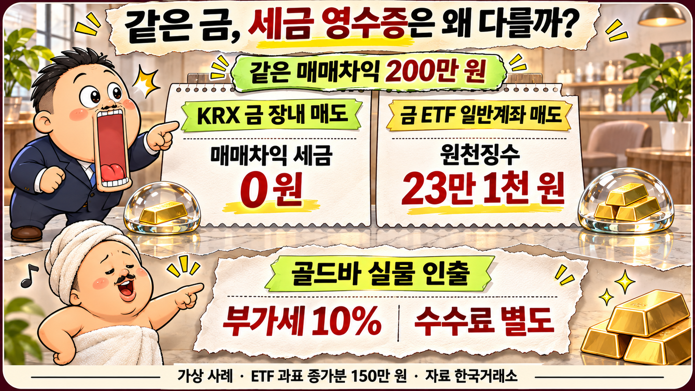

# 같은 금, 세금 영수증은 왜 다를까?

동료가 같은 이름이 쓰인 금 거래 영수증을 두 장 내밀었습니다. 한 장은 KRX 금시장에서 직접 매도한 영수증, 다른 한 장은 금현물 ETF를 일반계좌에서 매도한 영수증이었습니다. 각각 200만 원을 벌었다고 가정했는데 붙은 세금은 0원과 23만 1천 원이었어요. 천억이가 골드바를 출고할 때 받는 세 번째 영수증도 펼쳤습니다.

*가상 거래. 두 매도의 차익은 200만 원이고 ETF 과표기준가격 증가분 상당액은 150만 원입니다.*

**편집부 Q&A · 편집부가 만든 질문**

**골드바를 받아 가도 왼쪽 영수증처럼 세금이 0원인가요?** 실물 출고 때에는 부가가치세 10%와 수수료가 붙습니다. 왼쪽은 개인이 KRX 금시장에서 장내 매도한 사례입니다. 오른쪽의 금 ETF 원천징수는 일반계좌에서 가상 매매차익과 과표 증가분을 비교한 결과입니다.

## 200만 원을 벌고 팔았을 때

**가정.** 한국 거주 개인이 원화 1,000만 원을 첫날 각각 한 번 넣고 1년 뒤 전량 장내 매도합니다. 1년 가격 수익률은 두 거래 모두 가상의 20%이고, 별도 입출금·분배·환전·재투자는 없습니다. 개인 거래 수수료, 호가 차이와 추적 차이는 0으로 두고 펀드 보수는 가상 매매수익률에 별도로 차감하지 않습니다. 다른 금융소득과의 합산 및 추가 세금도 계산에서 제외합니다.

| 원화 | KRX 금시장 직접 장내 매도 | 금현물 ETF 일반계좌 매도 |
|---|---:|---:|
| 원금 | 10,000,000원 | 10,000,000원 |
| 가상 매매차익 | 2,000,000원 | 2,000,000원 |
| 가상 과표기준가격 증가 상당액 | 해당 없음 | 1,500,000원 |
| 매매차익 관련 세금 | 0원 | 231,000원 |
| 가상 정산액 | **12,000,000원** | **11,769,000원** |

ETF의 가상 원천징수액은 매매차익 200만 원과 과표기준가격 증가분 150만 원 중 작은 금액에 지방소득세 포함 15.4%를 곱한 값입니다. 같은 차익이라도 과표 증가분이 0원인 조건으로 바꾸면 이 모형의 원천징수액은 0원입니다. 과표 증가분이 260만 원이라면 작은 쪽인 200만 원이 기준이 되어 30만 8천 원이 됩니다.

## 금을 팔지 않고 집으로 가져간다면

100g 종목을 한 번에 g당 10만 원으로 100g 매수했다고 가정합니다. 그대로 한 바를 인출할 때 과세표준은 이동평균 매입단가 10만 원 × 100g = 1,000만 원입니다. 따라서 이 예의 인출 부가가치세는 **100만 원**이며 수수료는 별도입니다. 처음 50g을 9만 원에, 나중 50g을 11만 원에 샀어도 중간 거래가 없다면 평균은 g당 10만 원입니다. 시세가 바뀌어도 이 단순 예의 인출세 계산은 매입단가와 수량으로 합니다.

## 주문 전에 확인할 것

1. **거래 장소**가 KRX 금시장인지 확인합니다. 이름이 비슷한 장외 매장과 거래 경로가 다릅니다.
2. **계좌 종류**는 직접 장내 거래의 금현물 계좌인지, ETF를 담은 일반 증권계좌인지 확인합니다.
3. **거래 단위**는 금시장의 1g과 ETF 1좌를 구분합니다.
4. **인출 단위**는 보유한 종목에 따라 100g 또는 1kg입니다.
5. **보관**은 장내 매수 후 한국예탁결제원에 보관되는 구조를 확인합니다.
6. **차익 과세**는 KRX 금시장 개인 장내 거래와 ETF 매도의 기준을 구분합니다.
7. **과표기준가격**을 일반계좌 ETF 매매차익과 같이 확인합니다.
8. **실물 인출 부가가치세**는 매매차익 대신 출고 과세표준으로 계산합니다.
9. **거래와 출고 수수료**는 증권사 공지와 거래 화면에서 확인합니다.
10. **매매 가격**을 비교할 때는 g당 장내 가격, ETF 좌당 시장가격, 좌당 순자산가치를 구별합니다.
11. **국내 금값**에는 국제 금값, 환율과 국내 수급이 영향을 줍니다.
12. **출고 일정과 현금 잔액**을 확인합니다. 수령 가능한 지점과 예상 세액·수수료를 미리 확인할 수 있습니다.

동료는 처음의 영수증에서 ‘금’ 대신 마지막 동사에 동그라미를 쳤습니다. 실물을 받으려는 동료가 선택한 한 가지 행동은 **증권사에서 보유 종목의 출고 단위와 예상 부가세·수수료를 확인하기**였습니다.

## 근거 원문

자료 확인일은 2026년 11월 27일입니다. KRX 리플릿은 2023년 12월 자료이며, 위 예시 가격은 실제 시세와 무관합니다.

- [KRX 금시장 안내](https://open.krx.co.kr/contents/OPN/01/01050206/OPN01050206.jsp)
- [KRX 실물 인출 부가가치세 규정 안내](https://regulation.krx.co.kr/contents/RGL/04/04010201/RGL04010201.jsp)
- [KRX 금시장 리플릿](https://regulation.krx.co.kr/contents/RGL/04/04010108/KRX_GOLD_Leaflet_20231226.pdf)
- [조세특례제한법 금지금 과세특례](https://www.law.go.kr/lsLinkCommonInfo.do?lsJoLnkSeq=1019943883)
- [KRX KIND 금현물 ETF 상품 공시](https://kind.krx.co.kr/disclosure/etfisudetail.do?method=searchEtfIsuSummary&strIsurCd=41106)
- [한국투자신탁운용의 ETF 계좌별 과세 안내](https://www.aceetf.co.kr/investment/investmentGuide)

## 관련 장과 FAQ

- [ISA 손익통산과 세후 정산](EP128.md)
- [금과 미국 주식의 리밸런싱](EP112.md)
- [같은 1,000만 원, 자산 7종의 5년 순위](EP126.md)
