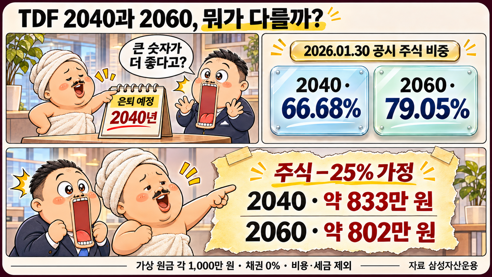

# TDF 2040과 2060, 뭐가 다를까?

동료는 일을 줄이고 싶은 2040년에 달력 표시를 해 두었습니다. 연금 앱에서는 이름에 더 큰 숫자가 적힌 TDF 2060을 고르려고 했어요. 천억이는 운용사가 같은 날 공개한 주식 비중을 보여 줬습니다. 2040은 66.68%, 2060은 79.05%였습니다. 두 비중에 같은 가상 하락을 적용하니 1,000만 원의 잔액은 약 31만 원 차이였습니다.

*주식 비중은 2026년 1월 30일 기준 공시 수치입니다. 금액은 해당 비중에 가상 충격을 적용한 예시입니다.*

**편집부 Q&A · 편집부가 만든 질문**

**두 상품에서 주식이 같은 비율로 하락하는데 왜 잔액이 다를까요?** 채권이 제자리이고 주식이 25% 내리는 가정에서는 주식에 더 많이 배정한 2060 쪽이 더 크게 하락합니다. 목표 연도는 상품이 설정한 자산 배분의 기준 시점입니다. 그해 받는 금액은 시장에 따라 달라집니다.

## 같은 1,000만 원에 같은 충격을 주면

**가정.** 첫날 원화 1,000만 원을 각 장부에 한 번 배정하고 1년 동안 납입·인출·리밸런싱을 하지 않습니다. 글로벌 주식의 가상 1년 원화 총수익은 −25%, 국내 채권은 0%로 둡니다. 총수익에는 분배 재투자 효과가 포함되는 것으로 가정합니다. 환율 효과는 별도로 더하지 않고 보수·거래비용·세금도 제외했습니다. ETF 실현 성과와 미래 수익은 이 표에서 추정하지 않습니다.

| 목표 연도 | 글로벌 주식 실측 비중 | 국내 채권 실측 비중 | 가상 기말 잔액 |
|---|---:|---:|---:|
| 2030 | 50.32% | 49.68% | 8,742,000원 |
| 2040 | 66.68% | 33.32% | 8,333,000원 |
| 2050 | 75.82% | 24.18% | 8,104,500원 |
| 2060 | 79.05% | 20.95% | 8,023,750원 |

2040은 주식 6,668,000원 × 0.75에 채권 3,332,000원을 더합니다. 2060은 주식 7,905,000원 × 0.75에 채권 2,095,000원을 더합니다. 이 조건에서는 2040의 잔액이 **309,250원** 더 큽니다.

**조건을 바꾸면.** 주식만 25% 상승하고 채권은 그대로라면 2040의 잔액은 11,667,000원, 2060은 11,976,250원입니다. 순서가 바뀝니다. 두 자산이 똑같이 5% 내릴 때는 네 장부 모두 9,500,000원입니다. 채권도 변동할 수 있으므로 주식 비중 외에 채권의 금리 및 신용 위험을 확인합니다.

## 설명서에서 확인할 항목

1. **목표 연도**는 상품이 자산 배분을 설계하며 참고하는 시점입니다.
2. **첫 인출 예정 연도**는 자기 지출 일정에서 정합니다.
3. **공시 기준일**은 현재 비중을 비교할 때 두 자료에서 맞춥니다.
4. **글라이드패스**는 시간에 따른 목표 자산 배분 경로를 뜻합니다.
5. **은퇴 시점의 주식 비중**은 현재 비중과 함께 확인합니다.
6. **목표 연도 이후 배분**은 조정이 계속되는지 살펴봅니다.
7. **실제 비중과 목표 비중**은 시장 움직임과 리밸런싱 시점에 따라 벌어질 수 있습니다.
8. **비용**은 운용 보수와 실제 보유·거래 과정에서 드는 비용을 확인합니다.
9. **계좌 편입**은 이용하는 금융회사에서 주문 가능 여부와 한도를 확인합니다.
10. **상품 코드**를 대조하면 이름 변경 전 공시도 찾을 수 있습니다. 2040은 433980, 2060은 0082V0입니다.
11. **계좌 전체 비중**은 TDF 밖에 보유한 주식형 상품까지 합쳐 봅니다. 2040형 예시 1,000만 원과 순수 주식형 ETF 1,000만 원을 함께 보유하면 전체 주식 비중은 83.34%입니다.

동료가 탁상 달력에 한 줄을 더 적었습니다. **설명서에서 내 첫 인출 예정 연도의 주식 비중을 찾아 날짜 옆에 쓰기.**

## 근거 원문

자산 배분 관측일은 2026년 1월 30일, 자료 확인일은 2026년 11월 27일입니다.

- [삼성자산운용 연금투자 가이드북 37쪽](https://www.samsungfund.com/upload/kodex/newsroom/20260211093328479.pdf)
- [삼성자산운용 2026년 4월 1일 상품명 변경 공지](https://www.samsungfund.com/etf/lounge/notice-view.do?no=74454)
- [미 SEC 목표연도 펀드 투자자 안내](https://www.investor.gov/introduction-investing/general-resources/news-alerts/alerts-bulletins/investor-bulletins/target-date-funds-investor-bulletin)

## 관련 장과 FAQ

- [은퇴 생활비와 필요한 자산](EP034.md)
- [인출 시점과 수익률 순서](EP113.md)
- [연금저축 인출과 세금](EP114.md)
