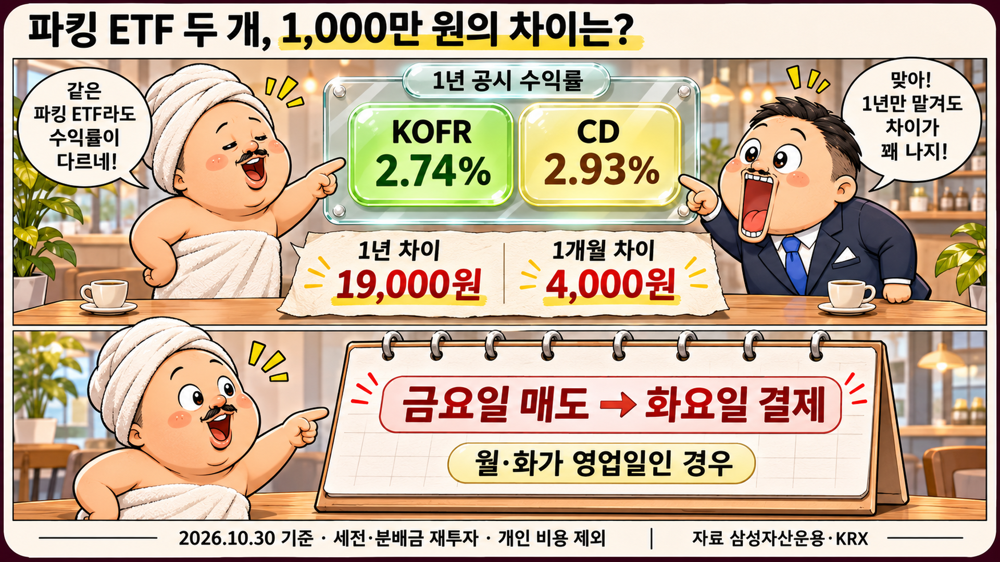

# 파킹 ETF 두 개, 1,000만 원의 차이는?

동료는 다음 달 카드 대금을 잠깐 넣어둘 곳으로 파킹 ETF 두 개를 보고 있었습니다. 천억이가 같은 기준일의 공시를 펼치고 원화 1,000만 원을 대입했습니다. 지난 1년 성과로는 1만 9,000원 차이, 지난 한 달 성과로는 4,000원 차이였습니다. 동료는 더 높은 쪽에 표시했다가 카드 대금일과 ETF 결제일이 맞는지도 확인했습니다.

*공시 2026년 10월 30일 기준. 세전 분배금 재투자 성과를 가상 원금에 적용했으며 개인 거래비용은 제외했습니다.*

**편집부 Q&A · 편집부가 만든 질문**

**월요일 자동이체에 쓰려고 금요일에 팔면 되나요?** 그림의 조건에서는 결제가 화요일입니다. 국내 ETF의 결제는 체결일 기준 두 영업일 뒤입니다. 은행으로 이체할 수 있는 날짜와 시각은 증권사 계좌에서 확인합니다.

## 같은 1,000만 원으로 비교

**가정.** 두 기간은 각각 시작할 때 원화 1,000만 원을 한 번 배정하고 중간 입출금 없이 평가합니다. 기준가의 세전 분배금 재투자 공시 성과를 적용합니다. 환전은 없고 투자자가 별도로 내는 거래비용, 호가 차이와 세금은 제외합니다. 펀드 운용 중 기준가에 이미 반영된 비용은 다시 빼지 않았습니다. 실제로 주문을 체결한 결과나 앞으로 적용될 금리는 별개입니다.

| 2026년 10월 30일 기준 | KOFR 423160 | CD 459580 |
|---|---:|---:|
| 1년 공시 ETF 수익률 | 2.74% | 2.93% |
| 가상 1년 기말 평가액 | 10,274,000원 | 10,293,000원 |
| 1개월 공시 ETF 수익률 | 0.25% | 0.29% |
| 가상 1개월 기말 평가액 | 10,025,000원 | 10,029,000원 |

**조건을 바꾸면.** 이 한 달 사례에서 CD 쪽 개인 매수·매도 비용이 6,000원 더 크다고 가정하면, 공시 기준의 4,000원 우위가 사라지고 비용을 뺀 결과는 2,000원 뒤집힙니다. 이는 비교용 가상 비용입니다.

## 주문까지 확인할 항목

1. **KOFR**는 국채·통화안정증권 담보 익일물 RP 거래 기반 금리입니다.
2. **CD** ETF의 비교 기준은 CD 91일물 금리를 누적하는 지수입니다. 91일은 지표의 대상 기간입니다.
3. **합성 구조**는 운용사가 장외파생상품을 사용할 수 있음을 뜻합니다. 거래상대방 위험은 설명서에서 확인합니다.
4. **예금자보호**는 두 보고서 모두 적용되지 않는다고 표시합니다.
5. **성과 항목**은 같은 종료일, 같은 기간의 ETF 행에서 읽습니다. 비교지수와 ETF의 실적은 따로 나옵니다.
6. **분배금**은 공시 수익률의 재투자 가정과 내 계좌의 실제 입금을 구분합니다.
7. **1주당 기준가**는 해당 보고서에서 약 11만 653원과 107만 3,746원이었습니다. 실제 호가는 주문 화면에서 확인합니다.
8. **정수 주문**을 가정할 때 1주 가격이 각각 11만 원과 107만 원이면, 예산 100만 원에서 9주와 0주가 됩니다. 비용은 0원이라는 가정입니다.
9. **거래비용**은 수수료와 실제 호가·체결가 차이를 포함해 비교합니다.
10. **결제일**은 체결 후 두 영업일입니다. 금요일에 체결되고 다음 월·화가 영업일이면 화요일입니다.
11. **출금 가능 시각**은 결제일과 함께 봅니다. 같은 날이라도 자동이체보다 늦게 옮길 수 있다면 지출 일정을 맞추기 어렵습니다.

동료가 카드 대금 날짜 옆에 한 줄을 적었습니다. **매수하기 전에 이 ETF를 팔았을 때 내 계좌에서 현금을 출금할 수 있는 날짜와 시각을 확인하기.**

## 근거 원문

월간 보고서의 관측 기준일은 2026년 10월 30일, 자료 확인일은 2026년 11월 27일입니다.

- [삼성자산운용 KOFR ETF 10월 월간 리포트](https://m.samsungfund.com/sheet/20261104/2ETFG6_20261031.pdf)
- [삼성자산운용 CD ETF 10월 월간 리포트](https://m.samsungfund.com/sheet/20261104/2ETFJ8_20261031.pdf)
- [한국은행 KOFR 개요](https://www.bok.or.kr/portal/main/contents.do?menuNo=201069)
- [삼성자산운용 CD ETF 투자설명서](https://m.samsungfund.com/upload/invest/2ETFJ8-A.pdf)
- [KRX ETF 결제제도](https://regulation.krx.co.kr/contents/RGL/03/03060102/RGL03060102.jsp)

## 관련 장과 FAQ

- [정기예금 중도해지 이자 비교](EP101.md)
- [해외 ETF 거래 비용 확인](EP106.md)
- [순매수 결제와 보관잔액](FAQ05.md)
