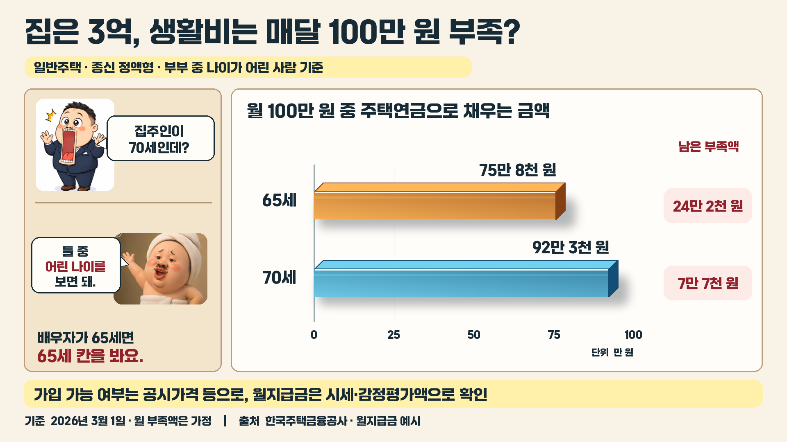

# 집은 3억인데 생활비가 월 100만 원 부족하다면? 주택연금 예상액부터 확인하세요

## 1. 현관 열쇠와 통장

가상의 천억이는 아침마다 같은 길로 복지관에 간다. 집을 팔면 현금은 생기지만 병원과 시장이 가까운 동네를 떠나야 할 수 있다. 수건 친구가 식탁 위에 열쇠와 생활비 통장을 나란히 놓는다. “이 집에 계속 산다는 조건으로 매달 부족한 돈을 얼마나 채울 수 있을까?” 두 사람은 집값을 월급처럼 적어 놓았던 가계부부터 고친다.

## 2. 같은 3억 원에도 다른 가격표가 붙는다

한국주택금융공사는 가입 가능 여부를 판단하는 가격과 월지급금을 산정하는 가격을 구분한다. 가입 대상 판단에 쓰는 공시가격 등과 월지급금 산정에 쓰는 시세 또는 감정평가액을 각기 확인한다. 아파트 실거래가를 한 건 보고 가입 여부와 월 금액을 동시에 확정하기 어렵다. 주택연금은 집을 담보로 제공하고 월지급금을 받는 대출 구조다. 통장에 찍히는 돈과 장래 정산할 금액은 다른 장부에 적는다. [한국주택금융공사 주택연금 안내](https://hf.go.kr/ko/sub03/sub03_01_01_01.do) · [한국주택금융공사 월지급금 예시](https://www.hf.go.kr/ko/sub03/sub03_01_01_02.do)

## 3. 공사 표에서 연령과 주택가격이 만나는 칸을 봤다

공사의 2026년 3월 1일 기준 일반주택 종신지급방식 정액형 예시에서 평가 가격 3억 원이면, 부부 중 연소자가 65세일 때 월 75만 8천 원, 70세일 때 월 92만 3천 원이다. 공사가 신규 신청자에게 월지급금을 조정했다고 안내한 시행 기준과 예시표의 기준일을 같이 확인했다. 노인복지주택과 주거목적 오피스텔의 표는 별도로 있다. [한국주택금융공사 월지급금 예시](https://www.hf.go.kr/ko/sub03/sub03_01_01_02.do) · [한국주택금융공사 월지급금 조정 안내](https://www.hf.go.kr/ko/sub04/sub04_08.do?article.offset=0&articleLimit=10&articleNo=599732&mode=view)

## 4. 두 달력이 같은 생활비를 만났을 때

국민연금 등 기존 실입금이 월 150만 원, 월 생활비가 250만 원인 가상 부부를 둔다. 위 표의 각 조건에서 12개월 내내 공시 예시 월액이 지급되고 지출과 기존 수입이 일정하다고 가정한다. 원화 현금흐름만 비교한다. 금액을 재투자하지 않으며 세금, 별도 비용, 주택 가격 변화, 대출 잔액과 보증료의 누적은 이 생활비 차액 계산에서 제외한다.

| 3억 원 일반주택의 연소자 | 공사 표의 월지급금 | 남는 월 생활비 부족액 | 12개월 부족액 |
|---|---:|---:|---:|
| 65세 | 758,000원 | 242,000원 | 2,904,000원 |
| 70세 | 923,000원 | 77,000원 | 924,000원 |

월지급금을 받아도 이 예의 지출은 둘 다 전부 충당하지 못한다. 두 조건의 차이는 월 16만 5천 원, 12개월이면 198만 원이다. 서로 다른 두 사례를 비교한 값이므로 지금 65세인 사람에게 5년 뒤 같은 표와 가격이 적용된다고 보지는 않는다.

*한국주택금융공사 종신 정액형 월지급금 예시를 가상 월 부족액 100만 원에 대입했다.*

친구가 한 해의 장부를 실제 납부 일정처럼 다시 펼친다. 적어 둔 월 이백오십만 원에는 관리비와 식비처럼 달마다 나가는 돈만 있다고 하자. 그와 별도로 여름에 수리비 백이십만 원이 한 번 든다. 70세 사례의 정기적인 부족액은 열두 달 합계 구십이만 사천 원이었다. 여기에 수리비를 더하면 이백십이만 사천 원이다. 65세 사례에는 이백구십만 사천 원에 수리비를 더해 사백십만 사천 원이 들어간다. 표에서 읽은 월지급금이나 평소 적자액은 하나도 바뀌지 않았는데, 따로 마련해야 할 돈은 백이십만 원 커졌다. 연평균으로 쪼개면 매달 십만 원이지만 실제로는 수리하는 달에 한꺼번에 나간다. 공사 일정을 잡기 전에 그날 인출할 수 있는 돈이 있는지 확인해야 한다.

그런데 수리비가 매년 나갈지 한 번으로 끝날지 아직 모른다. 첫해 이야기라면 한 번만 더하면 된다. 정기적인 교체 비용을 위해 별도 적립을 하는 경우에는 매달 적립할 금액을 월 지출에 포함할 수 있다. 그렇게 장부에 이미 넣었다면 나중에 수리비를 다시 월평균 예산에 얹지 않는다. 친구가 두 칸을 따로 긋는다. 하나는 매달 들어오는 돈이 적어서 생기는 부족, 하나는 큰 지출일에 현금이 모자라서 생기는 부족이다.

수건 친구는 같은 집에 계속 살면서 장부의 부족액만 바꿔 보기로 한다. 70세의 예시 월지급금은 구십이만 삼천 원. 지금 다른 수입과 지출을 다시 확인했더니 매달 구십만 원이 모자랐다고 하자. 이 금액이라면 월 이만 삼천 원이 남는다. 매달 백만 원이 모자라면 앞서 본 것처럼 칠만 칠천 원이 부족하다. 월지급금 액수는 바뀌지 않았지만 두 가계부는 서로 다른 판단을 한다. 점심 외식 두 번을 줄이라는 이야기가 아니다. 당장 계약하기 전에 내가 부족하다고 생각한 월 금액이 실제 통장에서 확인된 값인지 알아보자는 것이다.

만약 고정 수입 백오십만 원 가운데 일부가 정확히 열두 달 뒤에 끝난다면 첫해와 둘째 해도 따로 그린다. 매달 받던 임시 소득이 삼십만 원이었다고 정하자. 70세 첫해에는 월 칠만 칠천 원의 빈칸이 있다. 다음 해 소득이 그만큼 줄면 다른 조건이 그대로일 때 빈칸이 삼십칠만 칠천 원으로 커진다. 월지급금이 줄어드는 사건은 없지만 생활비에 쓸 수 있는 돈이 달라진다. 둘째 해의 부족액을 첫해와 비교하면 일 년에 삼백육십만 원이 더 필요하다. 친구는 소득의 이름 옆에 종료 예정일을 적는다. 회사에서 받던 돈만 종료 날짜가 있는 것은 아니기 때문이다.

## 5. 한 살이 아니라 어느 사람의 나이인가

천억이는 집 명의자의 나이를 적었다가 지운다. 집주인이 70세여도 배우자가 65세라면 이 예의 산정 연령 칸은 65세다. 또 일단 70세라는 조건이 같아도 평가 가격이 2억 원이면 표의 월액은 61만 5천 원이다. 같은 부족액 100만 원에 대입하면 매달 38만 5천 원이 여전히 비어 있다. 연령 하나나 집값 하나만으로 다른 집의 월 지급 사례를 가져올 수 없다. [한국주택금융공사 월지급금 예시](https://www.hf.go.kr/ko/sub03/sub03_01_01_02.do)

이번에는 공사 표의 집값을 이억 원에서 삼억 원으로 바꿀 수 있는 사람이 누군지 따져 본다. 천억이가 “우리 아파트 이웃이 집을 삼억에 팔았다는데?” 하고 묻자, 친구는 그 가격이 집의 현재 상태나 실제 적용되는 평가 가격을 대체할 수는 없다고 답한다. 공사의 조회 화면에서 어떤 가격을 적용하는지부터 읽는다. 오늘 조회한 시세에 따른 월액은 참가 여부를 결정하기 위한 예상치다. 실제 상담에서는 주택 유형과 계약 조건을 반영한 안내를 확인한다. [한국주택금융공사 예상연금조회](https://hf.go.kr/ko/sub03/sub03_02_02.do)

가상 비교의 다른 끝도 본다. 연소자가 70세인 일반주택의 공사 표에서 평가 가격 4억 원이면 월 123만 1천 원이다. 생활비 부족액을 월 백만 원으로 두면 이 조건의 장부에는 이십삼만 천 원이 남는다. 평가 가격이 3억 원이면 칠만 칠천 원이 부족했다. 같은 나이와 같은 장부로 비교하니, 평가 가격이 달라졌을 때 남는 돈의 방향이 바뀐다. 이 값을 보고 집을 더 비싸게 사야 한다고 결론낼 수는 없다. 새 집을 구입하는 데 드는 돈과 거주 비용이 가상 예산에 들어 있지 않아서다. [한국주택금융공사 월지급금 예시](https://www.hf.go.kr/ko/sub03/sub03_01_01_02.do)

## 6. 한 달에 들어오는 돈과 나중에 정산하는 돈

주택연금 월지급금은 담보대출에서 지급되는 현금이다. 앞으로 받은 월지급금만 단순 합산해서 가족이 정산해야 할 금액으로 써 두기에는 정보가 부족하다. 대출이자와 보증료 등 상품 조건이 정산에 영향을 준다. 담보대출을 상환하기 위해 일부를 먼저 인출하는 방식이나 초기증액형을 택하면 앞의 종신 정액형 표로 같은 월지급금을 가정하기 어렵다. [한국주택금융공사 주택연금 안내](https://hf.go.kr/ko/sub03/sub03_01_01_01.do)

천억이는 첫해에 받는 총액을 계산해 본다. 월 구십이만 삼천 원을 열두 번 받으면 천백칠만 육천 원이다. 이것을 집값 삼억 원으로 나누면 약 삼 점 육구 퍼센트가 나온다. 그러나 수건 친구는 그 비율 옆에 ‘집값 대비 첫해 현금 유입’이라고 적는다. 투자한 원금 삼억 원에 대한 이자율이라는 뜻으로 읽으면 지급액의 성격을 놓친다. 한 달씩 지급되는 돈은 담보대출에서 들어오고, 정산할 잔액에는 계약에 따른 이자·보증료가 함께 영향을 준다. 반대로 예금의 이자를 계산할 때는 원금과 이자에 적용할 계약 조건을 따로 적는다. 같은 비율을 계산기로 얻었다고 두 상품이 같은 방식으로 돈을 만들어 주는 것은 아니다.

집을 팔아 더 작은 집으로 옮기는 방안도 종이 위에 놓아 보자. 집값 삼억 원, 옮겨갈 집값 이억 사천만 원, 거래와 이사에 드는 총비용 육백만 원으로 가정한다. 기존 대출·추가 세금·새 집 수리비를 모두 영 원으로 두면 가용 현금은 오천사백만 원이다. 이 돈에서 이자 없이 월 백만 원씩 쓰면 쉰네 달분이다. 실제로는 가족이 가까워지는지, 관리비가 달라지는지, 이사에 따라 병원 접근성이 바뀌는지도 따로 고려한다. 주택연금과 이사 안을 비교하려면 같은 날짜와 같은 주거비를 넣고 남는 돈을 보아야 한다. 이 계산은 가정한 현금소진 기간만 보여 주며 집값이나 세금의 실제 견적은 아니다.

친구가 다음 장의 제목을 ‘나중에 집을 처분하는 날’이라고 쓴다. 한국주택금융공사는 부부 모두 사망 후 담보주택을 처분해 정산하는 경우 월지급금 누계에 수시인출금, 초기·연 보증료, 그에 대한 대출이자를 더한 금액을 본다고 설명한다. 집을 처분한 금액이 이보다 많으면 남는 부분이 상속인 또는 신탁 방식의 귀속권리자에게 돌아가고, 부족하면 상속인에게 부족액을 따로 청구하지 않는다. [한국주택금융공사 주택연금의 장점](https://corp.hf.go.kr/ko/sub03/sub03_01_01_05.do)

예를 들어 처분액이 삼억 원이고 수시인출금과 보증료, 대출이자까지 더한 정산 기준 총액이 이억 칠천만 원이라고 놓으면, 다른 비용을 제외한 단순 차액은 삼천만 원이다. 처분액만 이억 오천만 원으로 바뀌면 이번에는 이천만 원이 부족하다. 두 사례는 특정 주택의 값이나 장래 대출잔액을 예측한 결과가 아니다. 생활비가 잘 들어오는지 확인하는 월별 장부와 가족이 보는 정산 장부의 기준이 어떻게 다른지 보여 준다.

한 분이 먼저 돌아가신 경우에는 두 분 모두 돌아가신 뒤의 정산과 시점부터 다르다. 가입자가 사망하면 공사 절차 안내에 따라 월지급금 지급이 일단 중단된다. 자격을 충족하는 배우자가 이어 받으려면 담보 방식에 맞춰 승계와 채무인수 신청을 진행해야 한다. 신탁방식의 경우 공사는 공동상속인 동의나 담보주택 이전등기 없이 승계가 가능하다고 설명한다. 신청과 구비서류는 두 담보 방식 모두에서 확인한다. 집을 계속 쓸 수 있는지 묻는 사람에게 월 예상액만 보여 줄 때 놓치기 쉬운 부분이다. [한국주택금융공사 가입고객 사망 후 절차 안내](https://www.hf.go.kr/ko/sub03/sub03_02_05_07.do) · [한국주택금융공사 담보제공방식 비교](https://www.hf.go.kr/ko/sub03/sub03_01_02_02.do)

계약을 비교하는 날에는 서류를 많이 모으기보다 질문을 나눠 적는 게 쉽다. 이번 달부터 받을 수 있는 금액과 지급 개시일은 언제인지, 기존 담보대출을 갚으려면 어떤 방식이 필요한지, 배우자가 승계 때 제출할 서류는 무엇인지 순서대로 묻는다. 자녀에게 설명할 때는 예상 월액과 나중에 정산할 금액을 서로 다른 문장으로 전한다. ‘집값 삼억에서 매달 얼마씩 차감한다’는 한 문장으로 합치면 비용과 시점이 빠지기 때문이다.

## 7. 다섯 해를 기다리는 동안에도 생활비는 나간다

월 부족액이 100만 원으로 고정된 가상 조건에서 아무 추가 수입 없이 60개월 기다리면 별도 자금에서 6,000만 원이 필요하다. 다른 소득이 그동안 월 80만 원 생긴다는 조건이면 1,200만 원으로 줄어든다. 이는 기다리는 동안의 가계 현금 필요액이다. 조기 신청과 나중 신청의 총손익을 비교하려면 당시 실제 월지급금, 기간, 생활비, 담보 대출잔액과 주거 계획을 함께 확인해야 한다.

수건 친구는 사례를 조금 더 현실에 가깝게 바꾼다. 별도 생활비 통장에 이천만 원이 있고 추가 수입은 없다고 하자. 월 백만 원을 보태야 하면 이 통장은 스무 달 뒤에 비게 된다. 중간에 다른 소득이 월 팔십만 원 들어와 부족액이 월 이십만 원으로 줄면 오 년의 생활비 부족에 천이백만 원이 필요하고, 처음 이천만 원 중 팔백만 원이 남는다. 예금이자와 물가 변화 없이 현금흐름만 놓은 결과다. 이제 질문이 바뀐다. 나중에 월지급금이 얼마일지보다, 그날까지 부족한 생활비를 어느 계좌에서 가져올 것인지 먼저 써야 한다.

이 장부에는 대출을 갚는 날짜도 넣는다. 집값이 같은 이웃이 같은 표를 열었어도 기존 담보대출을 먼저 정리하는 사람과 다달이 생활비만 받으려는 사람은 문의할 지급 방식이 다를 수 있다. 천억이는 월액 비교표의 빈칸에 ‘이미 갚아야 할 대출’, ‘가입 뒤에도 남는 고정비’, ‘일시 지출’이라고 쓴다. 월지급금 하나가 많거나 적다는 설명만으로 결정하기 어려웠던 이유가 표 안에서 드러난다.

기다리는 방법끼리도 출발 금액을 맞춘다. 한 사람은 생활비 통장 이천만 원을 그대로 들고 있고, 다른 사람은 그중 오백만 원을 집수리 예산으로 먼저 떼어 두었다고 가정한다. 월 백만 원이 비는 상황에서 첫 장부는 스무 달, 둘째 장부의 생활비 칸은 열다섯 달을 채울 수 있다. 둘 다 자산이 이천만 원 있다는 설명은 맞지만 새 월수입이 필요한 날짜가 다섯 달 앞당겨진다. 수리비가 실제로 어느 때 필요한지에 따라 한 계좌에서 두 가지 지출을 어떻게 기록할지가 달라진다.

수건 친구는 어느 쪽을 고르든 전화를 걸기 전에 가족에게 물어볼 질문도 적어 두자고 한다. 지금 집에 계속 살아야 하는 이유가 병원 때문인지, 돌봄을 받는 사람과 떨어지고 싶지 않아서인지, 이사하기 번거로워서인지에 따라 같은 월액을 보고 내리는 결정이 다를 수 있다. 숫자 계산에서는 이사비와 현금만 비교했지만, 일정표를 옮기는 데에는 눈에 보이지 않는 시간도 있다. 그래서 천억이의 마지막 장부에는 ‘돈이 준비될 달’ 옆에 ‘계속 살고 싶은 이유’가 한 줄 더 생긴다.

가계부의 첫 달과 다섯 해 뒤를 비교하는 연습도 해 본다. 앞서 본 70세 조건으로 이미 계약해 월지급금 구십이만 삼천 원이 같고, 다른 소득은 매달 백오십만 원으로 같다고 가정한다. 오직 월 생활비 이백오십만 원만 해마다 삼 퍼센트씩 다섯 차례 오른다고 놓는다. 이 물가 상승률은 전망이 아니라 두 사람이 장부에 넣어 본 숫자다. 다섯 번 곱하면 생활비는 약 이백팔십구만 팔천 원이다. 들어오는 돈을 뺀 월 부족액은 약 사십칠만 오천 원으로 커진다. 물가 상승을 가정하지 않았을 때의 월 칠만 칠천 원과 눈에 띄게 다르다.

이렇게 계산하다 천억이는 장부의 모든 지출에 같은 비율을 적용했던 자리에서 멈춘다. 관리비와 보험료와 장보기 가격은 동시에 오르지 않아도 된다. 가령 이백오십만 원 가운데 백만 원의 계약 지출만 고정되고 나머지 백오십만 원만 같은 삼 퍼센트씩 다섯 번 오른다고 놓으면 전체 지출은 약 이백칠십삼만 구천 원이다. 같은 정기 입금액을 뺀 부족분은 약 삼십일만 육천 원이다. 가계부를 쓸 때는 이 정도만 두 줄로 나눠도 어떤 가정이 월 부족분을 키우는지 볼 수 있다. 전국의 물가와 자기 집의 실지출을 같은 수치라고 놓을 필요는 없다.

친구가 이번에는 이천만 원 현금이라고 적힌 통장을 가져온다. 월 칠만 칠천 원씩 부족할 땐 새 예금이자 없이도 통장이 꽤 오래 버틸 것처럼 보인다. 앞의 다섯 해 뒤 사례에 나온 월 사십칠만 오천 원을 기준으로 보면 같은 돈으로 채울 수 있는 기간이 훨씬 짧다. 다만 부족분이 첫해부터 나중 액수에 고정돼 있었다고 계산하면 첫 다섯 해를 실제보다 어렵게 본다. 매년 다른 부족분을 따로 적어야 시간을 비교할 수 있다. 가계부의 세 번째 칸에 ‘언제부터’라는 말을 넣는 이유다.

여기서 수건 친구는 달력의 특정 달에 동그라미를 친다. 큰 병원비나 집수리비는 매달의 물가만 올려 잡아서는 넣기 어렵다. 처음부터 남겨 둔 현금이 있다면 그 달의 지출은 월지급금 부족과 겹쳐도 현금 장부에 별도로 기록된다. 같은 돈을 다음 해까지 계속 들고 있고 싶다면 다시 채울 날짜와 금액도 가계부에 쓸 수 있다. 매월 수입이 얼마나 늘어나는지를 확인하는 것과 한 번의 큰 청구를 감당하는 것은 같은 출발점에서 따로 시험해 볼 문제다.

천억이는 마지막으로 지출이 내려가는 경우도 생각한다. 월 이백오십만 원에서 정기적으로 쓰던 돈 십만 원이 줄어 이백사십만 원으로 바뀌고, 기존 소득은 그대로인 가정이다. 첫해의 70세 예시 월지급금을 더하면 월 이만 삼천 원이 남는다. 반대로 추가 관리 비용이 십만 원 들어 생활비가 이백육십만 원이면 월 십칠만 칠천 원이 부족하다. 같은 계약을 읽고도 두 집이 다른 관점으로 볼 수 있는 이유는 이처럼 지출 구조에 있다. 월지급금 숫자는 공사 표에서 찾지만 필요한 월액은 내 장부에서 찾는다.

## 8. 오늘 입력할 값 세 개

천억이는 공식 예상연금조회에서 **부부 중 연소자의 생년월일, 담보주택의 평가 가격, 지급 방식**을 같은 화면에 놓고 본다. 조회한 금액을 생활비 장부의 월 부족액에서 빼 보고, 남은 부족액과 별도의 대출·보증 비용 조건을 적는다. 집에 계속 살고 싶은 이유도 그 옆에 적는다. 월 금액만으로는 병원이나 가족과의 거리까지 판단할 수 없기 때문이다. [한국주택금융공사 예상연금조회](https://hf.go.kr/ko/sub03/sub03_02_02.do)

공식 화면을 연 뒤 천억이는 연령 계산에서 먼저 딴 길로 샐 뻔한다. “배우자는 올해 예순다섯인데 생일은 아직 남았어. 어느 나이를 적지?” 부부 조건을 손으로 어림하는 대신 조회 화면의 생년월일 칸부터 확인한다. 옆에 지난 상담의 인쇄물이 있으면 결과 이전에 당시 입력했던 날짜와 평가액을 먼저 본다. 예전과 이번의 월액이 다르면 두 집의 계약이 원래 달랐던 것인지, 기준이 바뀌었는지 나눠서 볼 수 있다. 공사의 월지급금 예시표와 개별 조회의 숫자를 같은 종류의 자료로 옮겨 적지 않는다. 예시표는 정해진 주택 가격과 연령에서 보는 대표 값이며, 예상 조회에는 실제로 내가 넣은 조건이 붙는다. 신청 시의 적용 조건은 확인을 거친다.

수건 친구는 조회 결과 아래 세 곳을 접는다. 첫 번째는 예상 월지급금, 두 번째는 입금이 실제로 시작될 시점, 세 번째는 기존 집의 대출을 어떻게 처리할지 묻는 곳이다. 화면만 보고 두 번째나 세 번째의 답이 부족하면 상담에서 확인한다. 예컨대 생활비는 지금부터 필요한데 첫 입금이 예산보다 한 달 늦어진다고 놓으면, 그 한 달에는 월 칠만 칠천 원이 아니라 기존 생활비 부족액인 백만 원을 따로 메워야 한다. 차이는 구십이만 삼천 원으로 월지급금 한 번에 해당한다. 이것이 매년 반복되는 지출 증가를 의미하지는 않는다. 시작 시점이 어긋난 달 하나의 현금표를 다시 작성하면 된다.

하루 차이 때문에 출금 경로가 달라지는 경우도 있다. 그달 관리비와 카드값 일부가 첫 지급 예정일보다 앞서 총 육십만 원이 빠져나간다고 가정한다. 입금일까지 기다렸다 내도 되는 항목과 반드시 그날 내야 하는 항목을 나눌 수 있다. 생활비 통장에 바로 쓸 수 있는 돈이 이십만 원밖에 없다면 그 이체일에는 사십만 원을 먼저 옮겨야 한다. 이미 월말에 충분한 돈이 들어온다는 계산과 그날 통장에서 빠져나갈 사십만 원을 양쪽에서 모두 새 부족액으로 계산하면 지출을 두 번 세게 된다. 그달 말 부족액을 계산하는 줄과 지급 전에 필요한 임시 현금을 계산하는 줄을 나눠 두면 어느 항목을 중복했는지 보인다.

가족에게 말로 전달할 때도 숫자를 세 가지로 정리한다. 천억이는 “우리 집이 삼억이래”로 시작하던 문장을 바꾼다. “지금 내 장부에서 백만 원이 모자라. 예상 표를 대입하면 월 칠만 칠천 원이 남아. 이번 겨울에는 수리비도 나갈 수 있어.” 친구는 마지막 두 문장의 ‘남아’가 무엇을 가리키는지 다시 묻는다. 월 칠만 칠천 원은 여유 자금이 아니라 아직 모자라는 생활비다. 같은 숫자를 입금, 지출, 부족 중 어느 칸에 적느냐에 따라 들리는 뜻도 달라진다. 입금이 확인된 뒤에야 월지급금을 실제 수입 칸으로 옮긴다.

마지막으로 비교표의 단위를 원화로 고정한다. 몇 년 치 월지급금을 더한 숫자와 지금 당장 현금화할 수 있는 잔액을 한 줄에 쓰지 않는다. 아직 받지 않은 돈은 받는 날짜가 있는 돈이다. 집을 떠나는 선택과 집에 남는 선택을 비교할 때도, 같은 기간에 주거와 생활비를 치르고 마지막에 남는 값을 각각 본다. 가상 장부의 답이 실제 계약 선택과 달랐던 경우에는 차이를 만든 한 가지 조건을 먼저 확인한다. 그것이 예상과 다른 주택 평가액인지, 다른 월지급 방식인지, 지출 계획이 바뀐 것인지부터 살펴보면 다시 계산할 자리를 찾을 수 있다.

같은 달을 비교하는 연습으로 세 가지 칸을 만든다. 첫 칸은 집을 그대로 보유하고 주택연금을 받는 경우다. 둘째 칸은 집을 줄여 옮기고 현금을 받는 경우다. 셋째 칸은 아무 계약도 바꾸지 않고 기존 현금에서 부족액을 메우는 경우다. 첫 칸에는 이미 확인한 월 부족액 칠만 칠천 원을 적고, 다른 비용 없이 십이 개월을 이어가면 구십이만 사천 원을 별도 현금에서 써야 한다고 쓴다. 셋째 칸은 매달 백만 원, 일 년에 천이백만 원이다. 두 칸의 현금 차이는 천백칠만 육천 원이지만, 그 차이에 해당하는 곳에서는 주택연금 대출이 생긴다. 현금 지출이 줄었다는 숫자를 자산이 불어났다는 뜻으로 옮기지 않는다.

둘째 칸의 오천사백만 원은 집을 옮긴 뒤 손에 남는다고 가정한 초기 현금이다. 새 집에서도 월 백만 원이 부족한 채 시작하면 일 년 뒤 사천이백만 원이 남는다. 새 집 생활비가 매달 이십만 원 덜 든다고 바꾸면 열두 달 동안 구백육십만 원이 나가서 사천사백사십만 원이 남는다. 이 계산의 시작점은 새 집에서 사는 첫날이다. 집을 팔기까지 걸린 시간이나 새 집에 먼저 들어가는 데 필요한 돈은 포함하지 않았다. 이삿날과 매매 잔금일이 다르면 그 사이 현금 흐름을 별도로 다뤄야 같은 기간의 비교가 된다.

수건 친구는 이 표에서 금액 한 줄이 아직 없다고 말한다. 첫째와 셋째 경우에는 원래 집이 남고, 둘째 경우에는 더 작은 집이 남는다. 현금만 일 년 뒤에 얼마나 남는지 비교하면 주택의 상태와 담보대출 잔액은 빠진다. 현금으로 옮긴 금액을 새로 생긴 수익으로 더하기 전에 집이 바뀌었다는 사실을 반영한다. 판단에 필요한 것은 어느 선택에서 생활비를 낼 수 있는지와, 그 이후에 어떤 자산과 빚이 남는지다. 둘을 각각 계산하면 현금이 많이 남는 쪽이 다른 기준에서도 자동으로 앞선다고 읽을 일이 줄어든다.

천억이는 실제로 할 수 있는 작은 연습으로 돌아간다. 통장에 백만 원이 찍혀 있어도 다음 주 병원비로 이미 정해 둔 돈이 육십만 원이면 자유롭게 쓸 수 있는 금액은 사십만 원으로 잡는다. 저축 통장에서 바로 옮길 수 있는 금액은 따로 적고 만기나 중도해지 조건이 있는 돈은 언제 확인할 것인지 날짜를 써 둔다. 주택연금을 받기 전에 무엇부터 써야 할지 몰랐던 이유는 보유 현금과 지출에 이미 배정한 현금을 같은 칸에 더했기 때문이다. 피부에 와닿는 비교를 만들려면 얼마를 받을 수 있는지에 이어 언제 어디로 들어오는지까지 보는 것이 좋다.

마지막으로 두 사람은 오늘 본 세 종류의 숫자를 말해 본다. 공시가격 등은 가입 가능성을 묻는 데 쓰는 숫자다. 시세나 감정평가액은 지급 예상액을 알아보는 데 쓰는 숫자다. 월급처럼 들어올 현금과 달라질 수리비를 합쳐 보는 곳은 집의 가격표가 아니라 나의 생활비 장부다. 이 세 숫자는 서로 연결되지만 부르는 이름을 바꿔 써도 되는 숫자는 아니다. 천억이는 공식 조회 화면을 닫기 전에 배우자의 출생일과 지급 방식, 그리고 계산에 쓴 금액이 적힌 페이지를 확인한다. 다음에 다시 열었을 때 어떤 값이 바뀌었는지 확인하기 위해서다.

## 편집부 Q&A

**집값이 오르면 이미 받고 있는 정액형 월지급금도 비례해서 오르나요?** 먼저 가입 당시 계약의 지급 유형을 확인한다. 이 글은 공사의 신규 신청 기준 예시를 사용한 종신 정액형 비교다. 다른 지급 유형의 월 금액 변화 규칙은 같은 방식으로 계산할 수 없다.

**이사 계획이 있는데도 표의 금액을 그대로 써도 되나요?** 담보주택과 실거주 계획이 바뀌는 경우에는 변경 가능 여부와 적용 조건을 공사에 확인하고, 주소와 담보가 확정된 뒤 다시 조회한다.
