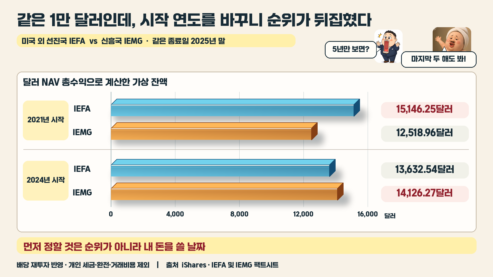

# 선진국 ETF와 신흥국 ETF에 1만 달러씩 넣었다면? 5년 차이와 마지막 2년의 반전

## 1. 미국 밖이라고 적은 두 봉투

가상의 천억이는 은퇴자금에서 당장 쓰지 않을 달러를 미국 외 주식에 나눠 담았다고 가정한다. 지갑에서 ETF 이름을 적어 둔 봉투 두 장이 나온다. 하나는 선진국, 다른 하나는 신흥국이다. 수건 친구가 같은 연말에 두 계좌를 보자고 한다. 천억이는 한 해 뉴스에서 앞섰던 쪽을 고르려다, 친구가 들고 있던 5년 달력을 본다.

## 2. 미국 주식 비중을 낮추는 두 상품이 담는 곳

IEFA는 MSCI EAFE IMI 지수를 추종하며 미국·캐나다를 제외한 선진시장의 대·중·소형 주식에 노출된다. IEMG는 MSCI 신흥시장 IMI 지수를 추종하는 미국 상장 ETF이며 대·중·소형 주식을 담는다. 나라를 어떤 쪽에 넣는지는 지수 사업자의 분류가 기준이다. 한국에 이미 투자한 독자라면 IEMG의 편입 국가 표에서 한국 항목도 확인할 수 있다. 미국 거래소에서 달러로 매매하는 형식과 안에 담긴 기업의 위치는 각각 확인해야 한다. [iShares IEFA 팩트시트](https://www.ishares.com/us/literature/fact-sheet/iefa-ishares-core-msci-eafe-etf-fund-fact-sheet-en-us.pdf) · [iShares IEMG 팩트시트](https://www.ishares.com/us/literature/fact-sheet/iemg-ishares-core-msci-emerging-markets-etf-fund-fact-sheet-en-us.pdf)

## 3. 같은 돈과 같은 마감일을 적었다

비교할 구간의 직전 연말에 각 ETF에 1만 달러를 한 번 넣었다고 가정한다. 개인 매매·환전비와 세금은 제외하고, 운용사 공시의 달러 NAV 총수익률을 사용한다. 펀드 내부 비용 차감과 해당되는 분배금 및 자본이득 재투자는 그 공시 총수익률에 반영돼 있다. 실제 주문 가격이나 원화 기록을 재현한 표가 아니다. 2021~2025년의 연 수익률을 이어 붙이며 각 해 `1 + 수익률`을 곱하고 마지막에 반올림한다.

## 4. 5년 표에서는 선진국 쪽에 2,627달러가 더 남았다

| 달력연도 | IEFA NAV 총수익률 | IEMG NAV 총수익률 |
|---|---:|---:|
| 2021 | +11.29% | −0.64% |
| 2022 | −15.13% | −19.87% |
| 2023 | +17.63% | +11.31% |
| 2024 | +3.41% | +6.92% |
| 2025 | +31.83% | +32.12% |

2021년 시작부터 2025년 말까지 가상 잔액은 IEFA 15,146.25달러, IEMG 12,518.96달러다. 두 결과는 5년 누적의 달러 잔액이다. 2021년에 첫 번째 격차가 생겼고 다음 해에는 양쪽 모두 하락했다. 해마다 표시한 수익률 자체가 소수점 둘째 자리까지 반올림되어 있어 합성액에 그 정밀도 한계가 있다.

## 5. 마지막 두 해만 펼쳤더니 순서가 바뀌었다

같은 계산을 2024년 시작부터 2025년 말까지 적용하면 IEFA 13,632.54달러, IEMG 14,126.27달러다. 신흥국 쪽이 493.73달러 앞선다. 시작을 한 해 앞당겨 2023년부터 비교하면 IEFA 16,035.96달러, IEMG 15,723.95달러로 순서가 다시 바뀐다. 2025년만 놓으면 두 결과는 13,183달러와 13,212달러다. 친구가 가리킨 숫자는 29달러 차이였다. 알아보고 싶은 목적에 따라 기간을 먼저 정해야 결과에 끌려서 출발일을 고르는 실수를 줄일 수 있다.

*각 시작 시점에 1만 달러를 넣고 공시 NAV 총수익률을 적용한 가상 잔액이다.*

## 6. 살림에 써야 하는 날이 하락에 걸렸다면

2022년 시작에 같은 1만 달러를 들고 연말에 병원비 등으로 9,000달러를 꺼낼 계획이었다고 가정한다. 달러 NAV 총수익률을 적용한 가상 잔액은 IEFA 8,487달러, IEMG 8,013달러다. 이 가정에서는 각각 513달러와 987달러가 모자란다. 2025년에 어떤 상품이 더 올랐는지 알아도 2022년 말 고지서를 낼 돈은 생기지 않는다. 원화로 써야 하는 사람은 출금·환전 시점의 실제 환율과 비용을 덧붙인다.

## 7. 반반이라면 수익률 순위에서 무엇이 남나

2024년 시작에 한 바구니에 1만 달러를 넣되 두 상품에 5천 달러씩 나눠 담고, 2년 동안 추가 거래·리밸런싱을 하지 않았다고 놓는다. 값은 양쪽 가상 잔액의 평균인 약 13,879.41달러다. 이 조합도 2022년 같은 두 상품 동반 하락을 피할 수 있는 구조라고 보기는 어렵다. 실제로 2022년만 같은 반반으로 시작하면 연말 잔액이 8,250달러다. 지역을 나눌 목적과 가까운 시기에 써야 하는 돈을 확보할 목적을 따로 적어 둔다.

## 8. 나에게 해당하는 비교를 만드는 방법

오늘 팩트시트 두 장을 열어 **Calendar Year Performance의 NAV 행과 지수명**을 확인한다. 내 노후 예산에서 첫 현금화가 필요한 날짜를 정하고, 그때까지 투자에 남겨둘 돈만 같은 원금·통화로 비교한다. 보유 중인 ETF가 있다면 같은 기업과 나라를 더 많이 담게 되는지도 확인할 수 있다. 천억이는 봉투를 다시 접으면서 바깥쪽에 “어느 나라?”와 “언제 쓸 돈?”을 각각 적었다.

## 편집부 Q&A

**2025년 신흥국 수익률이 높았으니 지금도 더 좋은가요?** 2025년 한 해 공시 성과의 비교다. 이 자료 안에서도 2년과 5년의 우위가 다르다. 앞으로 볼 조건에 맞춰 편입 국가, 위험과 현금화 일정을 확인한다.

**두 상품이 달러로 거래되면 교환할 때 환율은 한 번만 보나요?** 원화로 시작하고 원화로 마감할 경우에는 시작 환전 가격과 종료 환전 가격이 각각 필요하다. 이 글의 표는 달러로 시작해 달러 잔액까지만 계산했다.
