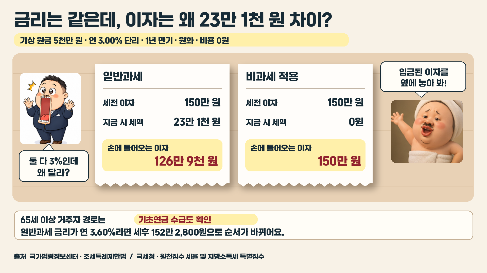

# 65세 넘으면 예금이자 세금이 다 없어질까? 비과세종합저축으로 23만 1천 원이 달라지는 조건

## 1. 지난번처럼 누르면 될 줄 알았다

가상의 천억이는 정기예금이 만기된 날 다시 가입하려고 은행 앱을 연다. 예전에는 창구에서 비과세 여부를 물어봤는데 이번엔 버튼이 보이지 않는다. 수건 친구가 “예금이자가 얼마나 되는지 보기 전에, 이번에도 같은 조건에 들어가는지부터 확인해 보자”고 한다. 천억이는 가입 화면에서 나이와 연금 종류가 따로 적힌 이유가 궁금해진다.

## 2. 나이를 확인한 뒤 연금 종류를 본다

현행 조세특례제한법 제88조의2의 고령자 가입 경로는 **65세 이상인 거주자이며 기초연금 수급자**라는 두 조건을 함께 둔다. 국민연금 노령연금을 받는다는 사실만으로 기초연금 수급 조건이 확인되지는 않는다. 법에는 등록 장애인, 국민기초생활보장 수급자 등 별도 자격도 있다. 65세 기준 경로에서 요건이 맞지 않는다고 다른 법정 경로까지 일괄적으로 판단할 수 없다. 현행 조문의 신규 가입 기한은 2028년 12월 31일이다. [국가법령정보센터 조세특례제한법 제88조의2](https://www.law.go.kr/lsLinkCommonInfo.do?chrClsCd=010202&lsJoLnkSeq=1033071447)

## 3. 5천만 원은 은행마다 새로 주어지는 칸일까?

기본 한도는 사람당 저축원금 5천만 원이다. 시행령은 각 금융회사와 해당 공제회의 비과세종합저축 계약금액을 합산한다. 같은 은행에 계좌를 하나 더 만들거나 다른 은행으로 가도 본인의 적용 한도가 새로 생기지 않는다. 해지하지 않은 종전 세금우대종합저축이 있다면 법에 따라 그 계약금액 차감도 확인한다. 이자가 원금에 들어간 일부 경우의 합산 방식은 원금 계약액과 구분된다. 가입 당시 비과세 적용을 신청하는 요건도 본다. [국가법령정보센터 조세특례제한법 시행령 제82조의2](https://law.go.kr/LSW/lsLinkCommonInfo.do?lspttninfSeq=132658)

## 4. 원금과 약정금리를 같은 값으로 놓았다

원화 5천만 원을 새로 한 번 예치하고 정확히 1년 후 원금과 이자를 받는 두 가상 예금이다. 모두 연 3.00% 단리이며 별도 비용, 중도해지, 재예치, 이자 재투자는 없다. 자격과 한도를 모두 충족해 계약 전체가 비과세 처리되는 경우와, 동일 금리의 일반과세 예금에서 지급 시 이자에 소득세 14%와 그 소득세의 10%인 지방소득세를 합해 15.4%가 원천징수되는 경우를 비교한다. 다른 금융소득과 종합과세 효과는 반영하지 않는다. [국세청 원천징수 세율](https://t.nts.go.kr/nts/cm/cntnts/cntntsView.do?cntntsId=7703&mi=2415) · [국세청 지방소득세 특별징수 안내](https://www.nts.go.kr/nts/cm/cntnts/cntntsView.do?cntntsId=7701&mi=2413)

| 가상 예금 | 세전 이자 | 지급 시 세액 | 손에 들어오는 이자 |
|---|---:|---:|---:|
| 일반과세, 연 3.00% | 150만 원 | 23만 1천 원 | 126만 9천 원 |
| 비과세 적용, 연 3.00% | 150만 원 | 0원 | 150만 원 |

차이는 23만 1천 원이다. 가계부에 추가할 금액은 원금 5천만 원 전체가 아니라 받은 이자 차이다. 일시 지급을 가정했으므로 매달 1만 9,250원씩 통장에 들어오는 구조도 아니다.

*같은 기간과 금리에서 과세만 바꾼 원화 사례다. 일반과세 연 3.60%에서는 세후 이자 순서가 바뀐다.*

## 5. 일반과세 상품 금리가 더 높으면 역전될까?

같은 기간·원금에서 일반과세 금리가 3.50%라면 세전 이자 175만 원 중 148만 500원이 남는다. 가상 비과세 3.00%에서 받는 150만 원보다 1만 9,500원 적다. 일반과세 금리가 3.60%라면 세후 이자는 152만 2,800원으로 순서가 바뀐다. 동점이 되는 일반과세 금리는 3.00%를 0.846으로 나눈 약 3.5461%다. 실제 약관의 이자 산정 방식과 비용이 같다는 가정에서만 쓸 수 있는 기준이다.

## 6. 한도가 이미 사용됐다면 절감액도 줄어든다

다른 은행 계약에 한도 4천만 원을 썼다고 가정한다. 종전 세금우대 계좌가 없고 1천만 원에만 비과세를 적용할 수 있으며 나머지 4천만 원은 별도 일반과세 계약이라면, 같은 연 3.00%에서 비과세로 아끼는 이자세는 4만 6,200원이다. 한도를 한 번도 쓰지 않은 가상의 23만 1천 원을 그대로 가져오면 실제 계획보다 18만 4,800원이 크게 잡힌다.

## 7. 가입 기한과 내 예금 만기는 서로 다른 날짜다

가입할 수 있는 법의 기한과 끝난 예금에서 이자가 붙는 계약 기간을 구분한다. 시행령은 해당 비과세종합저축의 계약 만료 이후에 발생하는 이자·배당에 특례를 적용하지 않는다고 규정한다. 만기 뒤 찾아가지 않은 돈의 이자나 자동연장·재가입을 검토한다면 적용 기간, 자격과 남은 한도를 금융회사에서 다시 확인한다. 이전 계약의 요건과 현행 신규 가입 요건을 같은 줄에 넣지 않는다. [국가법령정보센터 조세특례제한법 시행령 제82조의2](https://law.go.kr/LSW/lsLinkCommonInfo.do?lspttninfSeq=132658)

## 8. 이자율 옆에 실제 이자 원화를 쓴다

천억이가 은행에 묻는다. “제가 지금 새로 적용받을 수 있는 한도가 얼마고, 이 상품 약정대로 끝까지 보유하면 통장에 이자가 몇 원 들어오나요?” 오늘 할 행동은 같은 원금·만기에서 두 상품의 **지급 때 받을 이자 원화**를 한 줄씩 적는 것이다. 창구나 앱의 금리 숫자가 달라도 계산 조건부터 맞추면 절약되는 돈을 비교할 수 있다.

## 편집부 Q&A

**가족이 65세니까 내 예금도 그 한도로 계산하나요?** 사람당 가입 자격과 한도를 보는 제도다. 예금 명의와 계약자의 자격부터 확인한다.

**비과세라고 표시돼 있으면 예금자보호도 되나요?** 과세 방식과 보호대상 여부는 각각 확인한다. 금융회사와 상품설명서의 보호 표시를 별도로 확인한다. [관련 글 · 퇴직금 예금보호 범위](EP137.md)
