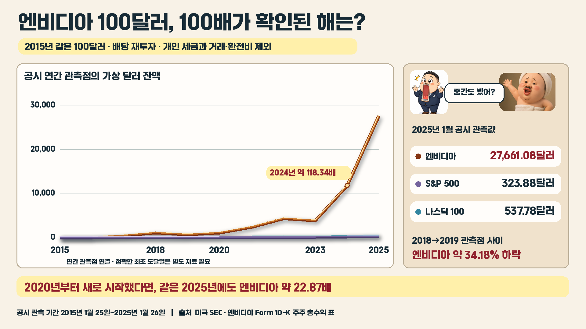

# 엔비디아에 넣은 100달러는 언제 100배를 넘었을까? S&P 500과 같은 날 비교

## 1. 결과표를 보던 손이 달력에서 멈췄다

가상의 천억이는 오래된 증권 명세서를 정리하다가 ‘엔비디아에 100달러를 넣었다면’이라는 문장을 적는다. 만약 그때 사 뒀다면 지금 얼마나 됐을지 먼저 궁금하다. 수건 친구는 계산기 대신 달력을 내민다. “네가 돈이 필요했던 해에도 그만큼 있었는지 볼까?” 두 사람은 가장 큰 숫자를 먼저 읽은 뒤, 그 숫자까지 가는 데 필요한 시간을 확인한다.

## 2. 회사가 공개한 두 표는 가운데 날짜가 같다

미국 SEC에 제출한 엔비디아 공시에는 자사 주식, S&P 500, 나스닥 100을 같은 출발금으로 비교한 주주 총수익 표가 있다. 한 표는 2015년 1월 25일부터 2020년 1월 26일까지, 다음 표는 2020년 1월 26일부터 2025년 1월 26일까지다. 공시의 기준일은 회계연도 관측일이므로 해당 날짜에 실제 주문이 체결됐다는 뜻은 아니다. 출발 금액은 100달러, 통화는 달러, 분배된 배당은 재투자한다고 가정한 비교다. [미국 SEC 엔비디아 Form 10-K 주주 총수익 표](https://www.sec.gov/Archives/edgar/data/1045810/000104581020000010/nvda-2020x10k.htm) · [미국 SEC 엔비디아 Form 10-K 후속 주주 총수익 표](https://www.sec.gov/Archives/edgar/data/1045810/000104581025000023/nvda-20250126.htm)

## 3. 같은 돈을 10년 동안 두었다고 가정했다

2015년 시작액 100달러를 2020년 표의 종료액으로 바꾼 뒤, 2025년 표의 종료값을 100으로 나눈 배율을 곱한다. 엔비디아라면 1,209.46달러에 22.8706을 곱한다. 아래 값은 공시에 표시된 단위에서 연결한 가상 잔액이며, 원자료 수치 자체가 반올림되어 있다. 개인 세금, 거래 수수료, 환전 비용은 제외한다. 비교지수에는 실제 매수 수단의 비용이나 추적 차이가 적용되지 않는다.

| 비교 대상 | 2015년 기준 100달러의 2025년 가상 잔액 |
|---|---:|
| 엔비디아 | 27,661.08달러 |
| S&P 500 총수익 비교값 | 323.88달러 |
| 나스닥 100 총수익 비교값 | 537.78달러 |

2015년의 원금 대비 각 잔액은 약 276.61배, 3.24배, 5.38배다. 엔비디아와 S&P 500의 종료 잔액 차이는 반올림 전 숫자를 빼서 약 27,337.20달러다. 엔비디아가 큰 성과를 냈다는 사실을 확인하는 표이며, 모든 투자자가 그때 선택할 수 있었던 종목의 수익률을 보여 주는 자료는 아니다.

## 4. 100배 문턱은 언제 확인되나

공시의 연간 관측점에서 엔비디아 잔액은 2023년 1월 29일에 원금의 약 39.47배, 2024년 1월 28일에 약 118.34배였다. 공시가 제공한 연간 관측점 중 100배 이상을 처음 볼 수 있는 건 2024년 자료다. 매일의 관측치가 없으므로 최초 100배 터치 날짜를 특정하지 않는다. 2024년보다 앞서 연중 한때 100배를 넘었다가 내려온 적이 있는지도 이 표만으로 판정하지 않는다. 확인할 수 있는 건 이 두 회계연도 관측점의 값이다.

*SEC 공시의 연간 관측점 비교다. 연중 정확한 최초 100배 도달일은 이 표로 알 수 없다.*

친구는 같은 자료에서 두 배와 세 배가 처음 보이는 관측점도 옮겨 적는다. 표본은 해마다 한 번씩만 있다. 엔비디아가 2016년 1월에 1.41배였다가 다음 관측점에 5.40배였다는 이유로, 그 사이의 두 배와 세 배가 같은 날이었다고 해석할 수는 없다. 아래는 **공시 표에서 조건을 충족한 첫 관측 연도**다.

| 2015년 100달러 기준 | 2배 이상 | 3배 이상 | 100배 이상 |
|---|---|---|---|
| 엔비디아 | 2017년 5.40배 | 2017년 5.40배 | 2024년 118.34배 |
| S&P 500 | 2022년 2.25배 | 2025년 3.24배 | 이 표에는 없음 |
| 나스닥 100 | 2020년 2.17배 | 2021년 3.09배 | 이 표에는 없음 |

천억이는 첫 번째 달력의 빈칸에 “정확한 날은 모름”이라고 적는다. 두 번째 달력에는 “세 배를 넘긴 뒤 다시 내려갈 수 있음”이라고 적는다. 실제로 나스닥 100은 2021년 관측점에서 약 3.09배였고 2023년에는 약 2.96배가 됐다. ‘한 번 넘었다’와 ‘내가 팔 때도 넘고 있었다’라는 질문이 여기서 갈라진다. 이 두 가지를 구분해야 은퇴 생활비를 꺼낼 날에 해당하는 데이터를 고를 수 있다.

## 5. 시작을 2020년으로 옮기면

같은 100달러를 2020년 1월 26일에 처음 넣어 2025년 1월 26일까지 기다렸다면 공시의 잔액은 엔비디아 2,287.06달러, S&P 500 200.32달러, 나스닥 100 248.12달러다. 2015년 사례에서 본 100배를 이 기간에 그대로 적용할 수 없다. 시장 전체 지수의 2배 도달도 2015년부터 보느냐, 2020년부터 보느냐에 따라 달라진다. 출발일을 먼저 고르면 같은 금액으로도 어떤 경로를 실제로 겪게 되는지 읽을 수 있다.

한국에서 생활비를 쓰는 천억이는 이 표를 원화로도 읽어 본다. 공시 기준일은 두 해 모두 일요일이라 연준의 직전 이용 가능 관측일을 쓴다. 2015년 1월 23일은 달러당 1,075.75원, 2025년 1월 24일은 달러당 1,429.17원이다. 이 환율은 뉴욕 정오의 연준 공개 계열이며 증권사에서 실제 환전할 때 받은 가격은 아니다. 아래 계산은 공시 샘플에 두 관측치를 붙인 가상 환산이다. [미 연준 H.10 · FRED 원·달러 현물환율](https://fred.stlouisfed.org/series/DEXKOUS)

100달러의 원화 출발값은 107,575원이다. 같은 달러 잔액에 마지막 환율을 곱하고 원 단위에서 반올림하면 엔비디아는 약 39,532,380원, S&P 500은 약 462,876원, 나스닥 100은 약 768,572원이다. 달러에서 원화로 환산해 생긴 차이도 원화 결과에 들어 있다. 원화 배율은 차례로 약 367.49배, 4.30배, 7.14배다. 같은 끝 환율을 세 대상 모두에 곱했으므로 세 대상의 상대 순서는 유지된다. 시작 환율보다 종료 환율이 낮아지는 다른 구간에서는 달러값이 올라가도 원화 수익이 그만큼 커지지 않을 수 있다.

친구가 다시 묻는다. “그럼 한화로 삼천구백만 원이 찍혔을 때 그 전부를 다음 달에 쓸 수 있어?” 환산표의 값과 실제 정산은 별도로 보는 것이 좋다. 실제 원화를 받으려면 주식 매도가 이뤄진 가격과 거래 비용, 환전 적용 가격, 각종 세금을 확인해야 한다. 같은 달러 잔액이라는 한 줄을 놓고 계산하더라도 계좌가 어떤 통화를 결제하는지, 원화로 바꾸는 날이 언제인지에 따라 생활비 통장에 들어가는 숫자가 달라진다. 천억이는 이번 표의 환율 관측일과 자신의 증권사 거래 내역에서 찾을 환전 날짜를 따로 적는다.

공시의 2022년 1월 30일 관측점에 100달러를 새로 넣은 사람도 생각해 보자. 이번 분모는 100이 아니라 그날 공시 표에 있던 각 자산의 값이다. 엔비디아의 다음 해 관측값 326.34를 시작값 365.66으로 나누고 100달러를 곱하면 89.25달러다. 같은 방식으로 S&P 500은 93.37달러, 나스닥 100은 84.90달러다. 세 대상 모두 첫 관측 구간부터 시작 원금보다 줄었다. 당시 통장에 쓰고 싶은 95달러가 들어 있는지 확인한다면 이 세 결과가 모두 부족하다는 결론이 나온다.

아무것도 꺼내지 않고 같은 2025년 마감까지 남겨 두었다고 가정하면 각 잔액은 약 625.46달러, 144.22달러, 154.48달러다. 처음 재구성한 10년 결과와 같은 종료일이지만 실제로 겪은 기간은 다르다. 더 늦게 시작한 것만으로 모든 기간의 숫자가 일괄적으로 좋아지거나 나빠지는 규칙은 없다. 처음 공개된 표를 보던 천억이는 한 사람이 세 가지 투자 중 하나를 고르는 실험과, 다른 해에 들어간 사람의 자산을 비교하는 실험이 섞였다는 점을 이제 알아차린다. 처음에는 어느 숫자를 뺄지가 궁금했지만, 이제 어떤 날짜가 분모가 되어야 하는지부터 확인한다.

공시를 읽는 장면을 한 번 더 되짚는다. 우선 2020년 1월의 수치가 어느 표에서 마지막 칸이고 어느 표에서 첫 칸인지 찾는다. 두 회사 이름이 같은지 확인한 다음, 같은 기준일이어도 한 표에선 1,209.46이고 다른 표에선 100으로 시작한다는 데 표시한다. 첫 표의 수익을 취소해서 숫자를 100으로 줄였다는 의미가 아니다. 다음 5년의 출발 기준을 새로 맞춘 표다. 두 표의 절대 수치를 더하면 안 되고 두 번째 표의 성장 배율만 첫 번째 표의 잔액에 적용해 이어 붙인다.

연간 관측점이 없는 날짜를 다루는 법도 여기에서 알 수 있다. 그래프에서 두 점을 이은 선이 가파르더라도 중간에 똑같은 속도로 올랐는지는 보여 주지 않는다. 아주 낮은 가격이 하루 있었는지, 연중 최고치가 언제였는지, 정확히 백 배에 팔 수 있었는지를 묻고 싶으면 그 질문에 맞는 일별 총수익 자료와 거래일 확인이 필요하다. 가족에게 이 표를 보여 줄 때도 ‘공시가 관측한 날’이라는 말을 숫자 옆에 남겨 둔다. 줄 하나를 더 적으면 역사를 자기가 원하는 날짜에 맞춰 읽을 여지를 줄일 수 있다.

## 6. 10년을 기다리기 어려웠던 장면

2018년 초 회계연도 관측점에서 엔비디아의 100달러 총수익 잔액은 1,174.93달러였다. 2019년 초 다음 관측점에는 773.30달러로 내려갔다. 두 관측점 사이 비교로 약 34.18% 하락이다. 일별 최대낙폭은 따로 계산해야 한다. 가상 지출 900달러를 두 번째 시점에 치러야 했다면, 그때 이 계좌의 잔액만 꺼내는 조건에서 126.70달러가 모자랐다. 같은 사람이라도 쓸 날짜와 버틸 수 있는 손실에 따라 맞는 선택을 다르게 볼 수 있다.

2019년 관측점의 잔액 773.30달러를 직전 1,174.93달러 수준으로 회복하려면 약 51.94%가 올라야 한다. 하락 전 금액과 하락 뒤 금액이 각각 퍼센트 계산의 출발점이기 때문이다. 같은 열한 개 연간 관측점에서 앞선 표본 최고치 대비 하락의 최댓값을 계산하면 엔비디아 약 34.18%, S&P 500 약 6.63%, 나스닥 100 약 15.10%다. 해마다 한 번 찍은 점만 사용한 값이므로 세 대상의 일별 최대낙폭을 뜻하지 않는다. 천억이는 화면의 상승 곡선이 매일 눈앞에 펼쳐졌다고 생각했는데, 실제로 들고 있던 사람에게는 표 밖의 날들이 있었다.

분배금을 재투자하는 가정도 바꿔 본다. 해외 생활비 명목으로 분배가 들어올 때마다 바로 써 버리는 사람이 있다면 이 표와 현금흐름이 달라진다. 중간에 판 주식이 있으면 다음 구간의 상승을 적용할 돈도 달라진다. 표의 단순 연결은 처음 넣은 돈과 재투자된 돈이 다음 관측점까지 남아 있다는 가정이다. ‘옆에 있는 계좌로 조금 꺼내 썼다’는 작은 문장 하나가 그 뒤의 잔액을 바꾼다.

이번에는 두 사람이 실제로 돈을 꺼내는 순간을 비교한다. 두 사람 모두 2015년에 엔비디아에 가상의 100달러를 넣었다. 각자 보유하던 주식에서 300달러를 현금화해 그날 지출했고, 남은 돈은 2025년 관측점까지 그대로 뒀다고 하자. 한 사람은 2018년 초 공시 관측점의 잔액 1,174.93달러에서 300달러를 뺐다. 다른 사람은 2019년의 773.30달러에서 같은 금액을 뺐다. 세금·거래비용은 없고, 남은 계좌는 공시 총수익과 동일한 비율로 움직인다고 가정한다.

먼저 꺼냈던 장부에는 2025년에 약 20,598.25달러가 남는다. 하락 뒤에 꺼냈던 장부에는 약 16,930.02달러가 남는다. 이제 두 출금액 300달러는 같아도 그만큼을 현금화하려고 내보낸 지분의 비율은 다르게 읽힌다. 첫 번째 이체는 당시 금액의 약 25.53%, 두 번째는 약 38.80%를 꺼낸 셈이다. 나중에 반등을 겪는 몫이 달라져 마지막 차이가 생긴다. 이 예는 나중의 반등을 이미 알고 두 날짜를 고른 가상 비교다. 처음부터 더 좋은 현금화 날짜를 알아낼 수 있다는 뜻으로 해석하지 않는다.

생활비가 일정하지 않은 가정이라면 위 실험을 그대로 옮길 수 없다. 지출을 미룰 수 있는지부터 서로 다르기 때문이다. 예를 들어 병원비처럼 납부일을 미루기 어려운 돈은 한 달 뒤 주가가 오를 것이라는 예상으로 채우기 힘들다. 반대로 쓸 시점을 본인이 정할 수 있는 지출은 남은 투자금과 현금 잔고를 보고 달력을 조정하는 선택이 가능하다. 어느 쪽에 해당하는지는 수익률 계산기보다 자기 고지서가 먼저 알려 준다.

수건 친구가 전체 잔액과 생활비로 꺼냈던 돈을 한 장에 써 보라고 한다. 300달러를 이미 써버렸으므로 2025년 계좌에 되돌려 적을 수는 없다. 다만 실험에서 누린 생활비까지 기록할 때에는 언제 300달러를 받았는지 따로 남긴다. 중간 인출이 있는 두 계좌를 비교할 때 최종 잔액만 하나를 떼어 보면 같은 돈을 써 왔는지 알 수 없다. 이 글의 비교는 중간 300달러의 시점만 바꿨기 때문에 그 차이를 확인하기 쉽다.

## 7. 나중에 안 종목을 과거에 고르는 실험의 한계

이 자료에서 엔비디아를 뒤늦게 고른 사람은 이미 회사가 큰 폭으로 성장했다는 결과를 알고 있다. 그 당시 후보로 놓을 수 있었던 종목에는 중간에 부진하거나 사라진 회사도 있었다. 그런 표본까지 함께 보지 않고 100배 사례 한 건으로 선택 방법의 성공률을 구할 수는 없다. 비교에 쓰인 두 지수에도 엔비디아가 들어 있다. 한 종목이 들고 있는 위험과 여러 종목을 섞은 바구니가 들고 있는 위험을 비교할 때, 같은 기업의 노출이 일부 겹친다는 점도 함께 확인한다. [미국 SEC 엔비디아 Form 10-K 후속 주주 총수익 표](https://www.sec.gov/Archives/edgar/data/1045810/000104581025000023/nvda-20250126.htm)

수건 친구가 계산기에서 마지막으로 누르는 것은 목표 연율이다. 매년 똑같은 복리율을 열 번 곱해 100배가 되려면 연 약 58.49%라는 값이 필요하다. 이것은 필요한 수학적 비율이다. 특정 종목이 그 비율을 내 줄 확률을 알아내는 계산은 아니다. 공시의 엔비디아 10년 합성 잔액을 같은 방식으로 거꾸로 구하면 연 약 75.46%다. 하지만 현실의 경로는 한 해 정해진 이자를 받는 통장처럼 움직이지 않았다. 앞서 본 2018년에서 2019년 구간의 하락이 당시에도 실제로 기다릴 수 있었는지 살펴보게 한다.

친구가 투자 봉투를 두 개 놓는다. 투자 당시 엔비디아에 5달러, S&P 500 총수익을 그대로 따른다고 놓은 가상 바구니에 95달러를 넣고 비중을 되돌리지 않았다고 가정하자. 시작일과 종료일, 세금과 비용은 앞선 10년 비교와 같다. 2025년 관측점에는 두 금액을 합해 약 1,690.74달러가 된다. 원금 중 5%였던 엔비디아 투자분이 마지막 평가액에서는 약 81.80%까지 커졌다. 이 비율은 별도 종목으로 산 부분만 계산한 값이다. 지수 바구니 안의 엔비디아 간접 보유분은 더하지 않았다.

2018년부터 2019년 관측점으로 옮겨 보면 이 가상의 배분은 약 193.22달러에서 167.43달러로 줄었다. 같은 시점의 엔비디아 단일 계좌 하락폭과 가상 혼합 계좌의 하락폭이 달라지는 이유는 앞서 오른 것도, 같은 기간 흔들린 범위도 다르기 때문이다. 반대로 마지막 2025년 표를 보면 상승한 종목의 비중이 아주 커진다. 시작하는 날 정한 5% 비중을 10년 동안 계속 보유한다는 말과, 자산을 팔지 않아 평가 비중이 저절로 바뀐다는 말은 다른 계획이다. 친구는 표 옆에 ‘처음 나눈 비율’과 ‘오늘 장부에서 차지하는 비율’을 따로 그어 놓는다.

만약 첫날에 둘을 절반씩 샀다면 종료 잔액은 약 13,992.48달러다. 이 경우 엔비디아 직접 보유분이 차지하는 비중은 약 98.84%다. 두 가상 계좌의 성과가 달라진 것은 시작 비중이 달랐기 때문이다. 처음부터 절반을 투자할 수 있었는지, 급락을 읽고도 감당할 수 있었는지, 실제로 비중을 중간에 다시 조정했는지는 같은 비교의 다른 장부로 남는다. 실제 상품의 거래비용과 과세 없이 만든 이 값은 분산 포트폴리오의 미래 성과를 보장하는 기준이 아니다.

수건 친구는 왜 나스닥 100을 들고 있던 사람도 이 주식에 노출됐을 수 있는지 확인한다. 공시는 엔비디아가 두 비교지수에 포함된다고 밝힌다. 따라서 지수 바구니를 보유한 상태에서 개별 주식을 더 담으면 같은 기업 몫이 두 곳에 생길 수 있다. 어느 시점에 얼마나 들고 있었는지 알려면 당시 지수 구성 비중과 투자자가 보유한 ETF의 당시 자산 목록이 필요하다. 여기서 계산한 81.80%에 오늘의 지수 구성 비중을 끼워 넣어 과거의 보유량처럼 쓰지 않는다.

두 사람이 같은 출발 비중을 끝까지 유지하려 했다면 장부가 또 달라진다. 매년 공시에서 관측한 기준일마다 그 직전 구간의 총수익률을 각각 적용하고, 다음 구간이 시작되기 전에 엔비디아에 5%, S&P 500 총수익을 가상으로 구현한 바구니에 95%가 되도록 다시 맞춘다. 원금은 2015년 100달러다. 추가 입출금, 거래비용, 매도 시 세금은 모두 0원이라고 두고 배당은 공시 가정에 따라 재투자한다. 2020년은 두 공시의 접점이므로 같은 날짜에 수익률을 두 번 적용하지 않는다. 각 구간의 두 성장 배율에 비중을 각각 곱해 더하고 지난 잔액에 적용한다.

이 가상 재조정은 2025년까지 453.92달러를 남긴다. 반면 시작 비중만 5%로 나누고 이후 건드리지 않은 경우에는 약 1,690.74달러였다. 상승한 종목을 일정 비율로 되돌릴 때 그 뒤 상승을 겪는 돈도 줄어들었다. 처음부터 직접 보유 절반과 지수 절반으로 해마다 맞춘 가상 장부에서도 최종 4,706.84달러로, 아무 조정 없이 13,992.48달러가 된 경우와 차이가 난다. 모두 같은 과거 경로에서의 결과다. 이 자료만으로는 어느 방식이 다른 종목과 다른 시기에도 앞설지 정할 수 없다.

수건 친구는 특히 조정이 필요한 날을 묻는다. 정비할 날짜는 기록에 있지만 같은 날짜에 실제로 거래할 수 있었는지는 별개다. 공시 관측일이 주말인 경우 시장이 여는 날짜와 가격을 별도로 확인해야 하고 거래를 실제로 했다면 비용과 세금도 붙을 수 있다. 그래서 위의 계산은 구간 끝 지수값을 그대로 써서 움직이는 장부다. 현금으로 나온 이익과 아직 계좌 안에 있는 평가액, 매도 후 손에 들어오는 원화는 따로 놓는다.

지수에 포함된 엔비디아의 몫까지 반영하려면 그때마다 실제 지수 구성과 상품 비중이 얼마나 달랐는지를 더 확인해야 한다. 여기서 매년 5%를 다시 맞췄다는 말은 직접 산 엔비디아의 몫을 다섯으로 맞췄다는 뜻이다. 다섯이라는 숫자만 보고 나머지 아흔다섯 안에는 같은 기업이 없다고 놓을 수 없다. 투자 전에 본인이 감당할 한도를 적을 때는 직접, 간접으로 얼마나 들고 있는지 각각 읽을 곳을 정해 둔다.

## 8. 수익률 옆에 지출 날짜를 먼저 적는다

천억이는 다시 계산하기 전에 생활비로 투자금 일부를 쓸 날짜를 적는다. 오늘 할 일은 공시의 **Stock Performance Graphs**에서 시작일과 중간 관측점을 각각 한 번 읽는 것이다. 100배를 처음 확인할 수 있는 관측점과 내가 자금을 꺼내야 했던 시점을 따로 표시한다. 수건 친구는 두 표시 사이에 공백이 큰 경우, 저축에서 쓸 돈과 변동을 감수할 돈을 같은 경험으로 계산하지 않는다.

투자계좌에 생활비를 같이 넣은 사람과 현금을 따로 둔 사람을 비교하려면 시작자산을 서로 맞춰야 한다. 가상의 두 사람이 2015년에 각각 400달러를 가지고 있었다고 하자. 한 사람은 100달러만 엔비디아에 넣고 나머지 300달러는 이자 없는 현금으로 남겼다. 다른 사람은 400달러를 전부 엔비디아에 투자했다. 둘 다 2019년 관측점에 300달러를 생활비로 지출했다. 처음 사람은 현금에서 꺼냈고, 두 번째 사람은 주식 일부를 팔아 냈다. 배당 재투자와 세금·비용 제외 가정은 앞서와 같다.

현금을 따로 보관했던 사람의 2025년 계좌에는 약 27,661.08달러가 남는다. 전액 투자했던 사람은 2019년 당시 3,093.20달러에서 300달러를 냈고, 그 뒤 공시와 같은 비율로 움직인 가상 잔액은 약 99,913.25달러다. 이 경로에서는 더 많이 투자했던 사람이 마지막에 더 많이 남겼다. 다른 사람은 예정한 지출일에 주가를 확인하거나 주식을 팔 필요가 없었다. 어느 부분이 자기 계획에 중요한지에 따라 같은 비교에서 보는 칸이 달라진다.

가상의 지출이 300달러가 아닌 3,200달러였다면, 전액 투자 계좌도 2019년에 106.80달러가 모자랐을 것이다. 300달러를 따로 남긴 쪽도 그 큰 지출을 충당하지 못한다. 그날 현금과 주식을 합쳐 1,073.30달러였기 때문이다. 둘 다 실제 시작자산으로는 감당하기 어려운 청구서였다. 나중에 어느 쪽 잔액이 컸는지와 그때 어느 쪽이 예정된 지출을 낼 수 있었는지는 별개의 질문이다.

## 편집부 Q&A

**주식분할로 주식 수가 10배면 그것만으로 총수익도 10배인가요?** 분할 전후의 동일한 지분 경제가치를 비교할 때는 늘어난 주식 수와 주당 가격을 함께 봐야 한다. 여기서는 주식 수를 따로 곱하지 않고 공시 총수익을 사용했다.

**2024년에 샀어도 원금 대비 100배라는 뜻인가요?** 100배는 2015년 출발액이 분모다. 매수 시점이 새로 정해지면 같은 자료라도 그날의 잔액으로 다시 나눠 수익률을 계산한다.
