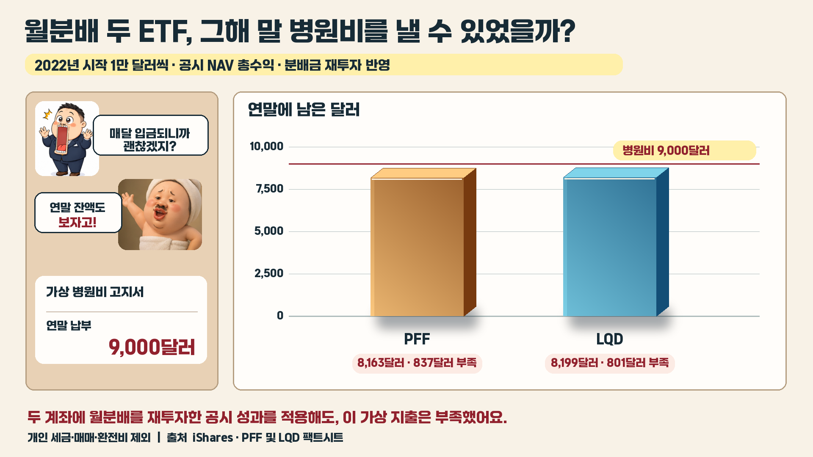

# 둘 다 월분배인데 1만 달러는 다르게 남았다. 우선주 ETF PFF vs 회사채 ETF LQD

## 1. 매달 입금 알림만 보고 있었다

가상의 천억이는 퇴직 뒤 1만 달러를 어떻게 둘지 고민하며 두 ETF의 운용사 자료를 펼친다. 두 상품 모두 월분배라고 적혀 있다. 수건 친구가 입금 알림 하나와 계좌 잔액을 나란히 보여 준다. “한 달에 한 번 들어온다는 건 알겠는데, 네가 원금을 꺼내야 했던 해에는 얼마가 있었어?” 천억이는 분배 주기로 표시한 달력에 연말 잔액을 적기 시작한다.

## 2. 지급 달력은 같아도 들고 있는 증권이 다르다

PFF는 미국 달러 표시 우선주와 혼합증권에 노출되는 ETF다. 운용사는 우선주와 후순위채 등으로 소득 노출을 얻는 상품으로 설명한다. LQD는 미국 달러로 표시된 투자등급 회사채 지수를 추종한다. 두 공식 팩트시트에는 월분배라고 적혀 있지만, 분배일이 있다는 점은 분배액이나 시장 가격의 안정성을 뜻하지 않는다. 우선주나 후순위 증권은 발행사별 계약이 다르고, 회사채 가격에도 시장금리와 신용 여건이 영향을 준다. [iShares PFF 팩트시트](https://www.ishares.com/us/literature/fact-sheet/pff-ishares-preferred-and-income-securities-etf-fund-fact-sheet-en-us.pdf) · [iShares LQD 팩트시트](https://www.ishares.com/us/literature/fact-sheet/lqd-ishares-iboxx-investment-grade-corporate-bond-etf-fund-fact-sheet-en-us.pdf)

또 공시의 통화와 담고 있는 자산을 섞지 말아야 한다. LQD 팩트시트의 2026년 6월 말 유효 듀레이션은 7.92년이었다. 금리 변화에 따라 채권 가격이 얼마나 민감하게 반응할지 보는 지표다. 단순히 다른 조건이 일정한 상태에서 수익률이 1%포인트 오르는 작은 변화로 가정하면 가격 변화의 1차 근삿값은 약 −7.92%다. 실제 펀드 총수익에는 이자, 신용 스프레드, 곡률, 기간 중 보유채권 변화가 영향을 미친다. 그 한 시점의 숫자를 표의 2022년 손실을 설명하는 당시 듀레이션으로 가져다 쓰지 않는다. [iShares LQD 팩트시트](https://www.ishares.com/us/literature/fact-sheet/lqd-ishares-iboxx-investment-grade-corporate-bond-etf-fund-fact-sheet-en-us.pdf)

PFF는 2026년 9월 말 팩트시트에서 금융기관 비중 55.76%를 보고했다. 당시 기준의 편입 집중도를 보는 자료이며 과거 모든 해에 같았다고 볼 수 없다. 우선주 노출을 찾는 사람이라도 어떤 업종의 영향을 많이 받는지 상품 이름보다 자산구성 표에서 확인할 수 있다. [iShares PFF 팩트시트](https://www.ishares.com/us/literature/fact-sheet/pff-ishares-preferred-and-income-securities-etf-fund-fact-sheet-en-us.pdf)

## 3. 비교는 같은 1만 달러에서 시작했다

직전 연말을 출발점으로 각각 1만 달러를 일시 투자한 가상계좌다. 달러 기준 공시 NAV 총수익률을 적용하고 개인 매매·환전 비용과 세금은 제외한다. 공시 성과에는 펀드 내부 비용 차감과 분배금 등 재투자가 반영된다. 그달 받은 돈을 모두 생활비로 써 버린 계좌의 잔액을 보여 주는 표에는 별도의 가격·분배금 자료가 필요하다.

| 달력연도 | PFF NAV 총수익률 | LQD NAV 총수익률 |
|---|---:|---:|
| 2021 | +7.09% | −1.57% |
| 2022 | −18.37% | −18.01% |
| 2023 | +9.32% | +9.27% |
| 2024 | +7.87% | +0.99% |
| 2025 | +4.70% | +8.00% |

## 4. 5년 뒤 잔액과 마지막 한 해는 다른 답이 나왔다

2021년 시작부터 2025년 말까지 각 연도의 성장 배율을 곱하면 PFF 10,793.09달러, LQD 9,618.15달러다. 5년 누적으로 PFF는 약 7.93% 늘고 LQD는 약 3.82% 줄었다. 반면 2025년 한 해만 보면 PFF 10,470달러, LQD 10,800달러로 LQD에 330달러 더 남는다. 5년 우위에서 마지막 한 해의 결과를 추정할 수 없다. 공시된 연 수익률 자체가 반올림되어 있는 정밀도도 함께 기록한다.

## 5. 2022년에 생활비가 필요했다면

2022년 시작에 1만 달러를 넣고 연말에 9,000달러가 필요했다고 하자. 위 조건의 가상 잔액은 PFF 8,163달러, LQD 8,199달러다. LQD에 36달러 더 있지만 두 계좌 모두 고지서를 감당하기엔 부족했다. 각각 837달러, 801달러가 모자란다. 두 상품이 그해에 월분배 형식을 썼더라도, 재투자까지 포함한 공시 달러 총수익은 두 자릿수 마이너스였다. 어떤 지출을 예정대로 하려면 매달 받을 수 있는 금액과 자산 가격이 변할 때 꺼낼 수 있는 잔액을 각기 확인한다.

*각각 1만 달러를 넣고 2022년 달러 NAV 총수익을 적용한 가상 잔액이다.*

## 6. 기간을 잘라 보니 원금 회복 여부가 바뀌었다

2022년 초부터 2025년 말까지라면 PFF 약 10,078.52달러, LQD 약 9,771.56달러다. 같은 끝날을 두고 2023년 초부터 출발하면 각각 12,346.59달러와 11,917.99달러다. 둘 다 원금보다 많아지는 이유는 앞선 큰 하락 구간을 지나고 나서 시작했기 때문이다. 이 표를 보고 하락을 미리 피할 수 있었다고 추론할 수 없다. 다음에 생길 급락의 날짜와 2022년에 실제 있었던 하락을 구분한다.

수건 친구와 2021년부터 5년을 보유한 장부의 중간도 펼친다. PFF는 처음 원금 1만 달러가 2021년 말 10,709달러가 됐다가 2022년 말 약 8,741.76달러가 됐다. LQD는 처음 원금보다 내렸던 2021년의 경로가 이어지며 2022년 말 약 8,070.28달러였다. 그래서 시작 원금과 이전 연말까지 포함한 최고치에서 2022년 말 잔액까지 비교하면 PFF가 약 18.37%, LQD가 약 19.30% 내려갔다. 관측점은 연말뿐이라 연중에 더 깊게 내렸는지는 알 수 없다. 하락폭으로 투자자의 최대 체감 손실을 이야기하려면 일별 자료가 필요하다.

같은 장부를 두고 질문도 바꿔 본다. 2022년 시작에 들어간 사람에게 PFF와 LQD의 연말 차이는 36달러였다. 그러나 2021년부터 들고 있었다면 그때 PFF 잔액이 약 671.48달러 더 컸다. 해당 한 해 수익률과 시작부터 합성된 잔액의 비교가 다른 예다. 종목을 골라 붙이는 표에는 시작한 날과 종료일을 함께 적어야 한다.

## 7. 입금액이 크면 계좌도 늘어났을까?

가상 ETF에 1만 달러를 넣고 1년 중 받은 분배금 500달러를 재투자하지 않고 생활비로 사용했다고 하자. 연말 ETF 매도 평가액이 8,900달러라면 계좌에 남은 돈은 8,900달러다. 받은 분배금까지 경제적 결과에 한 번 더하면 9,400달러로, 세금·비용을 빼기 전 원금 대비 600달러가 작다. 분배금이 같은 다른 가상 ETF에서 평가액이 10,100달러면 합계는 10,600달러로 순이익이다. 이 예는 실제 PFF·LQD 지급액을 재현한 숫자가 아니다. 분배율만으로 남은 잔액을 비교하지 않기 위한 장부다.

매매 가격 행을 사용하면 수치가 조금 달라진다. 운용사 공시의 2022년 시장가격 총수익률은 PFF −18.18%, LQD −17.93%다. 같은 1만 달러에 적용하면 가상 잔액은 각각 8,182달러와 8,207달러다. 두 수치는 펀드가 계산하는 시장가격 총수익이며 투자자의 특정 주문이 이 가격으로 체결됐다는 뜻은 아니다. 생활비가 실제로 필요했던 사람은 주문내역의 체결가와 수수료부터 본다. 이 예에서 시장가격 행을 사용해도 9,000달러 지출을 채우지 못한다. 수익률 행을 바꿔 계산하더라도 판단이 바뀌는 경계가 어디인지까지 확인한다. [iShares PFF 팩트시트](https://www.ishares.com/us/literature/fact-sheet/pff-ishares-preferred-and-income-securities-etf-fund-fact-sheet-en-us.pdf) · [iShares LQD 팩트시트](https://www.ishares.com/us/literature/fact-sheet/lqd-ishares-iboxx-investment-grade-corporate-bond-etf-fund-fact-sheet-en-us.pdf)

또 다른 줄에 ‘30일 SEC 수익률’이 있다. 이 글에서 보관한 공식 팩트시트에는 PFF가 2026년 9월 말 6.76%, LQD가 2026년 6월 말 5.24%로 나와 있다. 표준화한 소득 수익률 지표지만 관측 기준일이 다른 두 값을 바로 늘어놓고 상품 자체의 수익 우위를 매기기 어렵다. 6.76%를 열두 달로 나눈 금액이 다음 달에 보장된다는 뜻도 아니다. 현금 지급을 검토할 때는 실제 분배 이력의 주당 금액과 입금 시기, 분배율을 보려면 같은 날짜와 같은 정의의 값을 따로 찾는다. 지금 보려는 숫자가 이미 받은 돈인지, 과거 30일간의 수익력인지, 가격 변화까지 합친 성과인지를 말로 설명할 수 있어야 다음 계산으로 넘어간다. [iShares PFF 팩트시트](https://www.ishares.com/us/literature/fact-sheet/pff-ishares-preferred-and-income-securities-etf-fund-fact-sheet-en-us.pdf) · [iShares LQD 팩트시트](https://www.ishares.com/us/literature/fact-sheet/lqd-ishares-iboxx-investment-grade-corporate-bond-etf-fund-fact-sheet-en-us.pdf)

## 8. 비교할 때 한 화면에서 볼 숫자를 두 개로 정한다

수건 친구는 만기에 쓸 돈이 있는 사람이라면, 최근 몇 차례의 **실제 분배금과 같은 구간의 가격·총수익**을 함께 확인하자고 한다. 오늘 할 일은 운용사 팩트시트에서 월분배 표시 옆에 공시 NAV 연간 성과를 적고, 본인 지출일에 원금을 얼마나 꺼내야 하는지도 표시하는 것이다. 원화 생활비라면 실제 환전 적용 가격과 비용을 반영한다. 천억이는 입금 알림만 모아 두던 화면에 연말 잔액 칸을 하나 더 만든다.

## 편집부 Q&A

**월분배가 같으면 분배율도 같은가요?** 월분배는 주기다. 금액, 기준 가격, 집계 기간이 같아야 두 분배율을 비교할 수 있다.

**투자등급 회사채 ETF는 일정한 날에 내 ETF 원금을 만기상환해 주나요?** 펀드가 보유한 채권의 만기와 내가 ETF 지분을 현금화하는 날은 따로 확인한다. 이 글의 사례는 ETF의 공시 NAV 총수익을 사용했다.
