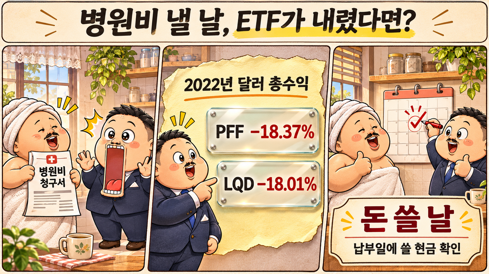

# 은퇴하고 매달 받을 돈, ETF가 18% 빠져도 괜찮을까?

병원비 낼 날은 정해져 있잖아요. 은퇴를 앞둔 천억이의 동료는 ETF에서 들어오는 돈으로 생활비를 보탤 생각이었습니다. 다음 진료비 고지서를 받은 날, 그 돈이 부족하면 ETF를 얼마나 팔아야 할지가 궁금해졌습니다. 천억이는 2022년 성과표에서 두 줄을 보여줬습니다. 우선주·혼합증권 ETF와 투자등급 회사채 ETF가 그해 달러 기준으로 둘 다 약 18% 내렸습니다.

*iShares 기준가 총수익으로 비교한 2022년 달러 기준 성과입니다.*

**편집부가 만든 질문. 어느 쪽이 2022년에 덜 내렸나요?** 회사채 ETF가 0.36%포인트 덜 내렸습니다. 두 값은 달러 기준 연간 기준가 총수익입니다. 병원비를 내는 특정 날짜의 체결가나 일별 최대낙폭을 알려면 그 날짜의 자료가 필요합니다.

## 두 상품에 같은 날 1,000만 원을 넣었다면

**가정.** 2020년 12월 31일에 각 1,000만 원을 배정하고 2025년 12월 31일까지 중간 납입이나 인출 없이 보유합니다. 달러 기준 연간 기준가 총수익은 분배 재투자를 반영합니다. 공시 수익에 반영된 운용비용은 한 번만 반영하고 개인 거래비와 세금, 환전 스프레드는 제외합니다. 고정 연율 대신 실제 관측된 해마다의 수익률을 적용합니다.

| 달러 기준 연간 총수익 | PFF | LQD |
|---|---:|---:|
| 2021 | +7.09% | −1.57% |
| 2022 | −18.37% | −18.01% |
| 2023 | +9.32% | +9.27% |
| 2024 | +7.87% | +0.99% |
| 2025 | +4.70% | +8.00% |
| 5년 달러 누적 | +7.93% | −3.82% |
| 5년 기말 원화 환산 | 약 14,355,042원 | 약 12,792,346원 |

운용사 수치가 반올림돼 기말값도 근사치입니다. 각 해마다 \(1+r\)을 이어 곱한 달러 배수에, 시작 환율 1,086.11원 대비 종료 환율 1,444.55원의 배수를 곱했습니다. 예를 들어 PFF는 1,000만 원 × 1.079308751 × (1,444.55 ÷ 1,086.11)입니다. 환율은 미 연준의 참조 관측값입니다. 5년을 통틀어 PFF가 앞섰지만 2025년 한 해는 LQD가 앞섰습니다. LQD의 기말 원화 평가액이 늘어난 계산에서도 달러 누적 성과는 음수였습니다.

## 이름과 숫자에서 확인할 열 가지

1. **편입 자산**을 확인합니다. PFF는 우선주와 혼합증권을 담으며 후순위 채무도 포함할 수 있습니다.
2. **회사채의 신용 범위**를 봅니다. LQD는 투자등급 회사채에 투자합니다.
3. **청산 때 지급 순서**를 구별합니다. 일반적인 우선주는 보통주보다 앞서고 채권자보다 뒤에 섭니다.
4. **지급 조건**을 봅니다. 편입 우선증권에 따라 지급 유예 또는 발행자의 조기 상환 가능성이 있습니다.
5. **금리 변화**를 봅니다. 금리가 오를 때 기존 고정금리 채권 가격에 하방 압력이 생길 수 있습니다.
6. **신용 스프레드**를 확인합니다. 같은 국채 금리에서도 회사채에 요구하는 추가 수익률이 커지면 가격이 하락할 수 있습니다.
7. **기간**을 맞춥니다. 같은 종료일이어도 1년과 5년은 결과 순서가 달라질 수 있습니다.
8. **표시 통화**를 확인합니다. 달러 총수익과 원화 환산 수익은 다르게 움직일 수 있습니다.
9. **재투자 가정**을 확인합니다. 생활비로 분배금을 쓰는 계좌에서는 공시 총수익과 다른 잔액을 볼 수 있습니다.
10. **기준가와 거래 가격**을 구별합니다. 매도 시 실제 받는 돈은 체결 가격과 개인 비용에 따라 달라집니다.

## 중간에 병원비를 쓰면

**설명용 가정.** 원화 1,000만 원을 넣고 첫 구간에 20% 하락합니다. 그 직후 병원비에 100만 원을 써서 남은 700만 원이 다음 구간에 25% 오르면 투자계좌엔 875만 원이 남습니다. 같은 구간 수익을 겪고 인출하지 않은 계좌는 1,000만 원입니다. 두 구간의 수익률은 연율이 아니며 분배·비용·세금과 추가 납입은 없다고 가정합니다. 실제 상품에서 매도한 사례는 아닙니다. 지출한 병원비 100만 원은 따로 기록합니다.

동료는 고지서의 날짜를 달력에 다시 옮겼습니다. **다음 고정지출 한 건의 납부일, 금액, 그날 쓸 현금 출처를 한 줄에 적어 보세요.**

## 근거 원문

2026년 11월 27일 확인 기준. 수익률 관측기간과 환율 관측일은 위 계산에 표시했습니다.

- [iShares PFF 상품 자료](https://www.ishares.com/us/literature/fact-sheet/pff-ishares-preferred-and-income-securities-etf-fund-fact-sheet-en-us.pdf)
- [iShares LQD 상품 자료](https://www.ishares.com/us/literature/fact-sheet/lqd-ishares-iboxx-investment-grade-corporate-bond-etf-fund-fact-sheet-en-us.pdf)
- [SEC PFF 요약 투자설명서](https://www.sec.gov/Archives/edgar/data/1100663/000119312526327904/d45841d497k.htm)
- [미 연준 원·달러 참조 환율](https://fred.stlouisfed.org/series/DEXKOUS)

[기간에 따라 달라지는 배당 ETF 비교](EP152.md) · [일일 목표와 보유기간의 차이](FAQ04.md)
