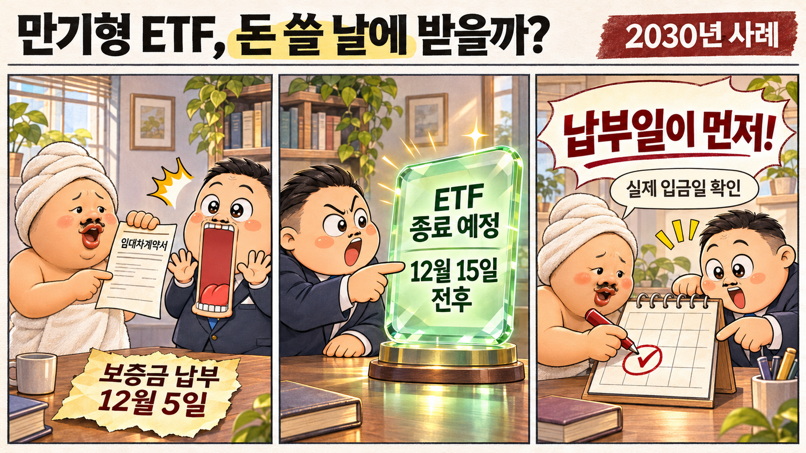

# 2030년에 쓸 은퇴자금, 만기형 ETF에 넣으면 그날 받을까?

“상품 이름에도 2030년이라고 써 있네. 이 돈으로 보증금을 내면 되겠어.” 퇴직을 앞둔 천억이의 동료가 임대인과 합의한 날짜는 2030년 12월 5일이었습니다. 천억이가 공시를 열어 두 번째 날짜를 보여 줬습니다. 미국 만기형 회사채 ETF IBDV의 종료 예정일은 2030년 12월 15일 전후였습니다. 같은 달인데도 납부일이 열흘가량 앞에 있었어요.

*납부일은 가상의 계약 날짜입니다. IBDV 종료 예정일은 SEC 공시 기준입니다.*

**편집부가 만든 질문. 둘 다 2030년 12월이면 보증금 낼 날에 정산금을 받을 수 있나요?** 이 사례에서는 납부일이 공시의 펀드 종료 예정일보다 앞섭니다. 그날 별도 현금이 없으면 다른 자금이 필요하거나, 거래 가능한 시점에 ETF를 팔아야 할 수 있습니다. 조기 매도라면 받을 금액은 그때의 시장 가격에 달려 있습니다.

## 달력에 네 날짜를 적습니다

첫째는 **보증금 납부일**입니다. 합의서에서 날짜와 원화 금액을 확인합니다. 둘째는 **펀드 종료 예정일**입니다. IBDV는 2030년 12월 15일 전후입니다. 셋째는 **상장 거래가 끝나는 날과 최종 분배 일정**입니다. 두 일정은 종료 공지에서 각각 확인합니다. 넷째는 **개인 계좌에서 돈을 실제로 쓸 수 있는 날**입니다. 달러가 지급되는 시점과 원화로 환전해 출금할 수 있는 시점은 증권사에서 확인합니다.

공시는 IBDV가 2030년 1월 1일부터 12월 15일까지 만기가 예정된 달러 표시 투자등급 회사채 지수를 추종한다고 설명합니다. ETF가 종료되면 청산계획에 따라 부채를 차감한 잔여 순자산을 분배합니다. 투자할 때 마지막 지급액을 정해 두는 구조가 아니고 중간 분배액도 달라질 수 있습니다.

## 달러 잔액이 늘었어도 원화 보증금이 모자랄 수 있습니다

**설명용 가정.** 2026년 12월 5일에 1,000만 원을 달러당 1,250원으로 환산해 8,000달러를 한 번 배정합니다. 날짜는 시뮬레이션의 장부 날짜입니다. 2030년 12월 5일까지 추가 납입이나 인출 없이 보유하고, 조기 매도 대금 7,520달러가 그날 원화로 사용 가능하다고 가정합니다. 누적 분배 640달러는 재투자하지 않고 이자 없는 현금으로 둡니다. 고정 연율은 가정하지 않습니다. 개인 비용·세금·환전 비용은 0입니다. 가상의 결과이며 IBDV의 성과나 전망으로 사용할 수 없습니다.

| 2030년 12월 5일 가상 환율 | 분배 현금을 모아둔 경우 | 분배 현금을 생활비로 모두 쓴 경우 |
|---|---:|---:|
| 달러당 1,100원 | 8,160달러 × 1,100원 = 897만 6천 원 | 827만 2천 원 |
| 달러당 1,300원 | 8,160달러 × 1,300원 = 1,060만 8천 원 | 977만 6천 원 |

분배를 모아둔 열에서는 달러 합산 기간수익이 2%입니다. 달러 잔액은 같아도 환율이 1,100원이면 보증금에 102만 4천 원이 부족하고, 1,300원이면 60만 8천 원이 남습니다. 같은 1,300원이라도 분배금을 먼저 지출했다면 22만 4천 원이 모자랍니다.

## 만기형 ETF를 볼 때 확인할 열 가지

1. 상품명 연도와 펀드 종료 예정일을 따로 봅니다.
2. 편입 채권마다 만기일이 다를 수 있습니다.
3. 최종 분배 일정은 종료 공지를 찾아 확인합니다.
4. 거래 중단일 전에 매도할 때는 시장 가격을 봅니다.
5. 증권사에 실제 지급일과 환전·출금 가능일을 각각 묻습니다.
6. 투자등급 회사채에도 신용위험이 있습니다.
7. 마지막 지급액은 부채 차감 후 잔여 순자산에 따라 달라집니다.
8. 종료가 가까워지면 단기 유동성 자산 비중과 해당 금리가 성과에 영향을 줄 수 있습니다.
9. 이미 쓴 분배금은 나중에 낼 보증금 잔액에서 뺍니다.
10. 달러 순수령액을 환전 비용을 반영한 원화 금액으로 다시 확인합니다.

**날짜가 달라지면.** 가상 납부일을 2031년 1월 15일로 미루면 펀드의 예정 종료일이 먼저 옵니다. 일정상 여유는 늘지만 실제 수령일과 원화 실수령액을 확인해야 합니다. 개별 채권의 경우 계약에 적힌 액면과 상환 조건을 확인할 수 있지만, 매입가가 액면과 다를 수 있고 발행사 신용위험도 있습니다.

천억이의 동료는 합의서를 달력에 붙였습니다. **큰돈이 나갈 날짜 옆에 그날 찾을 수 있는 원화 금액을 한 줄로 적어 보세요.**

## 근거 원문

2026년 11월 27일 확인. SEC 투자전략 표의 문서 기준일은 2025년 10월 31일이고 펀드 종료일은 2030년의 예정 일정입니다.

- [SEC IBDV 투자전략 공시](https://www.sec.gov/Archives/edgar/data/1100663/000119312526064179/R93.htm)
- [iShares IBDV 팩트시트](https://www.ishares.com/us/literature/fact-sheet/ibdv-ishares-ibonds-dec-2030-term-corporate-etf-fund-fact-sheet-en-us.pdf)
- [iShares 만기형 ETF 안내](https://www.ishares.com/us/literature/brochure/ishares-ibonds-etfs-building-better-bond-ladders-investor-guide-en-us.pdf)

[병원비를 낼 날 ETF가 내렸다면](EP154.md) · [일일 목표와 보유기간의 차이](FAQ04.md)
