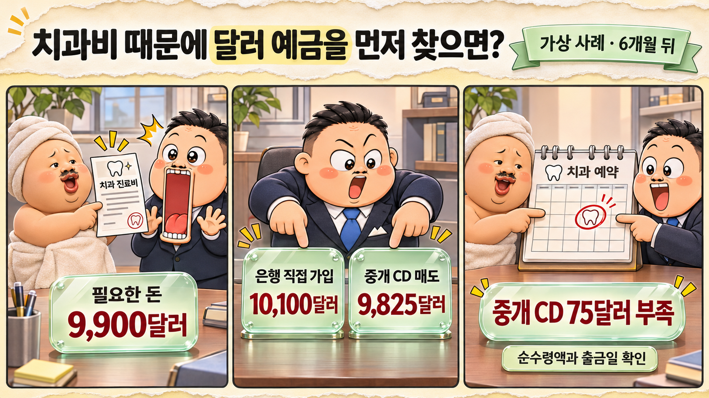

# 치과비 때문에 달러 예금을 먼저 찾았더니, 왜 원금보다 적었을까?

은퇴한 천억이의 동료는 미국에서 지내는 동안 쓸 달러를 1년 만기 예금에 뒀습니다. 석 달 뒤로 생각했던 치과 치료가 앞당겨져, 가입한 지 6개월째에 9,900달러가 필요해졌어요. 천억이는 같은 1만 달러를 넣은 두 가상 장부를 펼쳤습니다. 은행에서 직접 가입한 예금은 그날 10,100달러, 증권사를 통해 산 중개 CD는 9,825달러였습니다. 무엇이 275달러 차이를 만들었을까요?

*달러 1만 달러로 시작해 6개월에 정리한 가상 비교입니다. 예금 상품의 실제 조건과 시장 가격은 다를 수 있습니다.*

**편집부가 만든 질문. 둘 다 미국 은행 예금인데 왜 받을 돈이 달라졌나요?** 이 사례에서 은행 직접 가입 예금은 계약대로 이자 일부를 차감해 해지했습니다. 증권사를 통해 산 중개 CD는 다른 사람에게 시장 가격으로 팔고 매도비를 냈습니다. 먼저 돈을 꺼내는 절차와 가격 기준이 다릅니다.

## 같은 금리, 다른 중도 정리 방식

**가정.** 둘 다 1만 달러를 최초 한 번 넣는 가상의 1년 만기 미국 은행 CD입니다. 연 4% 단리, 중간 납입·분배 없음, 이자 재투자 없음, 개인 세금과 환율 제외입니다. 두 상품 모두 발행은행의 조기상환권이 없다고 둡니다. 6개월 시점에 자금을 정리할 때만 아래 차감 또는 매도비를 적용합니다. 표의 금액은 상품 실측과 금리 전망에 해당하지 않습니다.

| 6개월 시점 | 은행 직접 가입 CD | 중개 CD |
|---|---:|---:|
| 계산의 출발점 | 원금 10,000달러 + 쌓인 이자 200달러 | 경과이자를 포함해 구매자가 지급하는 9,850달러 |
| 차감 | 계약상 조기해지 차감 100달러 | 매도비 25달러 |
| 순수령액 | 10,100달러 | 9,825달러 |
| 치과비 9,900달러 대비 | 200달러 남음 | 75달러 부족 |
| 그대로 1년 만기 보유 시 가상 지급액 | 10,400달러 | 10,400달러 |

중개 거래대금에는 가상의 경과이자가 이미 들어 있습니다. 앞 열의 200달러를 또 더하면 중복 계산입니다. 표는 돈을 받을 수 있는 날까지 같다고 둔 금액 비교입니다. 실제로는 은행 해지 처리시간, 중개 매도 결제일, 출금 가능 시각을 확인합니다.

**조건을 바꾸면.** 중개 CD 총 매도대금이 10,250달러이고 비용이 같은 25달러라면 10,225달러를 받습니다. 이때는 직접 가입 CD보다 125달러 더 받습니다. 금리 변화와 구매자 수요에 따라 매도 가격이 달라질 수 있으며, 원하는 날짜에 거래가 성립하는지도 확인해야 합니다.

## 예금보험과 중도 매도를 따로 봅니다

미국 FDIC 예금보험의 기본 보호 한도는 예금자별, 가입 은행별, 계좌 소유 유형별로 25만 달러입니다. 같은 은행에 있는 같은 소유 유형의 예금은 취급 기관이 달라도 합산될 수 있습니다. 단독 명의로 이미 가입 은행에 24만 달러가 있고 같은 은행의 중개 CD 2만 달러를 같은 소유 유형으로 추가하면 합계는 26만 달러입니다. 추가 이자를 제외한 이 가정에서는 1만 달러가 기본한도를 넘습니다. 중개 CD는 발행은행과 예금보험 적용에 필요한 중개기관 기록도 확인합니다. 이 보호는 가입 은행 파산에 대한 제도이며, 만기 전에 시세로 팔 때의 대금은 시장 거래 조건으로 결정됩니다.

## 돈 쓰는 날짜에 맞춰 확인할 열 가지

1. **가입 국가와 통화**를 봅니다. 이 글은 미국에서 달러로 가입한 경우입니다.
2. **발행은행과 판매 중개기관**을 구별합니다.
3. **예금의 만기일**을 달력에 씁니다.
4. **직접 가입 CD의 조기해지 가능 여부**와 차감 공식을 확인합니다.
5. **중개 CD의 중도 매도 가능 여부**와 매수 호가를 확인합니다.
6. **경과이자가 제시 가격에 포함되는지** 묻습니다.
7. **매도비 등 비용을 뺀 수령액**을 기록합니다.
8. **결제일과 실제 출금 가능일**을 확인합니다.
9. **은행이 먼저 상환할 수 있는 상품인지** 봅니다.
10. **같은 가입 은행과 소유 유형의 다른 예금**을 합해 예금보험 기준을 확인합니다.

동료는 치과비 견적서에 결제 날짜를 다시 적었습니다. **상품 안내에서 만기 전 돈이 필요할 때의 절차를 찾아, 예상 순수령액과 실제 출금일을 한 줄에 적어 보세요.**

## 근거 원문

2026년 11월 27일 확인. 가상 예시 수치는 관측값이나 계약 조건에 해당하지 않습니다.

- [미 SEC 중개 CD 투자자 안내](https://www.investor.gov/introduction-investing/general-resources/news-alerts/alerts-bulletins/investor-bulletins/brokered-cds-investor-bulletin)
- [미 FDIC 예금보험 안내](https://www.fdic.gov/deposit-insurance/deposit-insurance-glance-brochure-english.pdf)
- [미 SEC 발행은행 조기상환 가능 CD 설명](https://www.investor.gov/introduction-investing/investing-basics/glossary/callable-cds)

[연 6% 채권의 조기상환과 생활비](EP158.md) · [만기형 ETF와 실제 지급일](EP156.md)
