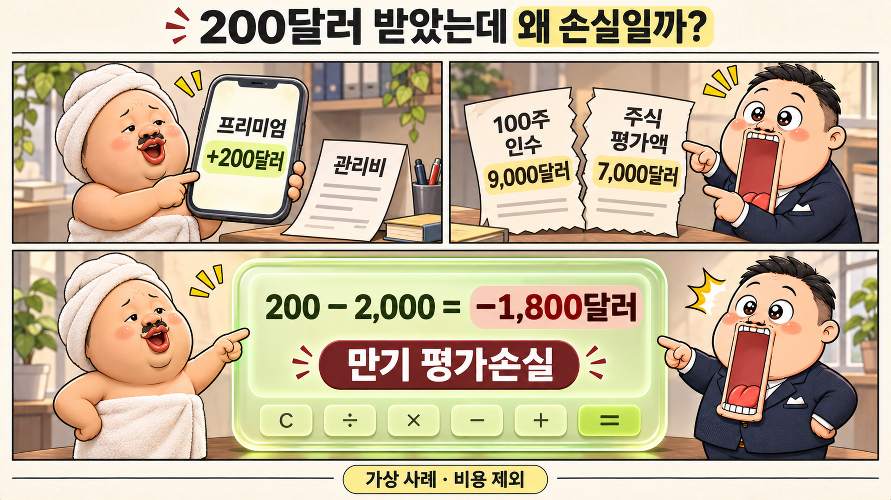

# 관리비 200달러를 벌려다, 왜 1,800달러 평가손실이 났을까?

퇴직한 수건 친구가 관리비 고지서와 옵션 거래 명세를 나란히 놓았습니다. 고지서도 200달러, 거래하자마자 받은 돈도 200달러였어요. 그런데 만기 때 주가가 70달러인 주식을 계약대로 90달러에 100주 인수하자, 받은 돈까지 합쳐도 **1,800달러 평가손실**이 났습니다. 가상 사례입니다. 거래 첫날 들어온 200달러를 한 달 관리비 수입으로 적으려면 어떤 줄을 더 봐야 할까요?

*가상 계약 한 건의 만기 평가손익입니다. 비용·세금·환율은 제외했습니다.*

**편집부가 만든 질문. 만화에서 2,000달러는 어디서 나왔나요?** 주식 인수 대금 9,000달러와 만기 평가액 7,000달러의 차이입니다. 프리미엄 200달러를 합하면 평가손실은 1,800달러입니다.

**편집부가 만든 질문. 현금 담보를 잡으면 주가가 떨어져도 손실이 줄어드나요?** 담보는 옵션 계약에 따라 주식을 사는 데 필요한 돈을 미리 마련하는 것입니다. 담보가 있어도 계약가에 사들인 주식의 시장가치가 떨어질 수 있습니다.

## 200달러를 받은 날, 9,000달러에 살 의무도 생겼습니다

풋옵션의 매수자는 계약이 정한 가격에 기초자산을 팔 권리를 가집니다. 가상 계약은 주식을 직접 인도하는 방식입니다. 매도자인 수건 친구에게 계약 이행이 배정되면, 계약가 90달러에 100주를 인수해야 합니다. 주당 2달러씩 받은 옵션 대가, 즉 프리미엄은 합계 200달러입니다.

**가정.** 미국 달러 10,000달러로 시작합니다. 주가 100달러인 가상 주식의 1개월 풋옵션 1건을 매도하고 현금 9,000달러를 인수 대금으로 따로 둡니다. 행사가 90달러, 계약당 100주, 주당 프리미엄 2달러입니다. 추가 납입, 관리비 인출, 중간 청산과 조기 배정은 없습니다. 비용·세금·환율·현금 이자·배당과 재투자는 모두 제외합니다. 아래는 한 달 만기의 결과이며 연율은 계산하지 않습니다.

만기 주가 70달러에서 계약 이행을 배정받으면 9,000달러를 내고 시장가치 7,000달러인 주식을 받습니다. 따로 남겼던 현금 1,000달러와 받은 프리미엄 200달러를 더한 계좌 평가액은 **8,200달러**입니다. 아직 주식을 팔지 않았으므로 시작금 10,000달러와의 차이 1,800달러는 만기 직후 평가손실입니다.

| 가상 만기 주가 | 가정한 만기 결과 | 프리미엄 포함 평가손익 |
|---|---|---:|
| 110달러 | 행사 없이 만료 | +200달러 |
| 89달러 | 90달러에 100주 인수 | +100달러 |
| 88달러 | 90달러에 100주 인수 | 0달러 |
| 70달러 | 90달러에 100주 인수 | −1,800달러 |
| 0달러 | 90달러에 100주 인수 | −8,800달러 |

**조건을 바꾸면.** 89달러에 끝나 계약이 배정됐어도, 주식의 평가 차손 100달러보다 프리미엄 200달러가 커서 합계는 100달러 이익입니다. 손익분기점은 비용을 제외하면 주당 88달러입니다. 주가가 110달러이고 행사 없이 만료되면 200달러가 남지만 주식 자체의 상승분은 받지 않습니다.

## 관리비 장부 옆에서 확인할 열 가지

1. 받은 현금이 계약 대가인지 확인합니다.
2. 기초자산과 행사가를 확인합니다.
3. 계약의 수량과 승수를 확인합니다.
4. 시장가격과 배정 시 지급할 가격을 구분합니다.
5. 주식 인도형인지 현금 결제형인지 읽습니다.
6. 계약가와 승수로 배정 시 지급할 총액을 계산합니다.
7. 담보를 생활비로 이중 계산하지 않습니다.
8. 계약의 행사 방식과 만기 전 배정 가능 여부를 확인합니다.
9. 만기 평가손익과 주식 매도 후 확정 손익을 구분합니다.
10. 수수료·세금 등이 포함되는 실제 거래라면 손익분기점을 다시 계산합니다.

수건 친구는 고지서 옆의 ‘200달러 수입’ 밑에 ‘9,000달러 매수 의무’를 적었습니다. **가상 계약 한 건을 놓고 배정 때 낼 총액, 최악의 평가손실, 배정 직후 남는 현금을 같은 줄에 적어 보세요.**

## 근거 원문

2026년 11월 27일 확인했습니다. 주식과 옵션 수치는 구조를 설명하기 위한 가정입니다.

- [OIC 현금담보 풋 안내](https://www.optionseducation.org/strategies/all-strategies/cash-secured-put)
- [Cboe 현금담보 풋 매도 설명](https://www.cboe.com/insights/posts/generating-income-and-managing-risk-cash-secured-put-writing-in-a-low-equity-return-environment)

[인터벌 펀드와 납부일](EP184.md) · [은퇴 생활비와 중개 CD](EP186.md)
