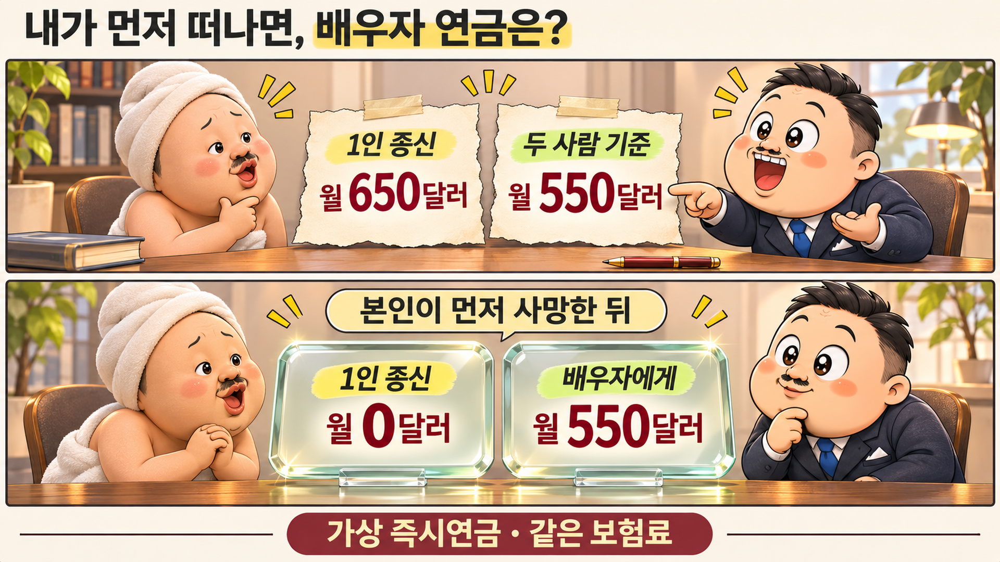

# 월 650달러 연금이 더 커 보였는데, 내가 먼저 떠나면 배우자는 얼마를 받을까?

은퇴한 수건 친구와 배우자는 매달 생활비가 550달러씩 모자란다는 걸 장부에서 확인했습니다. 가상의 미국 즉시연금 견적에서 월 650달러와 월 550달러를 보고 처음에는 650달러에 동그라미를 쳤어요. 천억이는 그 옆에 ‘내가 먼저 사망하면?’이라고 적었습니다. 이 사례에서 월 650달러 계약은 지급이 끝나지만, 월 550달러 계약은 살아 있는 배우자에게 **매달 550달러가 계속 지급**됩니다. 한 달에 얼마를 받는지에 더해, 누구에게 언제까지 지급하는지 봐야 합니다.

*같은 보험료로 가정한 미국 즉시연금 두 계약의 예시입니다.*

**편집부가 만든 질문. 만화에서 본인이 먼저 사망하면 어느 계약의 지급이 이어지나요?** 가상의 두 사람 기준 계약에서, 배우자가 살아 있는 동안 월 550달러가 이어집니다.

**편집부가 만든 질문. 월 550달러라고 적혀 있으면 배우자도 늘 550달러를 받나요?** 아래 가상 계약은 한 사람만 남아도 같은 금액을 지급한다고 정했습니다. 실제 계약은 생존자에게 지급하는 비율과 지급 사유, 제출 절차를 따로 확인해야 합니다.

## 같은 보험료로 두 가지 지급 방식을 비교했습니다

**가정.** 미국 달러 100,000달러를 같은 날 각 계약에 일시 보험료로 납입합니다. 첫 돈은 가입 한 달 후 받고 이후 월말마다 지급합니다. 계약 A는 한 사람의 생존을 기준으로 월 650달러를 지급하고 그 사람이 사망하면 끝납니다. 보증기간, 보험료 잔액 환급 또는 별도 사망급부는 없다고 둡니다. 계약 B는 부부 중 한 사람이라도 살아 있으면 월 550달러를 전액 지급하고, 두 사람이 모두 사망하면 끝납니다. 별도 인출·추가납입·비용·세금·환전·물가조정과 받는 돈의 재투자는 없습니다. 월 지급액은 시장 견적을 관측한 숫자가 아닙니다.

| 처음 120개월의 가상 상황 | A · 1인 종신 | B · 두 사람 중 한 명이 생존하면 전액 지급 |
|---|---:|---:|
| 두 사람이 120회 지급 시점까지 생존 | $650 × 120 = $78,000 | $550 × 120 = $66,000 |
| 본인이 36회 지급 직후 사망, 배우자는 120회까지 생존 | $650 × 36 = $23,400 | $550 × 120 = $66,000 |
| 두 번째 상황에서 37회째 배우자가 받는 월 지급액 | $0 | $550 |

첫 상황에서는 A가 10년 합계에서 12,000달러 앞섭니다. 두 번째 상황에서는 B가 42,600달러 앞섭니다. 어느 쪽이 유리할지 한 줄로 고르기 전에, **어느 사람의 생존이 지급 조건인지**를 읽어야 이유를 설명할 수 있습니다. 배우자가 먼저 사망하고 본인이 계속 생존한다면, 이 두 계약에서는 각각 기존 월 지급이 이어집니다.

120개월 합계는 받은 달러를 그대로 더한 값입니다. 미래 지급의 현재가치, 보험료 잔액, 수익률을 계산한 값이 아닙니다. 월 지급액에는 납입한 보험료를 돌려받는 성격의 현금흐름도 포함될 수 있어, 월 지급액을 보험료로 나눈 값을 이자율처럼 비교하면 안 됩니다. 즉시연금은 지급을 시작한 뒤 납입액 전체를 현금으로 찾기 어려울 수 있으므로 계약을 확인해야 합니다.

## 실제 견적서와 계약에서 확인할 열 가지

1. 보험료, 통화와 납입일을 맞춰 비교합니다.
2. 첫 입금일과 지급 주기를 확인합니다.
3. 지급의 기준이 되는 사람이 누구인지 확인합니다.
4. 본인이 먼저 사망하면 배우자가 얼마를 받는지 확인합니다.
5. 배우자가 먼저 사망하면 기존 월 지급액이 바뀌는지 확인합니다.
6. 두 사람이 모두 사망했을 때 지급이 끝나는지와 사망급부 조건을 읽습니다.
7. 최소 보증기간이나 잔여 보험료 환급이 따로 있는지 확인합니다.
8. 일시금 인출 가능 여부와 비용을 읽습니다.
9. 월 지급이 고정인지, 물가조정 조항이 있는지 확인합니다.
10. 지급 책임을 지는 보험사를 확인하고 세후 실제 생활비 장부를 따로 작성합니다.

미국 보험계약을 설명하는 가상 사례입니다. 실제 이행은 계약과 보험사의 지급 능력에 따릅니다. 한국 보험상품의 계약 조건과 세금은 별도로 확인해야 합니다.

수건 친구는 월 650달러에 친 동그라미 옆에 세 칸을 그었습니다. **실제 견적의 월 지급액 옆에 본인이 먼저 사망한 경우, 배우자가 먼저 사망한 경우, 두 사람 모두 사망한 경우의 지급액과 종료 조건을 각각 적어 보세요.**

## 근거 원문

2026년 11월 27일 원문을 확인했습니다. 월 지급액과 120개월 시나리오는 가상입니다.

- [미국 SEC 연금보험 안내](https://www.investor.gov/introduction-investing/investing-basics/investment-products/annuities)
- [미국 보험감독관협회 연금보험 구매 안내](https://content.naic.org/sites/default/files/call_materials/lvb-formatted-naic-annuity-buyers-guide.pdf)

[은퇴 첫해 인출 뒤 남는 돈](EP192.md) · [은퇴 후 순이자 비교](EP194.md)
