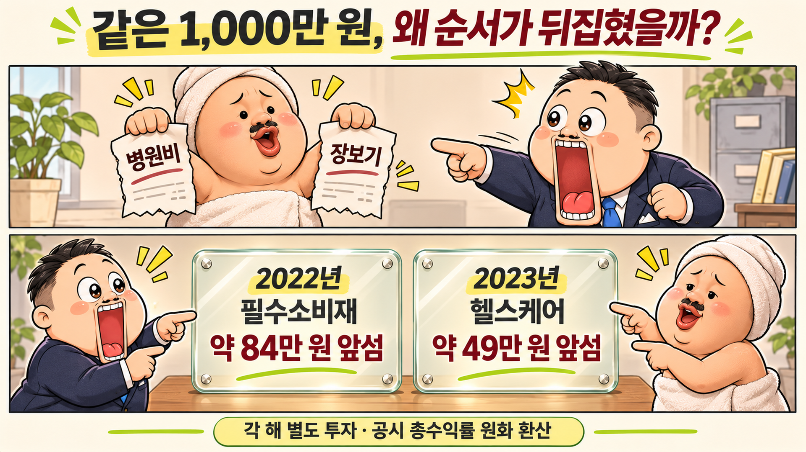

# 헬스케어 vs 필수소비재 ETF, 은퇴자금 1,000만 원의 결과가 왜 뒤집혔을까?

은퇴한 수건 친구는 병원비 영수증과 마트 영수증을 식탁에 나란히 놓았습니다. 병원도 가야 하고 장도 봐야 하니, 둘 중 어느 업종 ETF에 돈을 넣어 두면 더 많이 남았을까요? 천억이는 같은 1,000만 원으로 두 해를 각각 계산했습니다. **2022년은 필수소비재가 약 84만 원, 2023년은 헬스케어가 약 49만 원 앞섰습니다.** 생활에 꼭 필요한 업종이라는 공통점만으로는 두 해의 결과를 설명할 수 없었습니다.

*두 해에 각각 1,000만 원부터 시작한 원화 환산 비교입니다. 개인 세금과 거래·환전비용은 제외했습니다.*

**편집부가 만든 질문. 만화에서 두 해 모두 같은 ETF가 앞섰나요?** 2022년은 필수소비재, 2023년은 헬스케어의 환산 평가액이 더 컸습니다.

**편집부가 만든 질문. 헬스케어 ETF가 오르면 내 병원비도 그만큼 해결되나요?** 펀드 성과는 보유 기업의 주식 성과를 반영합니다. 개인 병원비의 금액과 납부일은 진료비 고지서에서 따로 확인해야 합니다.

## 같은 달력연도에 원화 1,000만 원씩 넣었습니다

미국 헬스케어 ETF IYH와 필수소비재 ETF IYK를 비교했습니다. 의료와 장보기는 은퇴 가계에서 자주 마주하는 지출이지만, 두 ETF는 해당 업종에 속한 기업의 주식을 담습니다. 가계 지출을 그대로 추적하는 상품으로 보지 않습니다. 2022년과 바로 이어진 2023년을 따로 계산해, 한 해 비교를 다음 해에도 적용할 수 있는지 살펴봤습니다.

**가정.** 각 해 초에 각각 원화 1,000만 원을 한 번 투자한 것으로 놓고, 달력연도 말에 평가합니다. 두 해는 서로 독립입니다. 추가 납입이나 인출은 없고 분배는 재투자한 것으로 봅니다. iShares 팩트시트의 달러 기준 연간 NAV 총수익률을 사용했으며 여기에 반영된 펀드 비용을 다시 빼지 않았습니다. 개인 세금·매매 수수료·환전 스프레드는 제외했습니다. 매매 체결가가 아닌 NAV 성과를 사용한 원화 환산값입니다.

| 별도 투자 기간 | IYH 달러 NAV 총수익률 | IYK 달러 NAV 총수익률 | IYH 기말 원화 평가액 | IYK 기말 원화 평가액 |
|---|---:|---:|---:|---:|
| 2022년 | −4.38% | +3.54% | 10,137,929원 | 10,977,632원 |
| 2023년 | +2.05% | −2.77% | 10,454,339원 | 9,960,562원 |

미 연준 H.10의 달러당 원화 환율을 두 펀드에 똑같이 적용했습니다. 2022년 비교는 1,188.59원에서 1,260.18원, 2023년은 1,260.18원에서 1,290.97원입니다. 사용한 관측일은 2021년 12월 30일, 2022년 12월 30일, 2023년 12월 29일입니다. 2021년 12월 31일 FRED 값이 결측이어서 직전 관측치를 썼습니다. 환율은 미국 뉴욕 정오 기준 지표로 증권사의 개인 환전 체결가와 다를 수 있습니다.

## 순위가 뒤집힌 이유를 두 조각으로 나눴습니다

2022년에는 IYH의 달러 기준 수익률이 −4.38%였습니다. 원화 상대 달러 가치가 오른 구간을 적용하니 환산 평가액은 약 1,014만 원으로 바뀌었습니다. IYK도 같은 환율을 적용받으므로, 두 펀드 중 순서를 바꾼 항목은 각 해의 **달러 NAV 총수익률 차이**입니다. 환율은 공통으로 곱해져 두 잔액과 격차 크기를 바꿨습니다.

**조건을 바꾸면.** 2022년에서 2023년으로 비교 기간을 바꾸자 앞서는 ETF가 바뀌었습니다. 같은 2022년에서 환율만 시작값에 고정하면 IYH 956만 2,000원, IYK 1,035만 4,000원입니다. 이 반례에서 순서는 그대로이고 IYH는 원화 기준으로도 원금 아래입니다. 실제로 환전 없이 살 수 있었다는 뜻이 아니라 환율의 효과를 따로 보는 계산입니다.

## 거래 앱과 가계 장부에서 확인할 열 가지

1. 두 ETF의 정식 이름과 기초 업종을 확인합니다.
2. 해당 업종의 투자 비중과 주요 편입 종목을 확인합니다.
3. 두 운용사 표에서 같은 연도와 같은 수익률 행을 읽습니다.
4. NAV 기준과 시장가격 기준을 구분합니다.
5. 총수익률에 포함된 분배 재투자를 다시 더하지 않습니다.
6. 환율 단위가 달러당 원화인지 확인합니다.
7. 연말 환율 결측 시 대용한 관측일을 기록합니다.
8. 세금·거래·환전비용과 공시 수익률에 이미 반영된 비용을 구분합니다.
9. 필요한 인출 시점과 실제 출금 가능 시점을 따로 확인합니다.
10. 연말 잔액만으로 연중 최대 하락이나 미래 성과를 판단하지 않습니다.

천억이는 처음의 영수증 두 장을 다시 펼쳤습니다. **운용사 표에서 같은 기간의 달러 NAV 총수익률 행을 찾아, 실제 지출 예정일과 나란히 놓아 보세요.** 수익률을 비교할 기간과 자금이 필요한 기간을 혼동하면 어느 쪽에 더 남았는지 답이 달라집니다.

## 근거 원문

2026년 11월 27일 확인했습니다. 운용사 자료 기준일은 2025년 9월 30일이며, 사용한 수익률은 2022년·2023년 달력연도 성과입니다.

- [iShares IYH 팩트시트](https://www.ishares.com/us/literature/fact-sheet/iyh-ishares-u-s-healthcare-etf-fund-fact-sheet-en-us.pdf)
- [iShares IYK 팩트시트](https://www.ishares.com/us/literature/fact-sheet/iyk-ishares-u-s-consumer-staples-etf-fund-fact-sheet-en-us.pdf)
- [FRED DEXKOUS 환율 관측표](https://fred.stlouisfed.org/data/DEXKOUS)

[물가와 달러 구매력](EP124.md) · [첫해와 5년 성과 비교](EP120.md)
