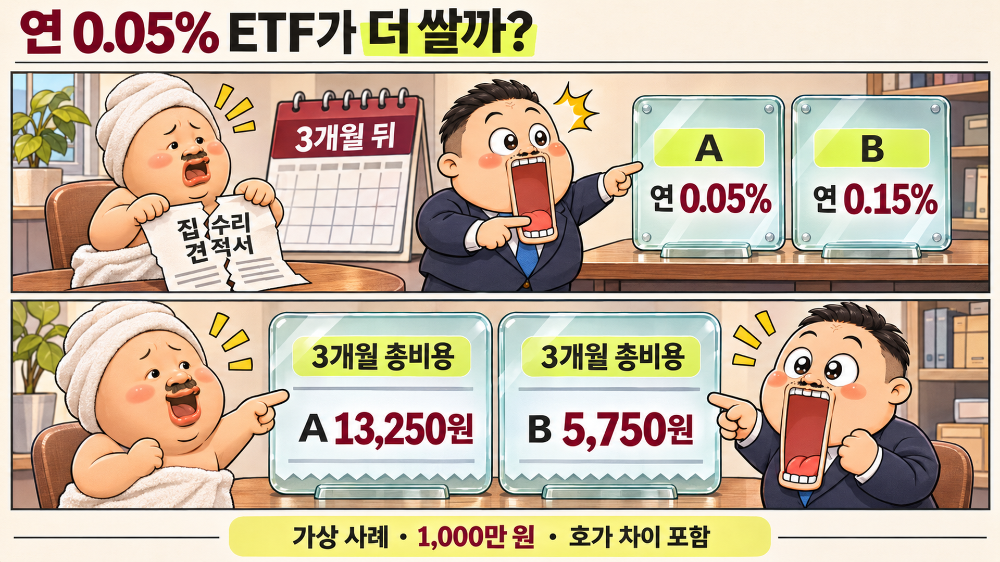

# 연 0.05% ETF가 더 쌀까? 석 달 뒤 쓸 1,000만 원으로 계산해 봤습니다

은퇴한 수건 친구는 석 달 뒤 집수리비로 낼 1,000만 원을 따로 표시했습니다. 두 ETF 가운데 연 운용비가 0.05%인 쪽이 0.15%인 쪽보다 싸다고 생각했어요. 천억이는 가상 주문 화면에서 살 때와 팔 때의 가격 차이까지 더했습니다. **석 달 비용은 연 0.05% 쪽이 13,250원, 연 0.15% 쪽이 5,750원**이었습니다. 낮은 연 운용비를 고른 쪽이 왜 7,500원을 더 냈을까요?

*가상 1,000만 원 기준. 연 운용비를 석 달로 환산하고 왕복 호가 차이를 더했습니다.*

**편집부가 만든 질문. 어떤 쪽의 석 달 비용이 더 적나요?** 가상의 호가 조건에서는 B가 5,750원으로 A보다 7,500원 적습니다.

**편집부가 만든 질문. 운용사가 공개한 30일 호가 차이 중앙값이 제 주문의 비용인가요?** 해당 공개 수치는 관측 기간의 대표값입니다. 실제 주문에서는 당시 호가, 호가별 수량, 거래 규모와 체결가를 확인해야 합니다.

## 한 번 거래하는 비용과 보유하는 동안 붙는 비용

매수자가 제시하는 최고 가격과 매도자가 제시하는 최저 가격 사이의 간격이 호가 차이입니다. 미국 증권거래위원회(SEC)는 이를 ETF 투자자가 부담할 수 있는 비용으로 설명합니다. 매수 시 높은 쪽 가격에 사고 매도 시 낮은 쪽 가격에 판다고 가정하면, 두 시점의 중간값을 기준으로 매수 때 반쪽, 매도 때 반쪽씩 부담하는 모형을 만들 수 있습니다. 실제 두 날짜의 간격이 같을 필요는 없습니다.

**가정.** 원화 명목원금 1,000만 원을 첫날 한 번 배정하고 중간 인출이나 추가 납입 없이 비교 종료일에 전량 매도합니다. 두 ETF의 중간값은 변하지 않고, 분배·재투자·세금·별도 거래수수료·환율 효과는 없습니다. 매수일과 매도일에 같은 호가 차이가 유지된다고 두어 왕복 금액은 명목원금에 전체 호가 차이 비율을 곱합니다. 운용비는 같은 원금에 연 비용률과 보유기간을 곱해 근사합니다. 복리와 실제 운용비 차감 후 잔액은 반영하지 않습니다.

| 가상 보유기간 | A · 연 운용비 0.05%, 호가 차이 0.12% | B · 연 운용비 0.15%, 호가 차이 0.02% |
|---|---:|---:|
| 3개월 | 12,000원 + 1,250원 = **13,250원** | 2,000원 + 3,750원 = **5,750원** |
| 1년 | 12,000원 + 5,000원 = 17,000원 | 2,000원 + 15,000원 = 17,000원 |
| 3년 | 12,000원 + 15,000원 = **27,000원** | 2,000원 + 45,000원 = **47,000원** |

A의 가상 왕복 비용은 B보다 1만 원 높고, 연 운용비 근사값은 해마다 1만 원 낮습니다. 따라서 이 모형에서 1년이면 두 비용이 같아집니다. 3년에는 A의 비용이 2만 원 적습니다. 어느 펀드의 미래 수익이 더 높다는 계산은 아닙니다.

**조건을 바꾸면.** A의 호가 차이가 매수와 매도 시 모두 0.02%이고 나머지 조건이 같다면 3개월 비용은 2,000원＋1,250원인 3,250원입니다. 여기서는 A가 3개월에도 B보다 2,500원 쌉니다. 호가 차이는 고정 계약 조건처럼 읽을 수 없으므로 양쪽의 실제 거래 조건을 확인합니다.

## 주문 화면과 견적서에서 확인할 열 가지

1. 주문 화면에서 매수·매도 호가의 의미를 확인합니다.
2. 양쪽 호가 차이를 돈 단위로 계산합니다.
3. 표시된 호가에 해당하는 수량을 확인합니다.
4. 매수일과 매도일의 비용을 각각 계산합니다.
5. 30일 중앙값과 예상 체결값을 구별합니다.
6. 중간 호가 대비 차이와 NAV 대비 괴리율을 따로 봅니다.
7. 운용비를 비교할 보유기간을 맞춥니다.
8. 거래 수수료와 환전비를 실제 적용 기준에서 확인합니다.
9. 공시 수익률에 이미 들어간 비용을 다시 빼지 않습니다.
10. 수리비 날짜 전에 매도대금을 출금할 수 있는지 확인합니다.

수건 친구는 연 0.05%에 친 동그라미 옆에 ‘석 달’과 집수리 날짜를 적었습니다. **매수 화면의 호가 두 개와 내 주문 수량을 확인하고, 예정 보유기간의 운용비와 예상 왕복 호가 비용을 원 단위로 나란히 써 보세요.** 석 달 뒤 목돈을 써야 한다면 ETF 시장가격 변동과 출금 시점도 비용표와 별도로 확인합니다.

## 근거 원문

2026년 11월 27일 확인했습니다. 원문의 미국 ETF 호가 설명을 적용한 가상 원화 계산이며 실제 ETF 호가나 수익률 관측치가 아닙니다.

- [미국 SEC ETF 투자자 안내](https://www.investor.gov/introduction-investing/general-resources/news-alerts/alerts-bulletins/investor-bulletins-24)
- [미국 SEC 직원 안내의 30일 호가 차이 중앙값 항목](https://www.sec.gov/about/divisions-offices/division-investment-management/accounting-disclosure-information/adi-2025-15-website-posting-requirements)

[수익률 비교 기준](EP011.md) · [국채 만기와 생활비 일정](EP200.md)
