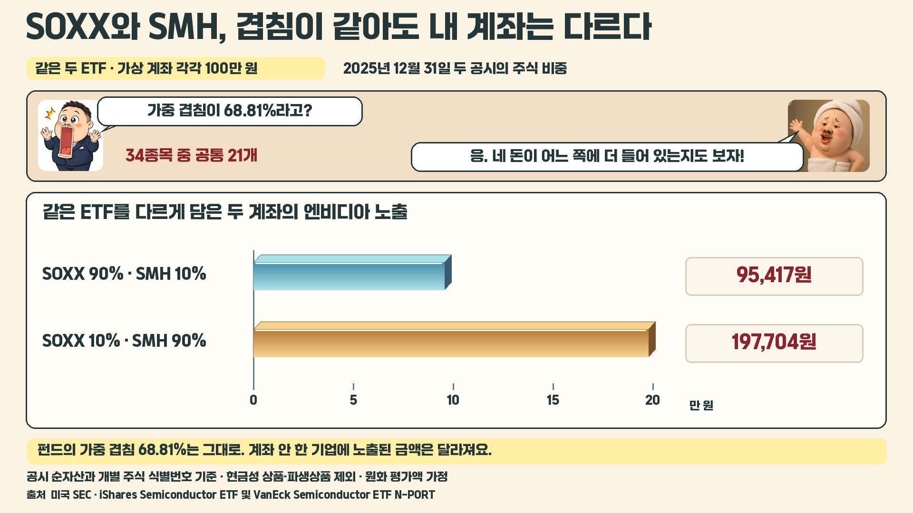
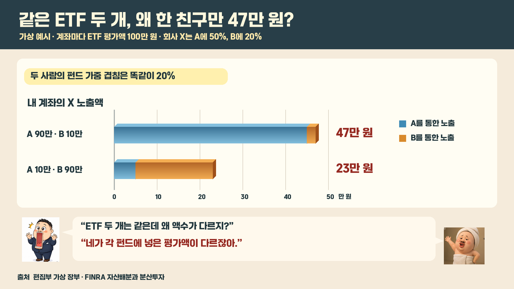
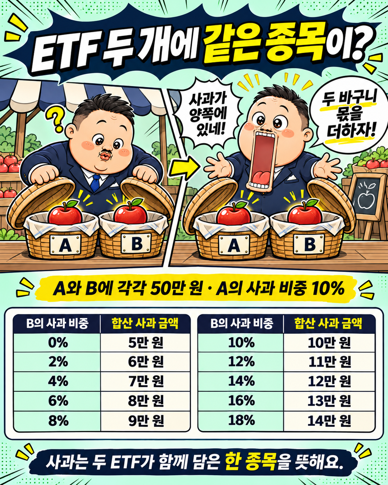

# ETF 중복률 50%가 내 계좌의 한 기업 비중 50%라는 뜻일까?

*편집부가 만든 질문입니다.*

## 분석기의 숫자 하나를 메모했다

가상의 천억이가 두 ETF를 비교하는 화면에서 ‘겹침 50%’를 읽었다. “그럼 내 100만 원 중 50만 원이 같은 기업에 들어가?” 수건 친구가 빈 바구니를 두 개 놓았다. 펀드의 구성은 두 바구니에 붙이고, 천억이의 투자 금액은 별도의 영수증에 적는다. 어느 종이에 있는 50%인지부터 알아야 같은 계산을 할 수 있다.

천억이는 스크린샷에 적힌 숫자를 보고 매수 내역을 열었다. 화면 속 펀드 두 개에 비슷한 업종 이름이 붙어 있었다. 주문을 두 번 나눴으니 업종 안에서도 돈이 넓게 퍼졌을 거라고 생각했다. 수건 친구가 바구니 안을 보기 전에 영수증부터 뒤집었다. 각 펀드 안에서 어느 회사가 몇 퍼센트인지, 그리고 그 펀드에 내가 돈을 얼마나 넣었는지. 이 두 숫자가 나란히 있어야 특정 회사에 걸린 돈을 계산할 수 있다.

## 종목 이름이 겹치는 개수를 센다

가상의 A는 회사 X와 Y를 절반씩, B는 X와 Z를 절반씩 담는다. 같은 관측일이고 현금과 파생 노출이 없는 단순화된 예다. 두 ETF 가운데 한 곳 이상에 담긴 기업은 세 곳이며, 공통 기업은 X 한 곳이다. 합집합 크기를 분모로 하는 종목 수 기준 겹침은 약 33.33%다. 반면 A가 가진 두 이름 중 B에도 있는 이름의 비중을 묻는다면 1÷2인 50%다. 같은 이름을 세더라도 분모를 어디에 뒀는지 확인한다.

여기서 바구니가 갑자기 커져 보이는 경우가 있다. 가령 A와 B에 주식이 각각 열 종목 있고, 겹치는 종목은 한 곳이라고 하자. 그 한 곳이 두 펀드에서 각각 40%이고, 나머지 아홉 종목은 양쪽에서 전부 다르다. 이름을 합치면 열아홉 곳, 공통은 한 곳이라 약 5.26%다. 공통 종목에 걸린 비중은 양쪽에서 각각 40%다. 대조표의 줄 수만 보면 가볍고, 돈을 얹은 자리까지 보면 무겁다.

## 종목별 작은 비중을 더한다

이번에는 공통 회사별로 두 ETF가 공개한 비중 중 작은 값을 더한다. 공통 X의 작은 값은 50%고 다른 공통 회사가 없으니 이 정의의 가중 겹침은 50%다. 한 회사가 양쪽에 있기는 해도 한쪽에 비중이 작다면, 이 지표에는 그 작은 쪽만 들어간다. 예를 들어 A의 X가 50%이고 B가 20%라면 이 기준의 겹침은 20%다. 종목의 등재 여부에는 변화가 없어도 이 수치는 바뀐다.

반대로 같은 이름이 아주 많이 보여도 합계가 작을 수 있다. A와 B의 공통 주식 열 곳이 두 펀드에서 각각 한 곳당 1%이고, 나머지 90%는 펀드별로 서로 다른 주식 한 곳을 담았다고 하자. 공통 이름은 열두 곳 중 열 곳이라 약 83.33%다. 가중 겹침은 1%를 열 번 더한 10%다. 한쪽의 90%짜리 주식이 어떤 회사인지 확인하는 편이 이 바구니의 집중도를 읽는 데 더 직접적이다. 천억이는 형광펜으로 그어 놓은 열 줄 옆에, 표시 하나 없던 가장 큰 숫자를 새로 적는다.

## 내 영수증에서는 금액에 비중을 곱한다

원화 평가액 100만 원 중 A가 90만 원, B가 10만 원이라고 가정한다. 단일 시점의 보유 노출이므로 수익률·분배금·세금·거래비용과 재투자는 계산하지 않는다. X가 두 펀드에서 각 50%라면 A를 통한 X가 45만 원, B를 통한 X가 5만 원이다. 합계 50만 원은 내 계좌의 50%다. 이번엔 두 펀드의 가중 겹침과 숫자가 같지만, 적용한 산식은 바구니 비교가 아니라 내가 넣은 금액에 따른 합계다.

지갑에서 꺼낸 돈의 비율도 시간에 따라 달라진다. 원래 두 펀드에 50만 원씩 넣었는데, 확인일의 원화 평가액은 A 60만 원, B 40만 원이라고 하자. 계산을 분리하려고 두 펀드에서 X의 확인일 비중은 각각 50%와 20%로 가정한다. 입금 당시와 같은 배분이라고 생각하면 X에 35만 원이 걸린 것처럼 보인다. 확인일 평가액을 쓰면 A를 통한 30만 원과 B를 통한 8만 원을 더한 38만 원이다. 이 예에서 평가액 차이는 이미 주어진 조건이며 그 차이가 생긴 기간 수익이나 환율은 추정하지 않는다.

## 같은 두 펀드를 두 친구가 담았는데 답이 달라졌다

B는 X 20%와 Z 80%라고 바꿔보자. A의 구성과 천억이의 평가액은 그대로다. 천억이의 X 노출은 45만 원과 2만 원을 더한 47만 원이다. 가중 겹침은 20%다. 친구가 같은 펀드를 A 10만 원, B 90만 원으로 가졌다면 X 노출은 5만 원과 18만 원을 더한 23만 원이다. 두 사람이 비교하는 펀드의 겹침은 같고 계좌에서 X에 걸린 돈은 24만 원 다르다.

## 분모에 현금과 직접 보유를 넣을 때

천억이의 펀드 평가액 100만 원은 그대로 두고 현금 100만 원을 추가했다고 하자. 기업 X의 펀드 경유 노출은 47만 원으로 같지만, 현금 포함 전체 계좌 200만 원을 분모로 삼으면 X 비중은 23.5%다. 여기에 X를 직접 가진다면 펀드 경유 금액과 직접 보유 평가액을 더해 다시 계산한다. 전체 계좌를 볼지 ETF 묶음만 볼지 먼저 정한다. 외화 평가액이 섞이면 같은 기준 시점의 환율과 통화로 맞춰야 금액을 더할 수 있다.

### 달러와 원화를 같이 들고 있으면

수건 친구가 이번에는 달러 영수증을 꺼낸다. 같은 기업을 담은 미국 ETF의 원화 평가액은 환율에 따라 움직인다. 가상 계좌에 500달러 평가액의 ETF가 있고 회사 X의 비중은 20%다. 원화 현금은 30만 원이다. 처음에는 1달러에 1,400원으로 환산한다. ETF는 70만 원, 전체 계좌는 100만 원, X에 걸린 원화 금액은 14만 원이다. 비중은 14%다.

달러 ETF 가격과 X 비중, 원화 현금은 모두 그대로 두고 환산환율만 달러당 1,200원으로 바꾼다. ETF는 60만 원이고 전체는 90만 원이다. X에 걸린 원화 금액은 12만 원, 전체 원화 계좌에서는 약 13.33%다. 달러로 계산한 ETF 내부의 X 비중은 20%로 같다. 원화 현금이 함께 있기 때문에 환율만 바꿔도 내 전체 계좌에서 X가 차지하는 몫은 달라진다.

천억이는 현금이 없는 가정도 그려 본다. 계좌 전체가 그 달러 ETF 하나라면 원화로 바꾼 ETF 평가액과 X 노출액에 같은 환율을 곱한다. 두 금액은 각각 바뀌지만 원화 기준 노출 비율은 두 경우 모두 20%다. 한 시점씩 비교한 가상 환율이며 세금, 환전·거래비용, 분배금과 재투자는 포함하지 않는다.

### 두 펀드의 업종 비중도 원화로 옮길 수 있을까

같은 업종에 돈이 얼마나 걸렸는지도 계좌 단위로 따로 계산할 수 있다. 가상의 A ETF 평가액이 70만 원, B가 30만 원이고, 두 펀드가 같은 업종 분류를 쓴다고 하자. 그 기준에서 A의 반도체 비중은 40%, B는 60%다. 반도체에 걸린 돈은 A에서 28만 원, B에서 18만 원이므로 합계 46만 원이다. 계좌 전체 100만 원의 46%다. 두 업종 비중을 그냥 평균한 50%와 차이가 난다. 금액을 가중치로 써야 한다.

수건 친구가 아까 계산기의 X 항목을 보며 물었다. “이 회사도 반도체라면 아까 구한 X 비중을 46%에 더해?” 두 펀드의 업종 집계 안에 X가 이미 들어 있다면 다시 더할 때 중복된다. 가령 위 46만 원에 X 12만 원이 포함돼 있다면, 그 업종을 X 12만 원과 다른 반도체 보유액 34만 원으로 나눠 그릴 수 있다. 같은 업종의 회사 X를 별도 주문으로 직접 보유하고 있다는 가정이라면, 그 별도 보유액은 ETF의 46만 원에 들어 있지 않으므로 직접 보유액을 업종 분자에 추가한다. 전체 계좌의 분모가 바뀌었는지도 함께 확인한다.

업종별 비중은 펀드마다 분류 기준과 집계 시점이 다를 수 있다. 두 화면에 업종 이름이 같아도 어떤 회사를 그 안에 넣었는지 확인하고, 분류가 달라 직접 맞출 수 없다면 범위를 밝혀서 비교한다. 이 예는 동일한 업종 분류와 동일한 원화 평가 시점을 가정했다. 성과·세금·비용·분배금과 재투자는 계산하지 않았다.

## 운용사의 파일에서 날짜와 식별자를 살핀다

실제 SOXX와 SMH의 운용사 페이지에서 보유 종목 자료를 확인할 수 있다. 두 상품을 비교할 때는 오늘 열어 본 두 화면의 기준일이 다를 수 있으므로, 같은 날짜의 원문부터 맞춘다. 이를 직접 계산할 때는 같은 날짜의 전체 공개 보유 목록을 쓰고, 표시 상위 종목 목록만 있는지 확인한다. 티커만 비교하면 종류주가 별도 종목으로 나올 수 있고, 기업 단위로 합칠지에 따라 결과가 달라질 수 있다. 현금과 파생상품, 음의 노출이 있는 펀드는 단순 주식 비중의 작은 값만 더하는 방식이 무엇을 놓치는지 기록한다.

### 상위 목록에서 이름이 빠졌을 때

“이 회사가 검색에 없네. 그러면 비중은 0%지?” 천억이가 운용사 화면을 확대한다. 수건 친구는 목록의 제목부터 읽는다. 상위 다섯 종목만 보여 주는 가상의 표라고 하자. 모든 종목을 같은 비중 기준으로 내림차순 정렬했고, 다섯 번째 주식의 비중은 정확히 4%다. 찾는 회사가 목록에 없다면 그 회사의 해당 주식은 아예 없거나, 있어도 4% 이하다. 다섯 줄에 없는 이름을 곧바로 0%로 입력하면 실제 보유가 있어도 합계에서 빠진다.

펀드를 50만 원어치 보유했다면, 이 화면에서 추정할 수 있는 그 증권의 노출액 상한은 2만 원이다. 매핑한 주식 하나만 본 가상 단일 시점 예이며 거래비·세금·분배금은 고려하지 않는다. 다섯 번째 값이 소수점 없이 반올림된 4%라면 정확한 상한 2만 원으로 쓰기 어렵다. 또한 화면이 상위 주식만 표시하면서 나머지 파생 노출을 담지 않는다면, 회사 전체에 대한 노출액의 상한으로도 쓸 수 없다.

친구는 빈칸에 ‘공개 목록에서 미확인’이라고 적는다. 0원을 입력하면 나중에 다른 ETF의 실제 노출액과 합쳐도 계산기에 경고가 뜨지 않는다. 전체 보유 목록을 내려받아 날짜를 확인하고, 정확한 종목코드로 다시 찾는다. 화면에 나타난 범위를 먼저 기록하면 계산이 멈춘 이유를 다음에 다시 확인할 수 있다.

**실측 · 같은 날짜의 SEC 공시로 두 ETF를 대조했다.** SOXX와 SMH의 2025년 12월 31일 자료를 내려받아, 공시상 기업 발행 주식(EC·CORP·Long)만 국제증권식별번호(ISIN)로 맞췄다. 현금성 펀드와 파생상품은 공통 종목 집계에서 뺐다. 주식별 비중의 분모는 각 ETF의 공시 순자산이며, 남은 주식의 비중을 다시 100%로 올리지 않았다. 보고서별 투자 평가액을 순자산으로 나눈 값이 공시의 비중 항목과 일치하는지도 대조했다.

| 같은 자료에 던진 질문 | 이 관측일의 답 |
|---|---:|
| SOXX와 SMH에 각각 몇 종목이 있었나 | 30종목과 25종목 |
| 둘 중 하나 이상에 담긴 종목 가운데 양쪽에 있던 종목은 | 34개 중 21개, 약 61.76% |
| 공통 종목별로 두 펀드의 작은 비중을 골라 모두 더하면 | 약 68.81% |
| 각 펀드에서 엔비디아의 비중은 | SOXX 약 8.26%, SMH 약 21.05% |

스물한 공통 종목의 기여도도 같지 않았다. 두 펀드에서 각 종목의 작은 비중을 골라 큰 순서대로 놓으면 앞 세 종목은 엔비디아, 브로드컴, 마이크론이다. 이 셋의 작은 비중 합계는 약 20.05%포인트로, 가중 겹침 68.81%의 약 29.14%를 설명한다. 엔비디아와 브로드컴은 SOXX 쪽 비중이 더 작았고 마이크론은 SMH 쪽 비중이 더 작았다. 따라서 한 ETF를 통째로 골라 그 보유 비중을 전부 더하면 같은 답을 얻기 어렵다. 작은 쪽은 종목마다 다시 골라야 한다.

**가상 계좌를 따로 계산한다.** 이 관측일의 비중이 적용되는 원화 평가액 100만 원짜리 계좌를 놓는다. 보유 비중만 비교하므로 기간 수익률이나 세금, 분배금과 재투자, 거래비를 계산하지 않는다. SOXX 90만 원과 SMH 10만 원으로 구성하면 두 펀드를 통한 엔비디아 노출의 합은 약 95,417원이다. 평가액을 반대로 두면 약 197,704원이다. 두 계좌의 원금과 펀드 두 개는 같다. 펀드끼리의 가중 겹침 68.81%도 같지만 엔비디아 노출은 약 10만 2,287원 차이가 난다. 마지막에 원화 금액과 퍼센트를 각각 반올림했다.

*같은 날 공시 비중을 두 가상 계좌에 적용했다. 두 펀드의 겹침과 특정 종목에 걸린 계좌 금액은 별도의 계산이다.*

이 계산은 기업 그룹 전체를 합친 값이 아니라 공시의 개별 증권 식별번호에 따른 비교다. 회사 이름이 비슷해도 서로 다른 종류주가 둘 이상의 ISIN을 갖는다면 이 계산에서는 따로 센다. 반도체 회사가 같은 업황에 반응하는 정도, 파생상품을 통한 간접 노출, 다음 달 보유 비중은 별도 질문이다. [미국 SEC · SOXX N-PORT 원문](https://www.sec.gov/Archives/edgar/data/1100663/000207169126004253/primary_doc.xml) · [미국 SEC · SMH N-PORT 원문](https://www.sec.gov/Archives/edgar/data/1137360/000141036826020340/primary_doc.xml)

### 증권은 다르고 회사는 같을 때

원문에서 회사 이름 옆에 적힌 식별번호를 보던 수건 친구가 물었다. “회사 한 곳이 두 종류의 주식을 냈다면, 한 회사로 셀까 두 주식으로 셀까?” 비교하려는 질문에 따라 장부를 두 장 만들 수 있다. 동일한 증권을 두 번 가지고 있는지 확인하는 장부에서는 두 종류의 주식을 따로 둔다. 회사 실적에 노출된 돈을 대략 파악하려는 장부에서는 두 주식이 같은 회사에서 발행됐는지 확인하고 합쳐 본다.

가상의 A ETF는 회사 X의 의결권이 있는 주식을 10% 보유하고 있고, 가상의 B ETF는 같은 회사의 다른 종류주를 6% 들고 있다고 하자. 나머지 구성은 서로 다르고 각자의 식별번호도 다르다. 증권 단위에선 두 펀드의 가중 겹침이 0%다. 같은 발행사 X를 한 줄로 묶어서 보유 비중을 비교하면 공통 회사가 한 곳 생기고, 작은 비중을 적용한 결과는 6%다. 어느 장부도 서로의 계산을 대체할 수 없다.

전체 원화 평가액 100만 원 중 A와 B를 50만 원씩 보유하면 회사 X에 노출된 돈은 A의 5만 원과 B의 3만 원을 합한 8만 원이다. 이 값은 가상 단일 시점에 보유 금액을 합한 사례다. 종류주 두 개는 가격과 거래 조건이 각각 다를 수 있다. 그래서 회사 노출 8만 원을 계산했다고 두 주식이 항상 같이 움직인다고 해석할 수는 없다.

이번에는 A에 담긴 주식만 10% 오르고 B에 담긴 종류주는 5% 내렸다고 해 보자. 다른 보유물과 환율이 고정된 가상 하루에서 X가 만든 계좌 변화는 5천 원 이익과 1,500원 손실을 합한 3,500원 이익이다. 두 종류주가 함께 10% 오른다면 같은 회사 보유액 8만 원에서 8천 원 이익이 생긴다. 시작할 때 회사에 걸린 돈은 두 가정 모두 8만 원인데, 각각의 가격 경로가 다르면 실제 손익도 달라진다. 비용, 세금, 배당과 재투자는 모두 뺐다.

친구는 장부 제목에 ‘식별번호 기준’과 ‘회사 기준’을 따로 적는다. 두 펀드가 동일한 주식을 샀는지 묻는 날에는 첫 장을 연다. 한 회사에 어떤 경로로 돈이 들어갔는지 보는 날에는 두 번째 장을 연다. 앞서 인용한 SEC 파일의 21개 공통 종목은 첫 장에 해당한다. 회사 기준으로 다시 계산한다면 해당 회사의 다른 종류주를 정확히 매핑하고 집계 방법도 함께 밝혀야 한다.

### 같은 공통 종목을 세었는데 왜 70%와 84%가 함께 나오나

천억이가 SOXX 목록부터 펼쳤다. 서른 줄에 형광펜을 대고 SMH에도 있는 줄에 표시를 하니 스물한 줄이다. SOXX 목록을 기준으로는 21 ÷ 30, 곧 70%다. 친구는 SMH 목록부터 펼쳐 똑같은 종목을 찾았다. 표시한 줄은 스물한 개로 같은데 전체가 스물다섯 줄이라 84%다. 두 목록을 합쳐 중복 행을 한 번만 세면 서른네 줄이고, 그중 공통은 약 61.76%다. 지표의 이름을 적을 때 분모까지 함께 쓰면 셋 중 무엇을 보고 있는지 바로 드러난다. 가중 겹침을 구하는 68.81%에는 개수 대신 보유 비중을 쓴다.

### 20만 원이 더 생겼다면 어디에 얹었을까

앞서 두 ETF를 50만 원씩 보유했다고 바꾸자. 같은 공시 비중을 적용한 엔비디아 노출은 약 146,560원이다. 여기에 새로 20만 원을 넣어 전체 평가액을 120만 원으로 만든 두 경우를 비교한다. 한 계좌는 새 돈을 전부 현금으로 두고, 다른 계좌는 전부 엔비디아 주식으로 직접 보유한다. 기존 두 ETF의 평가액과 공시 비중은 고정한다. 동일 시점의 원화 평가액을 쓰는 가상 비교이며 수익률, 세금, 비용, 분배금과 재투자는 계산에서 제외한다.

| 새 돈 20만 원의 위치 | 엔비디아 노출액 | 전체 120만 원 중 비중 |
|---|---:|---:|
| 현금 | 약 146,560원 | 약 12.21% |
| 엔비디아 직접 보유 | 약 346,560원 | 약 28.88% |

친구가 묻는다. “ETF 화면에는 같은 두 줄인데, 내 돈은 이렇게 다르게 움직일 수도 있어?” 엔비디아만 하루에 10% 떨어지고 다른 보유물의 가격과 환율은 고정된다고 가정하면 해당 종목이 만든 평가액 감소는 각각 약 14,656원과 34,656원이다. 둘의 차이는 새 돈 20만 원에 10%를 곱한 2만 원이다. 실제 하루의 두 ETF 수익률을 계산하려면 다른 종목의 등락과 환율 등도 함께 봐야 한다.

### 팔지 않고 새 돈을 넣을 때와 기존 돈을 옮길 때

수건 친구가 두 영수증을 끌어당겼다. “이번에는 돈을 더 넣지 말고, 엔비디아에 걸린 금액만 얼마나 달라지는지 보자.” 출발점은 SOXX와 SMH 각각 50만 원이다. 같은 날 SEC 공시의 비중과 전체 평가액 100만 원을 그대로 둔 가상 비교다. 처음의 엔비디아 노출액은 약 146,560원이다. SMH에 있던 평가액 20만 원을 SOXX로 옮긴다고 가정하면 SOXX가 70만 원, SMH가 30만 원이 된다. 엔비디아 노출은 약 120,989원으로 줄어든다.

이때 SMH의 비중 약 21.05%만큼 엔비디아 노출이 사라지고, 들어간 SOXX에서 약 8.26%만큼 다시 생긴다. 그래서 줄어드는 금액은 옮긴 20만 원에 두 비중의 차이 약 12.79%포인트를 곱한 약 25,572원이다. 이번엔 방향을 바꿔 SOXX에서 SMH로 20만 원을 옮기면 같은 금액만큼 노출이 커지고, 총 노출은 약 172,132원이 된다. 각 계산은 공시 원문 비중을 사용하고 끝에서 반올림했다.

천억이는 아까 계산한 현금 사례를 다시 펼친다. ETF는 건드리지 않고 20만 원을 현금으로 보태면 엔비디아에 걸린 금액은 약 146,560원 그대로인데, 전체 돈이 늘어 그 비율은 약 12.21%로 낮아진다. 펀드끼리 20만 원을 옮긴 사례에서는 약 120,989원, 곧 약 12.10%다. 비율만 적으면 두 선택의 결과가 거의 같아 보인다. 엔비디아 노출액을 함께 쓰면 약 2만 5,572원 차이가 보인다. 두 방식의 원금도 서로 다르므로, 금액과 비율을 같이 써야 내 질문에 답할 수 있다.

이 비교는 한 시점에서 구성만 바꿔 놓은 예다. 가격 흐름·환율·분배금과 재투자·세금·거래비용은 반영하지 않았다. 실제로 기존 ETF를 매도하고 다시 사는 경우에는 매도 체결액과 새 매수 체결액이 같다는 보장이 없다. 내 목표가 원화 노출액을 줄이는 건지, 전체 돈 가운데 한 종목 비중을 낮추는 건지 먼저 적어 보면 어떤 거래 내역을 확인해야 할지도 달라진다.

### 바꾸는 데 든 돈까지 장부에 적으면

친구가 아까 20만 원을 옮기기로 한 영수증에 비용 칸을 그렸다. 이번에는 매도와 매수를 합해 총비용 1,000원이 실제로 지출된다고 가정한다. 비교를 단순하게 하려고 이 비용은 두 ETF의 평가액 밖에 있던 소액 현금에서 따로 떼고, 두 펀드의 교체 금액은 앞과 같이 20만 원으로 둔다. 세금은 이 비교에서 제외한다. 과거에 산 가격, 계좌 유형, 등락률, 분배금과 재투자도 별도로 계산하지 않는다.

앞서 검산했듯 SMH에서 SOXX로 20만 원을 옮기면 엔비디아 노출이 약 25,572원 줄어든다. 만약 다음 날 엔비디아만 2% 떨어지고 다른 종목과 환율은 고정된다면, 두 계좌의 낙폭 차이는 약 511원이다. 이 가정에서 1,000원 비용을 감안하면 옮긴 쪽의 잔액은 그대로 둔 경우보다 약 489원 적다. 엔비디아만 8% 떨어지는 별도 가정에서는 낙폭 차이가 약 2,046원이고, 비용을 감안한 차이는 약 1,046원으로 옮긴 계좌 쪽에 남는다.

“그럼 몇 퍼센트 떨어져야 비용을 메워?” 천억이가 묻는다. 비용을 줄어든 원화 노출액으로 나누면 약 3.91%다. 이번에 고정한 조건만 남겨 놓을 때, 그만큼 하락해야 낙폭 차이와 지출이 서로 상쇄된다. 이 경계로 다음 날 엔비디아가 어디로 움직일지를 맞힐 수는 없다. 다른 종목과 환율도 움직이는 날에는 두 펀드의 수익률 자체가 달라지기 때문이다.

같은 비교를 반대 방향으로 돌려 보면 엔비디아가 2% 오르는 날에는 줄인 만큼 상승 기여도도 약 511원 작다. 여기에 비용 1,000원까지 내면 두 계좌의 차이는 약 1,511원이다. 두 사람은 장부에 따로 표시한다. 노출을 낮추겠다는 판단과 거래비가 얼마 드는지 확인하는 판단을 연결해야, 손실이나 이익을 비교할 때 기준이 바뀌지 않는다.

### 100만 원 중 15만 원을 넘기지 않으려면

천억이가 한 가지 조건을 정한다. “가령 전체 100만 원 중 엔비디아에 걸린 돈을 15만 원 이내로 보고 싶으면 어떻게 역산해?” 편집부가 만든 가상 한도다. 두 ETF만 보유하고 직접 투자나 현금은 없다고 하자. 공시 날짜와 평가 기준은 앞의 SEC 예시와 같다.

전액 SOXX라면 엔비디아에 노출된 돈은 약 82,632원이다. 여기에서 1만 원을 SMH로 옮길 때마다 두 비중의 차이만큼 노출이 약 1,279원씩 늘어난다. 한도 15만 원에서 출발점의 노출액을 빼고, 그 차액을 두 펀드의 비중 차이로 나누면 SMH 평가액의 경계는 약 526,901원이다. 천 원 단위로 확인하면 SMH 52만 6천 원일 때 약 149,885원, 52만 7천 원일 때 약 150,013원이다.

친구가 종이에 새 줄을 긋는다. 총액 100만 원 가운데 이미 엔비디아 주식 10만 원을 직접 보유했다고 바꿔 보자. 남은 90만 원을 전부 이 비교에서 엔비디아 비중이 낮았던 SOXX에 두더라도 노출 합계는 약 174,368원이다. 이 경우 두 ETF의 배분만 바꿔서는 15만 원이라는 가상 한도를 지킬 수 없다. 직접 보유분까지 장부에 써야 어느 조건이 결과를 가르는지 보인다.

이 계산은 해당일의 원화 평가액과 공시 비중을 고정했다. 기간 수익률, 환율 변화, 분배금과 재투자, 세금과 거래비용을 제외했다. 다른 날짜에 같은 계산을 하려면 두 펀드의 비중부터 다시 확인한다.

### 새로 산 종목이 없어도 비중은 움직인다

보유 목록 파일을 저장해 두고 며칠 뒤 ETF 값만 바꿔 넣어도 될까? 가상의 ETF에 X와 Y가 각각 50만 원씩 있다고 하자. X만 20% 오르고 Y와 환율은 그대로라면 X는 60만 원, 펀드는 110만 원이다. 새로 주문한 종목은 없지만 X의 비중은 50%에서 약 54.55%로 바뀐다. 평가액은 오늘 것이고 편입 비중은 지난 공시 것이라면, 결과 옆에 두 기준 시점을 남겨 추정치임을 구분할 수 있다. 이번 SEC 비교는 두 펀드가 같은 날을 보고한 자료를 사용했다.

## 분석기 대신 내 계산기로 X 한 곳을 다시 본다

천억이는 처음 메모에 두 줄을 만든다. 하나는 분석기의 겹침 정의, 다른 하나는 내 계좌에서 X에 노출된 금액이다. **직접 확인하기.** 계좌에서 관심 기업 하나를 골라 보유 ETF 각각의 현재 평가액과 해당 기업 비중을 곱하고, 직접 보유가 있으면 더한다. 마지막에 계좌 전체 또는 ETF 묶음 중 무엇으로 나눴는지 적는다.

*같은 가상 ETF 두 개의 가중 겹침은 20%다. 투자 금액이 달라 X 노출은 47만 원과 23만 원이다.*

*보조 만화는 같은 금액 50만 원씩과 공통 종목 비중 10%·14%를 쓰는 별도 사례다. 합계 노출은 12만 원이다.*

### 계좌가 두 곳일 때는 퍼센트를 어떻게 합칠까

계좌가 두 곳이면 영수증에도 이름을 적는다. 가령 첫 계좌에는 환산 평가액 80만 원짜리 ETF가 있고, 그 안의 X 비중이 12%다. 두 번째 계좌에는 X 주식 평가액 4만 원과 현금 16만 원이 있다. 두 계좌를 합친 총액은 100만 원이다. 같은 시점으로 맞춘 원화 가정이며, 분배금과 재투자, 거래비용과 세금은 제외한다.

첫 계좌 화면만 보면 X에 걸린 금액은 9만 6천 원이다. 두 계좌까지 포함하면 4만 원을 더한 13만 6천 원이 된다. 현금 16만 원은 전체 평가액에 들어간다. 두 계좌를 합친 X 비중은 13.6%다. 화면에 찍힌 첫 계좌의 12%와 두 번째 계좌의 20%를 그냥 평균하면 16%가 되는데, 두 계좌의 규모가 달라 실제 합산 비중과 맞지 않는다.

수건 친구는 장부를 분리해 쓸 때와 합칠 때의 목적을 먼저 적는다. 생활비 계좌까지 전부 계산하라는 뜻일까? 특정 투자계좌를 점검하는 날에는 그 계좌만 쓴다. 여러 증권 계좌에 같은 돈의 목적을 두고 평가하면 그 범위를 묶는다. 귀가한 천억이가 다시 펜을 들고 맨 윗줄에 “오늘 합친 계좌는 두 곳”이라고 적는다. 다음번에도 그 두 곳을 보면 같은 기준으로 변화를 읽을 수 있다.

**편집부 Q&A · 같은 구성의 ETF를 둘로 나누면 기업 비중이 두 배인가요?** 총 평가액을 유지한 채 같은 구성끼리 비중만 나누면 기업 노출 비율은 같다. 새 돈을 더 넣으면 같은 기업에 걸린 금액은 커질 수 있다.

### 이름이 겹치지 않아도 함께 빠질 수 있다

천억이가 아예 겹치지 않는 ETF 두 개를 찾았다고 한다. 수건 친구는 가상의 하루를 장부에 그려 본다. A는 설비를 납품하는 회사들, B는 그 설비를 사는 제조사들을 담는다. 양쪽 주식 목록에는 같은 회사가 없다. 투자자는 원화 환산 평가액 50만 원씩, 합계 100만 원을 들고 있다. 환율은 고정하고 분배금·세금·비용·재투자는 계산에서 뺀다.

같은 날 설비 투자가 미뤄진다는 가상의 소식에 A가 8%, B가 6% 하락한다고 두자. A에서 4만 원, B에서 3만 원이 줄고 두 ETF를 합친 잔액은 93만 원이다. 서로 다른 회사에 투자했어도 이 시나리오에서는 같은 업황에 반응했다. 반대로 A가 8% 하락하고 B가 6% 상승했다면, 똑같이 겹침 0%인 두 바구니의 잔액은 99만 원이다. 두 가정의 결과를 가른 건 종목 목록의 공통 개수가 아니라 그날 각 바구니가 어떤 방향으로 움직였는지다. 이 숫자는 실제 업종 수익률이 아니다.

“그럼 겹침 도구를 닫아?” 천억이가 노트북을 반쯤 접는다. 수건 친구는 계산기를 옆에 놓는다. 보유 목록은 한 기업에 몇 번 돈이 걸려 있는지 바로 찾는 데 쓴다. 업종과 같은 위험에 얼마나 함께 반응했는지를 보려면 따로 같은 기간·통화의 성과를 비교한다. 기간을 정하지 않은 채 오늘의 공통 종목 개수를 과거 수익의 이유로 돌리면, 그동안 중간에 어떤 종목과 비중이 있었는지 알 수 없다. [FINRA 자산배분과 분산투자](https://www.finra.org/investors/investing/investing-basics/asset-allocation-diversification)

**편집부 Q&A · 겹침이 낮으면 위험도 자동으로 낮나요?** 여러 기업이 같은 산업이나 위험에 노출될 수 있다. 기업 중복, 산업 집중, 자산 배분은 각각 확인한다.

### 노출을 줄이면 다음 날 잔액은 얼마나 다를까

두 사람이 앞서 검산한 실제 공시 비중을 다시 꺼냈다. 두 계좌의 가상 원금은 각각 100만 원이고, 첫 계좌는 SOXX 90만 원과 SMH 10만 원, 두 번째는 그 반대다. 다음 거래일에 엔비디아만 20% 떨어지고 두 ETF의 다른 보유물과 환율은 변하지 않는다고 가정한다. 엔비디아의 하락이 계산대로 펀드 평가액에 반영되고, 펀드 내 재조정, 분배금과 재투자, 세금, 거래비용도 없다고 둔다.

첫 계좌에서는 노출 약 95,417원에 하락률을 적용한 손실 약 19,083원이 발생해 약 980,917원이 남는다. 두 번째에서는 노출 약 197,704원에 같은 하락률을 적용해 약 39,541원이 줄고 약 960,459원이 남는다. 결과가 약 20,457원 차이 난다. 시작하는 돈도 두 바구니의 목록도 같은데 두 사람이 넣은 비율이 달랐기 때문이다. 실제 하루 수익률을 재현한 사례는 아니며, 해당 회사에 걸린 돈 하나가 평가액에 미치는 민감도를 보는 계산이다.

수건 친구가 화살표를 위로 돌린다. 같은 회사가 20% 상승하고 나머지 조건은 같으면 노출이 큰 계좌의 이익이 약 20,457원 더 크다. 노출액은 그 회사가 오를 가능성이나 내려갈 가능성을 말해 주지 않는다. 특정 가격 변화가 일어났다고 가정할 때 원화 계좌에 얼마나 크게 반영되는지 계산하게 해 준다.

수건 친구가 마지막으로 잔돈 봉투를 장부 옆에 놓는다. 두 펀드에 든 금액은 그대로인데 같은 계좌에 현금이 들어오면 어떻게 될까?

가상의 계좌에 현금을 이십오만 원 더 넣되 주식은 사지 않았다고 하자. 처음 평가액 백만 원은 백이십오만 원이 된다. 그 기업에 걸린 돈이 십만 원이었다면 그 돈은 그대로다.

그 기업의 계좌 비중은 십 퍼센트에서 팔 퍼센트로 내려간다. 같은 하루에 그 기업만 이십 퍼센트 떨어지는 가정이라면, 계좌에서 줄어드는 원화 금액은 여전히 이만 원이다.

투자 자산을 그대로 둔 채 현금을 넣었다면 비중의 분모가 바뀐 것이다. 지난달보다 비중이 낮아졌다는 점을 확인했으면, 그 다음은 실제로 걸린 원화 금액이 줄었는지 살펴보자.

천억이는 처음의 쪽지를 다시 가져왔다. ‘겹침 50%’ 아래에 ‘내 계좌에서 이 기업에 걸린 금액’이라고 한 줄을 새로 쓴다. 그 아래에는 ETF 두 종목의 평가액을 적고, 직접 보유가 있는 계좌는 영수증을 따로 붙인다. 다음 달에는 같은 방식으로 합계를 다시 낼 수 있다. 지금 장부에서 옮겨 적을 첫 숫자는 자신이 확인하고 싶은 기업의 보유 비중이다.

**원문**　[FINRA 자산배분과 분산투자](https://www.finra.org/investors/investing/investing-basics/asset-allocation-diversification) · [iShares SOXX 상품 및 보유 정보](https://www.ishares.com/us/products/239705/ishares-phlx-semiconductor-etf) · [VanEck SMH 상품 및 보유 정보](https://www.vaneck.com/us/en/investments/semiconductor-etf-smh/)

**이어 읽기**　[ETF에 넣은 돈 중 한 회사에 걸린 금액](EP001.md) · [ETF 다섯 개 속 공통 기업](EP006.md) · [전자책 목차](목차.md)
