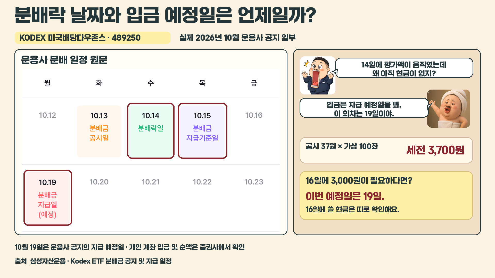
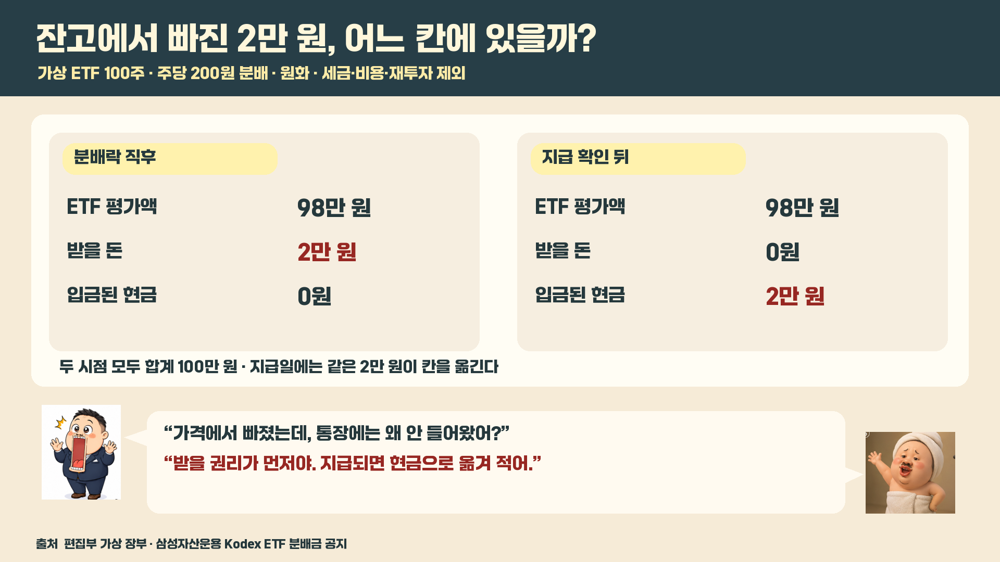
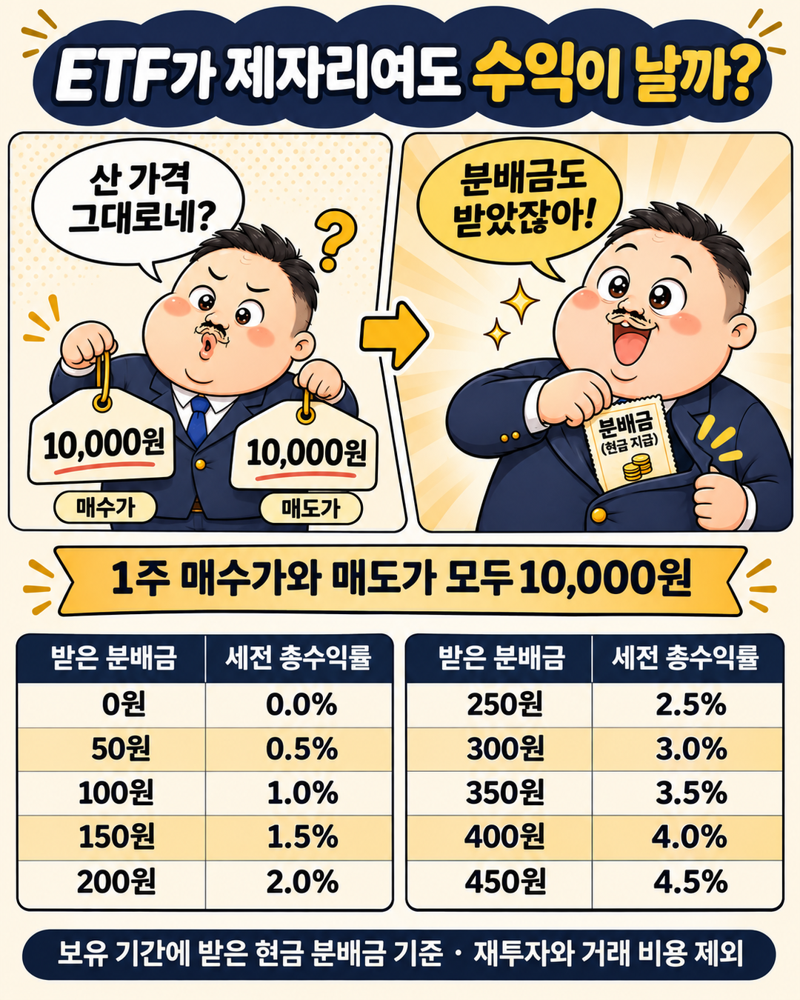

# ETF 분배락에 2만 원 줄었는데 입금은 없었다. 내 돈은 어디에 있을까?

*편집부가 만든 질문입니다.*

## 아침 잔고와 통장이 서로 다른 말을 한다

가상의 천억이는 월요일 아침 ETF 잔고에서 2만 원이 줄어든 것을 보고 은행 앱을 열었다. 입금은 없었다. 수건 친구는 앱을 닫기 전에 장부를 세 칸으로 나눴다. 지금 주식 가치, 받기로 한 돈, 지금 쓸 수 있는 돈이다. 세 칸에 같은 금액을 적는 날은 언제일까?

## 분배 직전의 가상 장부를 맞춘다

권리 취득 조건을 충족한 ETF 100주를 주당 10,000원에 가지고 있다. 원화 투자원금은 100만 원이다. 주당 200원 현금 분배가 확정됐다고 가정한다. 다른 시장 변동, 세금·비용은 없고 재투자하지 않는다. 실제 상품에서 같은 가격 변화가 반복된다는 뜻은 아니다. 분배 기준일과 분배락일, 지급일은 상품의 실제 공지로 각각 확인한다.

## 주가가 떨어진 날에는 ‘받을 돈’도 적는다

분배락 뒤 가격이 9,800원이라면 ETF 평가액은 98만 원이다. 권리가 생긴 사람의 받을 돈은 200원 곱하기 100주로 2만 원이다. 두 칸을 합치면 여전히 100만 원이다. 이 사례에서 평가액 감소는 보유분에 붙어 있던 분배 권리가 떨어져 나가며 생겼다. 그 돈을 출금할 수 있는지와 받을 권리가 생겼는지는 다른 상태다.

## 같은 가격 변화에서 받는 사람을 바꿔 본다

분배락일에 처음 매수한 사람이라면 그 회차에 이미 떨어져 나간 권리를 함께 사지 않는다. 같은 100주를 9,800원에 샀다는 가정에서 그 사람의 투입 원금은 98만 원이고, 이전 회차 미수액은 0원이다. 반대로 기존 보유자가 해당 권리를 이미 얻었다면 이후 매도가 있었더라도 지급 대상이 될 수 있다. 거래의 결제와 권리 판단은 해당 상품과 시장의 실제 일정에 맞춰 확인한다.

### 가격이 같아도 분배 직전에 산 사람과 뒤에 산 사람의 현금은 다르다

수건 친구가 ‘처음부터 가진 100만 원’을 두 통에 나눠 똑같이 적었다. 각각 100만 원을 가진 두 사람의 비교다. 첫 사람은 분배 전 1만 원에 100좌를 사고 공지에 따라 그 회차 분배 권리를 갖는다. 두 번째 사람은 분배락 뒤 9,800원에 100좌를 사서 2만 원을 현금으로 남긴다. 좌당 200원 분배, 원화, 동일한 수량, 다른 시장 변동 없음, 수수료와 세금 없음, 재투자 없음이라는 가정이다.

분배락 뒤 공통 평가 가격을 9,800원으로 놓으면 두 사람 모두 ETF 평가액이 98만 원이다. 첫 사람에게 나머지 2만 원은 아직 받을 돈이고, 두 번째 사람에게는 주문 뒤 남은 현금이다. 같은 시점에 두 사람의 자산 장부 합계는 100만 원이다. 그런데 그날 안에 15,000원을 결제해야 한다면 두 번째 사람은 현금으로 결제할 수 있고, 첫 사람은 아직 입금되지 않은 분배금으로 그 지출을 처리할 수 없다. 같은 평가액이 같은 지급 능력을 뜻하는 건 아니다.

가상의 장부를 다시 돌려 첫 사람이 분배 권리를 취득한 뒤 100좌를 9,800원에 매도했다고 하자. 세전 분배 권리 2만 원과 매도대금 98만 원을 합해 총금액을 계산할 수 있다. 하지만 매도 체결 직후에는 매도대금의 실제 출금 가능 시점도 별도로 확인한다. 분배금과 매도대금은 다른 경로로 현금이 된다. 어느 돈을 카드값에 쓸지 결정하려면 거래일 한 칸만 보지 않고 증권사의 출금 가능 금액과 지급 공지를 따로 읽는다.

반대로 두 번째 사람도 100좌 주문에 남겨 둔 2만 원으로 즉시 다른 자산을 사 버리면 그 현금으로 결제할 수 없다. 여기서 현금 차이를 만든 조건은 분배락 이후 매수 자체와 남은 돈을 현금으로 보유한 상태다. 계좌 잔액의 합계만 보면 이 두 조건을 확인할 수 없다.

## 9,700원에 거래됐다면 한 줄 더 적는다

다른 가정으로 분배락 뒤 시장 가격이 9,700원이라고 하자. ETF 평가액 97만 원에 분배 권리 2만 원을 더하면 99만 원이다. 가상 장부에서 분배를 포함한 기간 손실은 1만 원, 최초 100만 원 대비 −1%다. 연율이 아니다. 분배락의 이론상 조정만으로 실제 가격 변동 전체를 설명하기 어렵고, 시세와 기준가를 뒤섞어 차액을 계산하지 않는다.

### 기준가도 내렸고 시장 가격도 내렸는데 숫자가 다를 때

천억이는 증권 앱의 체결 가격을 보다가 운용사 화면으로 옮겼다. 가상 ETF의 분배 전 한 좌당 기준가가 1만 원, 같은 시점의 시장 가격은 10,050원이다. 상품의 시장 가격은 기준가보다 50원 높다. 기준가 대비 차이는 0.50%다. 가상 분배액은 좌당 200원이다. 분배락 뒤 다른 기초 자산 가격은 고정됐다고 두면 단순 계산의 기준가는 9,800원이다. 그런데 누군가 실제로 사고판 시장 가격은 9,750원이라고 하자. 이번에는 시장 가격이 기준가보다 50원 낮고, 그 차이를 9,800원으로 나누면 약 −0.51%다.

수건 친구는 두 화면에서 따로 빼 보라고 한다. 기준가는 200원 낮아졌다. 시장 가격은 10,050원에서 9,750원으로 300원 낮아졌다. 가상 예에서 시장 가격은 분배 전 기준가보다 50원 위에 있다가 뒤에는 50원 아래로 움직였다. 그 100원 변화를 포함하면 시장 가격의 300원 차이를 설명할 수 있다. 실제 ETF라면 기초 자산과 환율도 움직일 수 있고 두 가격의 관측 시점도 맞춰야 한다. 이 계산은 그런 변화가 없다는 가정으로 차이의 원리만 보여 준다.

그 날짜를 앞두고 시장에서 100좌를 산 사람은 1,005,000원을 냈다. 분배 권리를 갖고 다음 시점에 같은 수량을 보유 중이라면 거래 가격으로 평가한 975,000원과 세전 분배금 권리 20,000원을 합해 995,000원이다. 시작 금액과 비교하면 10,000원 감소, 가상 기간 수익률은 약 −1.00%다. 거래비·세금·재투자는 제외했다. 처음부터 기준가 장부로 평가하면 100만 원과 뒤의 98만 원에 받을 돈 2만 원을 더한 값이 같다. 두 장부가 다른 결과를 내는 까닭은 실제 매수 가격과 실제 시장 평가 가격이 각각 기준가와 달랐기 때문이다.

친구가 투자 내역의 ‘체결’에 밑줄을 긋는다. 내 거래 손익은 내가 얼마에 샀고 지금 시장에서 얼마에 평가되는지부터 확인한다. 분배락 조정이 얼마였는지 추적할 때는 같은 기준가끼리 뺀다. 서로 다른 종류의 가격을 섞으면 기준가 조정과 실제 잔액 변화를 한 숫자로 오해하기 쉽다.

### 분배금을 포함한 수익률에서 현금을 또 더하면

천억이가 두 개의 성과 화면을 캡처했다. 가상 예에서 분배 전 시장 가격은 10,000원, 분배 뒤에는 9,800원이고 그 사이에 좌당 200원의 분배 권리를 얻었다. 원화로 100좌를 샀고 시작 원금은 100만 원이다. 평가일까지는 분배금을 재투자하지 않고 세금과 비용도 제외한다. 첫 화면은 가격 변동만 보여 준다. 10,000원에서 9,800원이 됐으니 −2%다. 두 번째 화면은 이 기간의 분배금까지 포함한 보유 수익률을 보여 준다고 가정한다. 가격이 200원 내렸지만 좌당 200원을 합산하므로 0%다.

분배를 이미 포함한 두 번째 화면의 0%를 계좌에 적용한 뒤 2만 원을 한 번 더 얹으면 장부가 102만 원이 된다. 실제 이 예에서 같은 시점의 합계는 100만 원이다. 첫 화면의 −2%로 계산할 때는 분배금을 넣어야 100만 원이 되고, 두 번째처럼 이미 넣은 계산을 쓰면 다시 더할 항목이 없다. 화면마다 이름은 다를 수 있으므로 가격 변동만인지, 분배금을 포함하는지, 포함한다면 어느 시점 재투자를 가정했는지 확인한다.

반대로 천억이가 분배락일에 처음 산 사람이라면 그 이전에 붙었던 200원은 자기 성과에서 제외된다. 이 사람의 원금은 100좌에 98만 원이다. 매수 직후 시장 가격을 평가하면 98만 원 그대로다. 해당 기간을 분배 전날로 돌려 놓고 나온 화면의 변동률을 그대로 적용하면 자기 매수 전의 가격과 권리가 섞인다. 기간 수익을 비교할 때 분배 처리와 시작 시점은 함께 확인한다.

## 운용사 공지에서는 ‘좌당’과 평가 기준을 같이 읽는다

삼성자산운용의 2026년 10월 13일 공지에서 KODEX 미국배당다우존스 ETF의 해당 회차 분배금은 좌당 37원으로 표기됐다. 공지의 분배율 열은 10월 12일 종가를 기준으로 계산했다. 이 공시의 지급 요건을 충족한 100좌를 가정하면 총액은 세전 3,700원이다. 앞의 가상 200원과는 다른 회차 숫자다. 공지에서 세전 좌당 금액을 읽은 뒤 개인 계좌에서 실제 받은 순액을 따로 대조한다. 이 회차 지급률을 연간 수익률로 옮겨 쓰지 않는다.

**실제 공지의 날짜를 한 줄씩 읽어 보기.** 같은 운용사의 일정 안내 그림에서 2026년 10월 13일은 분배락 전일이자 공시일, 10월 14일은 분배락일, 10월 15일은 지급기준일로 나뉜다. 10월 19일은 현금 분배금의 **지급 예정일**이었다. 이 회차 공지에서는 13일까지 매수해야 현금 분배를 받을 수 있다고 설명했다. 날짜가 모두 같은 의미는 아니다. 14일 장 시작 전의 기준가 조정 내용은 실제 개인 계좌에 입금됐다는 기록과 구분한다. 장중 체결 가격은 다른 시장 요인에도 움직일 수 있다. [삼성자산운용 · Kodex ETF 분배금 지급 일정](https://www.samsungfund.com/upload/kodex/20261012//97735a3e-4b37-42a3-90be-668b579e3c92.png)

*공식 지급 일정 그림 일부. 좌당 분배금 37원에 가상 100좌를 적용하면 세전 3,700원이다.*

예를 들어 16일에 3,000원을 꼭 써야 하는 사람이 해당 회차 권리를 가진 100좌에 대해 세전 3,700원을 기대한다고 하자. 이 사례의 예정일은 19일이라 16일 지출 장부에는 해당 분배금을 입금된 현금으로 넣을 수 없다. 받을 금액이 지출보다 700원 크다는 계산은 예정일이 앞서야 바로 쓸 수 있다. 이는 실제 개인의 입금 확인이 아닌 공식 일정에 근거한 원화 가상 지출 장부다. 거래비, 세금, 재투자 및 기간 수익률은 계산에서 뺐다.

같은 ETF의 11월 11일 공지에는 좌당 27원이 표시됐다. 그 회차도 권리를 갖춘 100좌라면 총액은 세전 2,700원으로, 10월 사례보다 1,000원 적다. 10월 금액을 보고 다음 달에도 3,700원이 나온다고 적어 두면, 입금일을 맞췄더라도 필요한 3,000원에 300원이 모자랄 수 있다. 일정이 맞는지와 금액이 맞는지는 각각 확인한다. [삼성자산운용 · Kodex ETF 다음 회차 분배금 공지](https://m.samsungfund.com/etf/lounge/notice-view.do?no=80913)

### 두 달 치 분배금을 더할 때 오늘 보유 수량을 써도 될까

천억이는 이번에는 두 달 동안 받은 분배금 합계를 보고 싶어 했다. 증권 앱의 오늘 보유량에 두 회차의 좌당 분배금을 더해 곱하면 될까? 방금 확인한 운용사 공지의 10월 37원과 11월 27원을 그대로 쓰되, 투자자의 보유 수량은 가상으로 둔다. 첫 회차에는 100좌, 둘째 회차에는 130좌에 대해 각각 권리를 얻었다고 가정한다. 분배금은 원화 세전으로 계산하고, 비용과 이후 재투자 효과는 제외한다.

10월 권리분은 37원 곱하기 100좌인 3,700원이다. 11월 권리분은 27원 곱하기 130좌인 3,510원이다. 둘을 더하면 7,210원이다. 지금의 보유량 130좌를 두 회차에 모두 적용하면 8,320원이 된다. 10월 지급대상 수량을 30좌 크게 썼으니 장부가 1,110원 부풀었다. 10월과 11월에 모두 100좌라고 쓰면 6,400원이다. 그 경우 11월 지급대상 수량을 30좌 적게 써 합계가 810원 줄어든다.

친구가 두 행에 서로 다른 색으로 표시한다. 어느 회차에 지금의 잔고를 갖고 있었는지가 계산을 바꾼다. 11월에 늘어난 30좌를 10월 분배금으로 샀다고 볼 근거도 없다. 정기적립, 별도 입금, 매매 등 수량이 바뀐 이유는 거래 내역에서 확인할 수 있다. 이 계산의 7,210원은 두 회차의 세전 분배액 합계다. 원금과 평가금액의 변동을 합치지 않았으므로 두 달 투자 수익률이나 연 환산 수익률로 읽을 수 없다.

예정액 장부를 실제 입금 장부와 맞출 때는 10월과 11월을 먼저 나눠 보고, 각각의 지급 대상 수량과 계좌의 수령 내역을 확인한다. 이때 11월 수령 내역이 아직 없다면 3,510원을 입금으로 표시하지 않는다. 공시의 좌당 금액, 지급 대상 수량, 실제 순액을 같은 회차의 한 줄에 적으면 어느 항목에서 차이가 생겼는지 확인할 수 있다.

### 분배율이 높아진 달에도 좌당 입금액은 줄 수 있다

천억이는 두 달의 분배율 옆에 화살표를 그리다가 멈췄다. ‘비율이 올라가면 내가 받는 돈도 늘었나?’ 이번 계산은 운용사의 실제 수치와 분리한 가상의 원화 ETF다. 첫 달 좌당 분배금은 100원이고 각 분배율을 계산할 때 쓴 기준 가격은 10,000원이다. 다음 달은 분배금이 90원, 기준 가격은 8,000원이다. 각 회차의 권리를 모두 갖춘 100좌를 가정한다. 세전이며 기타 비용과 재투자는 제외한다.

첫 달의 지급액은 10,000원이고 해당 회차 분배율은 1.00%다. 둘째 달의 지급액은 9,000원이고 해당 회차 분배율은 1.125%다. 두 번째에 돈을 1,000원 적게 받았는데 비율은 높다. 좌당 분배액보다 기준 가격이 더 큰 비율로 낮아졌기 때문이다. 이 기준 가격은 비율을 계산하기 위한 가정이며, 투자자의 매수가나 순자산 가치가 같다는 조건은 없다.

분배금을 고정해도 같은 일이 생긴다. 좌당 100원을 두 회차에 똑같이 받지만 기준 가격이 10,000원에서 8,000원으로 떨어졌다면, 100좌 보유자의 현금은 회차마다 10,000원으로 같다. 게시된 회차 분배율만 1.00%에서 1.25%로 바뀐다. 분모가 작아졌을 때 생기는 변화다. 수건 친구는 지급 계획을 적는 칸에는 비율보다 좌당 금액과 이번 지급 대상 수량을 먼저 쓴다.

마지막으로 천억이는 1.125%에 12를 곱해 13.5%라고 써 본다. 모든 달에 같은 분배금과 같은 기준 가격을 반복한다고 가정한 단순 환산은 할 수 있다. 이 가정은 아직 관측되지 않은 열한 번의 지급을 설명하지 못한다. 실제 상품의 최근 여러 회차를 비교하려면 기간 내 지급액을 모아 같은 기준을 사용한다. 자기 계좌 수익을 비교하려면 매수 가격과 평가액, 입금 내역을 함께 본다. 지금 계산한 1.00%와 1.125%는 각 회차의 가격 대비 세전 분배액이다.

## 입금일에 옮겨 적고 재투자일에 다시 기록한다

세금과 비용이 없는 가상 첫 장부에서는 지급일에 미수 2만 원이 없어지고 입금된 현금이 2만 원 늘어난다. 평가액이 같다면 그날 합계는 여전히 100만 원이다. 두 칸에 2만 원을 남기면 잔액이 그만큼 부풀어 보인다. 실제로 세금 등이 반영된 순액을 받으면 차이는 별도 비용 또는 세금 기록으로 설명한다. 받은 돈으로 주식을 산다면 입금일과 실제 주문일이 다를 수 있다. 공시 총수익의 분배금 재투자 가정과 내 계좌의 실제 체결을 구분한다.

### 공지의 세전 금액과 증권 계좌 입금액을 맞춰 본다

천억이는 장부의 미수 2만 원 옆에 입금 내역을 붙였다. 이번에도 실제 상품 세율과 분리한 가상 기록이다. 장부의 세전 권리액은 2만 원이고, 증권사 내역에 공제액 3,000원과 순입금 17,000원이 찍혔다고 하자. 섣불리 순입금이 덜 왔다고 메모하기 전에 세 금액을 같은 회차로 나란히 확인한다. 이 장부에서 차이를 낳은 건 가정으로 준 공제액이다. 3,000원을 다른 상품이나 다른 계좌의 세금으로 적용하지 않는다.

입금일 직전까지 ETF 평가액 98만 원과 세전 미수 2만 원을 함께 기록했다면 세전 장부 잔액은 100만 원이다. 평가액이 그대로인 지급일에 미수금을 지우고 현금 순입금 17,000원만 더하면 새 잔액은 997,000원이다. 공제액을 이미 반영한 순입금에 다시 3,000원을 빼면 994,000원이 돼 같은 공제액을 두 번 적용하게 된다. 투자원금 100만 원 대비 실제 순입금을 적용한 이 가상 기간 변동은 −0.30%다. 연율로 보지 않고 기타 비용과 재투자도 제외한다.

지출 장부도 함께 보자. 18,000원의 납부가 입금일 뒤로 잡혀 있는 경우, 예정된 세전 2만 원만 보면 2,000원이 남을 것 같다. 그러나 실제 이 가정의 순입금으로는 1,000원이 모자란다. 반대로 지출이 16,000원이라면 1,000원이 남는다. 지급일이 납부일보다 늦다면 순입금 총액이 충분해도 해당 날의 자금으로 쓸 수 없다. 일정과 순액이 모두 맞아야 한다.

친구는 이 장부가 정산 항목을 확인하는 예라고 다시 짚는다. 실제로는 상품과 계좌의 세금 처리를 해당 증권사 거래내역과 공식 설명으로 확인한다. 입금이 여러 건이면 동일한 회차인지, 지급 대상 수량이 맞았는지 먼저 비교하고, 세율을 거꾸로 추정하기 전에 상세내역의 항목명을 확인한다.

### 달러로 지급되면 언제 원화 생활비가 될까

수건 친구는 다른 달력에 해외 ETF라고 적었다. 가상 계좌의 시작 원금은 1,000달러다. 100좌가 전부 분배 권리를 취득했고 세후 순입금이 총 20달러라고 가정한다. 납부할 금액은 원화 27,000원이다. 미국 ETF의 실제 지급 일정이나 원천징수율은 이 예에 적용하지 않는다. 해외 증권계좌에 달러로 입금된 뒤 그 돈만 환전하고, 투자금은 팔지 않으며 재투자도 하지 않는다.

입금일에 1달러당 1,400원으로 평가하면 20달러는 28,000원이다. 증권 앱의 원화 환산 숫자만 보고 이미 원화 통장에 들어왔다고 생각할 수 있지만, 아직 달러 잔고로 있다면 그 숫자는 환산액이다. 즉시 환전이 되고 실제 적용 환율도 1,400원이며 별도 비용이 없다고 가정하면 28,000원이 된다. 납부액보다 1,000원 많다.

반대로 환전 가능한 시점이 하루 늦고 그날의 실제 적용 환율이 1,330원이라고 하자. 달러 입금 자체는 그대로 20달러지만, 바꾼 원화는 26,600원으로 400원 모자란다. 수건 친구는 두 줄의 차이를 각각 적는다. 첫 번째는 외화가 증권 계좌에 들어온 시점이고, 두 번째는 원화로 바꿔 출금할 수 있게 된 시점이다. 가상 환율 차이에 따른 1,400원의 환전 결과 차이는 해당 ETF가 지급한 달러 분배금의 차이와 별개다.

달러 결제액 20달러를 마련하는 경우라면 두 가상 환율 중 무엇을 보더라도 이미 입금된 달러 자체는 같다. 이때는 해당 달러를 실제로 이체하거나 결제에 쓸 수 있는지가 새 조건이다. 잔고의 금액과 청구서의 통화가 같은지 확인하면, 분배금을 받았다는 말이 어떤 지출까지 커버하는지 판단할 수 있다. 이 비교는 투자원금을 제외한 분배금 환전액만 비교하므로 기간 수익이나 연율은 제시하지 않는다.

### 같은 2만 원을 입금일에 살 때와 일주일 뒤에 살 때

천억이는 분배금이 들어오면 그날마다 같은 ETF를 다시 산다고 생각해 왔다. 수건 친구가 두 장의 가상 주문서를 내민다. 분배락 전 100만 원으로 100좌를 들고 있었고, 분배금은 좌당 200원, 합계 2만 원이다. 입금일까지 기존 100좌를 보유했다. 입금일 가격은 9,800원, 일주일 뒤 가격은 10,200원으로 가정한다. 세금과 비용은 없고, 1좌 단위로만 주문한다. 남은 현금은 그대로 두고 추가 입출금도 없다. 비교 통화는 원화다.

입금일에 9,800원으로 2좌를 사면 19,600원을 쓰고 400원이 남는다. 일주일 뒤 공통 가격 10,200원으로 평가하면 기존 100좌와 새 2좌, 잔여 현금의 합계는 1,040,800원이다. 일주일 뒤까지 기다렸다가 10,200원에 사면 1좌만 사고 현금 9,800원이 남는다. 같은 시점에 평가한 합계는 1,040,000원이다. 이 예에서 일찍 주문한 쪽의 평가액이 800원 크다. 최초 100만 원 대비 전체 기간 가상 수익률은 각각 4.08%와 4.00%다.

“그러면 입금 당일에만 사면 이기는 거네?” 천억이가 말하자 친구가 두 번째 시나리오를 펼친다. 일주일 뒤 가격이 9,400원으로 내려간다고 바꾼다. 입금일에 산 사람은 102좌와 400원으로 평가액이 959,200원이다. 뒤에 산 사람은 2좌를 사고 1,200원을 남겨 960,000원이다. 이번에는 현금을 일주일 보유한 쪽이 같은 평가 시점에 800원 높다. 1좌 단위 조건 때문에 남은 현금도 함께 평가해야 한다. 두 시나리오의 차이는 입금된 현금의 금액이 아니라, 언제 어떤 가격에 다시 투자했는지에서 생겼다.

공시 성과를 내 계좌에서 재현하려는 사람이라면 재투자 가정, 실제 거래일과 체결가, 정수 단위 주문 여부를 맞춰 봐야 한다. 현금이 들어왔다는 기록과 새 매수가 체결됐다는 기록을 따로 두면, 이번 달 잔액이 공시의 가정과 왜 다른지 확인할 수 있다. 위 수익률은 각 가정의 시작부터 공통 평가일까지이며 연율로 환산하지 않았다.

### 한 좌 살 돈이 모자라면 분배금은 어디에 남을까

천억이는 실제 주문할 때 잔돈이 남는 이유를 묻는다. 첫 회차와 둘째 회차에 각각 6,000원의 순분배금을 받은 가상의 원화 계좌를 보자. 분배를 받은 원래 ETF의 수량과 가치는 양쪽에서 같다고 두고, 받는 돈으로 사려는 별도 ETF만 비교한다. 이 별도 ETF의 가상 가격은 두 입금일 모두 11,900원이다. 해당 주문에 건당 200원 비용이 든다고 가정한다. 실제 증권사의 요율이 아니며, 다른 세금과 비용은 없다.

첫 6,000원으로는 한 좌를 살 수 없다. 둘째 6,000원까지 현금으로 모으면 12,000원이다. 화면 가격만 보면 한 좌를 살 수 있을 것 같다. 하지만 가상의 주문 비용까지 더하면 12,100원이 필요하다. 거래가 체결되지 않았다면 분배금 12,000원은 현금으로 남아 있다. 첫 입금이 다음 입금 증액으로 곧바로 이어졌다고 적을 수도 없다. 아직 어떤 좌수도 늘지 않았다.

다음 장면에서 별도 ETF의 주문 가격이 11,700원으로 낮아졌다고 바꿔 보자. 거래 비용을 합하면 11,900원이라 1좌를 살 수 있고 현금 100원이 남는다. 주문 전에 12,000원이 있었고, 사자마자 새 좌수를 같은 시세로 평가하면 11,700원이다. 잔여 현금 100원을 더한 장부는 11,800원이다. 즉시 줄어든 200원은 가정한 거래 비용이다. 이 시점부터 새 ETF의 가격이 움직이면 양쪽의 최종 자산도 달라진다. 이 비교는 두 회차 현금의 재투자 여부를 따지는 것이므로 원래 ETF의 기간 수익률을 계산하지 않는다.

친구는 증권 앱에서 ‘주문 가능’과 ‘체결’을 다른 줄에 적는다. 현금 합계가 주문 금액과 비용을 넘는지 확인하고, 체결 이후 실제 수량과 남은 돈을 적는다. 이제 두 사람은 분배금 입금일과 다시 투자한 날을 달력의 다른 날에 넣을 수 있다.

### 다시 산 좌수가 다음 분배에 들어가려면

앞의 가상 입금 2만 원으로 9,800원에 2좌를 다시 산 사람은 새 주문 영수증에 2좌를 적었다. 새로 산 좌수에 대해서도 다음 회차 지급 권리가 생겼을까? 가상의 다음 회차 공지에는 좌당 120원이 적혀 있다고 하자. 기존 100좌는 다음 권리 조건을 충족한다. 다시 산 2좌도 조건을 충족하면 다음 회차 분배 권리는 102좌 곱하기 120원으로 12,240원이다. 두 좌를 아직 사지 않았거나 지급 대상 조건을 충족하기에 늦게 샀다면 기존 100좌에 대해서만 12,000원이다.

첫 회차의 현금 2만 원에서 19,600원을 써서 두 좌를 취득했고 400원은 남겼다. 다음 회차의 240원 차이는 그 두 좌가 지급 대상이 됐을 때만 생긴다. 처음 입금된 2만 원이 다음 분배에도 그대로 붙어 들어오는 모습과 다르다. 수건 친구는 2좌가 다음 권리에 ‘포함’인지 먼저 표시한 뒤, 오른쪽에 두 좌의 분배액 240원을 따로 쓴다.

반대로 입금일부터 다음 지급 요건 마감까지 너무 짧아 새 주문이 조건을 못 맞춘다고 가정하면, 앱에 보유량 102좌가 보이더라도 그 회차 예정액을 12,240원으로 잡을 수 없다. 실제 공지의 매수 마감 조건과 내 주문의 체결 여부를 함께 확인해야 한다. 이 예는 세전 원화 가상 계산이며, 재투자는 첫 회차에만 하고 다음 회차까지의 주가 수익, 세금과 수수료는 제외했다. 어느 경우가 총자산 평가액에서 더 유리한지는 다음 평가일 가격과 남겨 둔 현금을 같이 봐야 한다.

### 월중에 두 번 들어오면 월 합계로 납부일을 맞출 수 있을까

천억이 책상에 납부할 청구서 두 장이 올라왔다. 같은 달 10일에 1만 8천 원, 24일에 1만 2천 원이다. 이번에는 ETF가 두 개이고, 둘의 가상 분배금 순입금 합계는 3만 원이다. 첫 ETF가 8일에 1만 원을, 둘째 ETF가 22일에 2만 원을 지급하며, 시작할 때 이 비용에 따로 배정해 둔 현금은 없다. 공지된 날짜대로 현금이 실제로 들어온다고 가정한다. 분배금을 소비할지에 관한 원화 장부이므로 투자원금과 기간 수익률을 계산하지 않으며 추가 비용과 재투자는 제외한다.

월 전체로 보면 들어오는 돈과 내는 돈이 각 3만 원이다. 하지만 10일에는 1만 원만 들어왔으므로 8천 원을 마련해야 한다. 22일에 둘째 분배금이 들어와도 10일에 현금이 부족했다는 사실은 바뀌지 않는다. 가상 날짜를 그대로 둔 경우, 8천 원을 처음부터 현금으로 별도 보관하면 두 청구서를 모두 낼 수 있고 마지막에 현금 8천 원이 다시 남는다.

친구가 금액은 그대로 두고 둘째 ETF의 입금만 9일로 앞당긴 가상 달력을 그린다. 시작 현금이 없어도 10일 전에 먼저 3만 원이 들어와 첫 청구서를 내고 1만 2천 원이 남는다. 24일에 두 번째 청구서를 낼 수 있다. 두 달력의 월 합계는 같다. 두 날짜의 간격 때문에 필요한 출발 현금이 다르다.

천억이는 달력이 바뀌는 날마다 월말 잔액만 보던 습관을 바꾼다. 입금과 출금을 날짜순으로 적고, 어느 날 처음 잔액이 부족해지는지 확인한다. 예정일인 동안에는 해당 행에 ‘예정’을 남긴다. 실제 지급이 늦거나 순입금이 예상과 달라지면 그 행부터 고칠 수 있다.

## 앱을 열기 전에 세 날짜를 메모한다

천억이는 아침에 줄어든 잔고를 다시 본다. 이번에는 받을 권리, 입금 예정과 지급 확인, 실제 재투자 날짜를 같은 줄에 섞지 않는다. **직접 확인하기.** 최근 한 차례 지급의 운용사 공지에서 권리를 가르는 날짜를 찾고, 증권사 내역에서 실제 입금일과 순액을 확인한다.

*가격을 주당 9,800원으로 고정한 가상 장부. 받을 2만 원은 입금이 확인되면 현금 칸으로 이동한다.*

*보조 만화는 매수·매도가 모두 1만 원이라는 별도 조건을 쓴다. 본문과 가격 경로가 다르다.*

**편집부 Q&A · 오늘 분배락이면 현금도 오늘 바로 들어오나요?** 상품 공지의 지급일을 확인한다. 분배 권리를 취득하는 조건과 계좌에서 돈이 입금되는 시점은 별개다.

**편집부 Q&A · 분배금이 들어온 날 손익이 2만 원 늘어난 건가요?** 미수로 이미 기록했다면 기존 권리가 현금으로 바뀐 것이다. 평가 변화와 세후 차이는 별도로 계산한다.

### 입금 내역이 두 줄이라면 먼저 수량을 맞춘다

천억이는 같은 상품이 증권계좌 두 곳에 있다고 가정한다. 가상 지급액은 좌당 200원이고, 첫 계좌에서 60좌, 두 번째 계좌에서 40좌가 해당 회차 지급 요건을 충족했다. 두 계좌의 원화 세전 장부에서 예정 금액은 각각 12,000원과 8,000원이다. 실제 내역에 첫 계좌는 공제 1,800원과 순입금 10,200원이, 두 번째 계좌는 공제 1,200원과 순입금 6,800원이 표시됐다고 가정한다. 미리 정해 둔 가상 공제액이며 실제 세율은 적용하지 않는다.

첫 계좌만 확인한 날에는 자기 분배금이 10,200원으로 보인다. 두 번째 계좌 내역의 날짜와 상품, 지급 회차까지 맞추면 순입금 합계는 17,000원이다. 세전 20,000원과 합계가 다른 이유도 공제 합계 3,000원으로 확인할 수 있다. 반대로 두 번째 계좌에서 이번 회차 대상 수량이 0좌였다면, 다른 회차의 입금 6,800원이 우연히 같은 날에 표시돼도 합산 대상에 넣지 않는다. 판단을 바꾸는 건 같은 날짜라는 표시보다 어느 회차의 권리에서 입금이 나왔는지다.

친구가 영수증 뒷면에 ‘지급 회차, 지급 대상 수량, 공제 전 금액, 실제 입금’을 적는다. 계산 결과가 공식 공지와 다를 때 처음 비교할 칸을 정한 것이다. 공지의 금액을 바꾸거나 두 계좌에 같은 공제율을 가정할 필요도 없다. 거래비와 재투자는 제외했다. 이 예에서는 배정된 지급액만 확인하므로 전체 투자원금이나 기간 수익률을 판단하지 않는다.

### 장부의 세 칸을 한 번에 맞춰 본다

수건 친구는 아무 자료도 보지 않고 첫 장부를 복원해 보자고 한다. 가상의 투자자가 100좌를 1만 원씩 매수해 원금은 100만 원이다. 권리가 생긴 회차의 좌당 분배금은 200원이다. 분배락 뒤 시장 가격은 9,800원이다. 이 시점의 세전 장부에 ETF 평가액 98만 원, 받을 돈 2만 원, 입금액 0원을 적는다. 세전 합계는 100만 원이다. 장중에 주문을 추가하지 않았고, 환율을 쓸 필요 없는 원화 자산이라고 가정한다.

지급일까지 가격이 9,900원으로 올랐다고 두자. 입금은 같은 회차의 가상 공제액 3,000원을 제외한 17,000원이다. ETF 평가액은 99만 원, 받을 돈 칸은 0원, 입금된 현금은 17,000원이다. 합계는 1,007,000원이다. 첫 장부의 100만 원과 비교하면 주가 변화로 1만 원이 늘고 공제로 3,000원이 줄었다. 두 효과를 합친 최종 증가액은 7,000원이다. 원금 기준 그 기간의 수익률은 0.70%다. 보유 기간을 1년으로 가정하지 않았다.

천억이가 받은 17,000원으로 그날 9,900원짜리 1좌를 다시 샀다면, 수량은 101좌이고 남은 현금은 7,100원이다. 체결 직후 같은 가격으로 계산하고 재투자 주문비용은 없다고 두면, ETF 평가액 999,900원과 현금 7,100원의 합이 여전히 1,007,000원이다. 재투자 자체가 입금일의 합계를 다시 늘리지는 않는다. 한 좌를 사는 데 사용한 돈이 현금 칸에서 ETF 칸으로 옮겨졌기 때문이다.

다음 거래일 가격을 10,000원으로 두면 바로 다시 산 사람의 총액은 1,017,100원, 순입금 17,000원을 모두 현금으로 둔 사람의 총액은 1,017,000원이다. 바꿔서 다음 날 가격이 9,800원이라면 바로 다시 산 쪽 총액은 996,900원, 현금으로 둔 쪽은 997,000원이다. 이후 손익 차이 100원은 새로 보유한 1좌의 가격 변화에서 나온다. 같은 돈이 받은 권리에서 입금된 현금으로, 다시 투자 자산으로 움직일 때 각 단계의 잔액과 날짜를 붙여 두면 시작할 때의 질문에 답할 수 있다.

**원문**　[삼성자산운용 Kodex ETF 분배금 공지](https://www.samsungfund.com/etf/lounge/notice-view.do?no=80195) · [미 SEC Investor.gov 펀드 분배 안내](https://www.investor.gov/introduction-investing/general-resources/news-alerts/alerts-bulletins/investor-bulletins/fund-distributions-investor-bulletin)

**이어 읽기**　[배당과 ETF 일부 매도](EP035.md) · [월분배 총수익](EP041.md) · [전자책 목차](목차.md)
