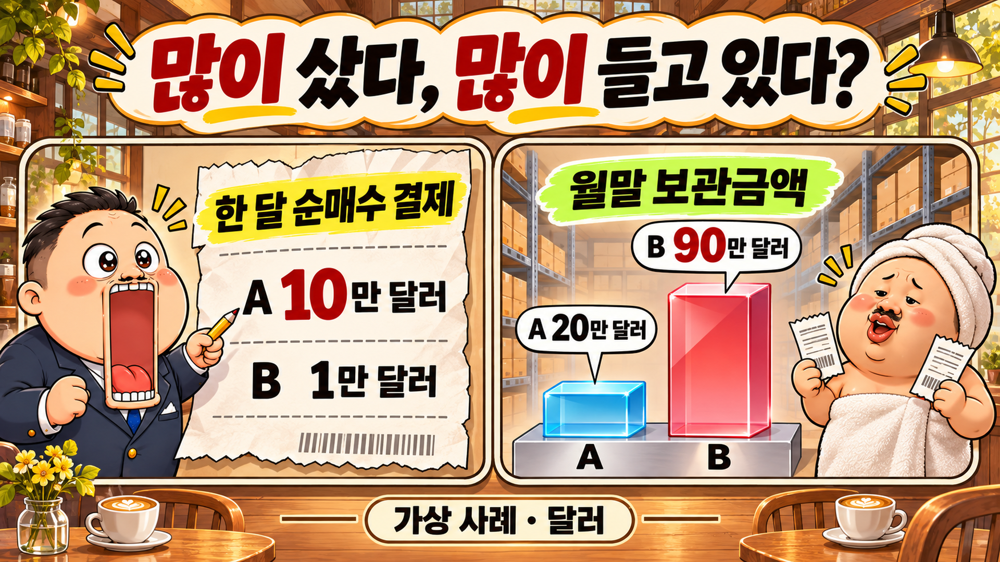

# 많이 샀다, 많이 들고 있다?

**편집부가 만든 질문.** 민서가 아버지에게 해외 주식 순매수 기사 한 장을 보냈습니다. 한 달 순매수 1위가 월말에 가장 많이 들고 있던 종목일까요?

**답.** 두 순위는 달라질 수 있습니다. 순매수 결제는 기간 중 매수 결제에서 매도 결제를 뺀 금액입니다. 보관금액은 기준일에 남아 있는 증권의 평가금액입니다. 천억이는 한 달치 영수증과 월말에 찍은 창고 사진을 꺼냅니다.

*가상 한 달, 미국 달러 기준. 유리 막대는 순서만 보여 주는 연출입니다. 금액은 숫자 라벨을 읽으세요.*

**편집부가 만든 질문.** 한 달 순매수가 큰 종목과 월말 보관금액이 큰 종목은 각각 무엇인가요?  
**답.** 결제 영수증을 보면 **A**, 월말 창고를 보면 **B**입니다.

## 한 달치 영수증과 월말 사진

**가상 조건.** 같은 달에 결제된 미국 달러 금액과 그달 마지막 날 보관금액을 비교합니다. 비용과 세금, 환전, 분배금·재투자, 증권 이전을 제외합니다. 개인의 투자 성과 계산이 아니므로 납입·인출, 초기 원금과 수익률을 가정하지 않습니다.

| 항목 | A | B |
|---|---:|---:|
| 한 달 매수 결제 | 12만 달러 | 7만 달러 |
| 한 달 매도 결제 | 2만 달러 | 6만 달러 |
| 한 달 순매수 결제 | 10만 달러 | 1만 달러 |
| 한 달 매수와 매도 결제 합계 | 14만 달러 | 13만 달러 |
| 월말 보관금액 | 20만 달러 | 90만 달러 |

**반례.** 월초 100주를 주당 100달러로 평가해 1만 달러가 있었습니다. 월중 같은 가격에 10주를 사고 월말 가격이 80달러로 떨어졌다고 가정합니다. 순매수 결제는 1,000달러지만 보관금액은 110주에 80달러를 곱한 8,800달러입니다. 기존 주식의 월말 가치가 2,000달러 줄었고, 새 10주의 월말 가치가 800달러 더해졌습니다. 반대로 거래 없이 주당 가격이 120달러로 오르면 100주의 보관금액은 1만 2,000달러입니다.

## 기사에서 확인할 열 가지

1. **순액과 총액.** 매수와 매도 결제를 빼면 순액, 더하면 양방향 결제 규모입니다.
2. **거래일과 결제일.** 미국 SEC는 2024년 5월 28일부터 대부분의 해당 증권 거래에 다음 영업일 결제를 적용한다고 안내합니다. [SEC T+1 안내](https://www.sec.gov/exams/educationhelpguidesfaqs/t1-faq)
3. **기간.** 주간 수치가 순매수여도 그 주 후반만 보면 순매도일 수 있습니다.
4. **기준일.** 분기 보관금액이 어느 날의 값인지 보고 보도자료 게시일은 따로 적습니다.
5. **가격.** 매도하지 않아도 가격이 하락하면 보관금액은 줄 수 있습니다.
6. **수량.** 주식 분할로 수량이 두 배, 이론상 주당 가격이 절반이면 그 자체로 평가액은 변하지 않습니다.
7. **통화.** 보관금액이 그대로 1만 달러여도 달러당 1,000원에서 1,100원으로 바뀌면 원화 표시액은 1,000만 원에서 1,100만 원으로 바뀝니다.
8. **집계 범위.** 자료가 다루는 보관기관, 주식·채권 범주, 상장 시장과 종목 식별자를 확인합니다.
9. **참여 규모.** 한 계좌가 10만 달러를 사는 경우와 100계좌가 각각 1,000달러를 사는 경우는 다른 거래가 없다면 순액이 같습니다.
10. **수익률.** 같은 돈으로 두 종목을 보유했을 때의 수익을 비교하려면 같은 기간의 가격과 분배금을 보고 환율, 비용, 세금을 맞춥니다.

**공개 집계 사례.** 한국금융연구원이 게시한 한국예탁결제원 보도자료 요약은 2025년 9월 말 외화증권 보관금액을 2,202.6억 달러, 같은 해 7~9월 결제금액을 2,007.6억 달러로 제시합니다. 게시일은 2025년 10월 27일이며 자료 확인일은 2026년 11월 27일입니다. 이 결제금액에서 별도의 종목별 순매수 순위를 읽을 수 없습니다. [한국예탁결제원 보도자료 요약](https://www.kif.re.kr/KIF/Publication/OthersDetail.aspx?ControlNo=354789&NodeID=402)

**오늘 해볼 일.** 관심 종목 기사 한 장에 두 줄을 만드세요. 첫 줄에는 결제 조회 기간과 순매수 금액을, 둘째 줄에는 보관 기준일과 통화·금액을 적습니다. 빠진 줄은 자료 없음으로 남깁니다.

관련 장 [지난 ETF 비교를 다시 계산하려면](EP070.md) · [ETF 괴리율, 날짜부터 맞춰요](EP092.md)
